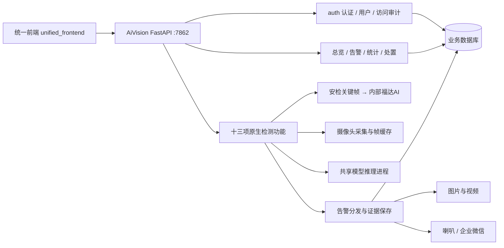
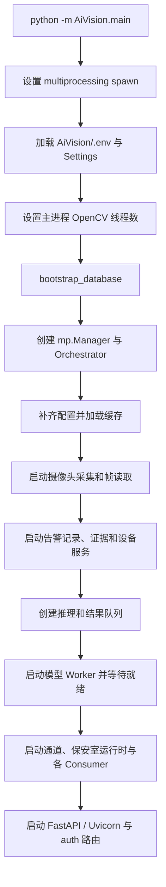
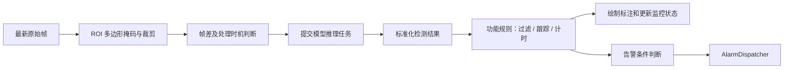

# AiVision：多摄像头视觉检测与告警后端

AiVision 是福达视觉平台唯一业务后端，负责摄像头采集、模型推理、十三项原生检测功能、总览、告警、统计、处置和证据保存。它通过 FastAPI 直接向统一前端提供接口，并加载项目根目录的 `auth` 模块处理认证、账号和访问审计。

本文按当前源码整理（2026-09-20）。重点是**一帧图像如何变成检测结果和告警、各算法实际判定什么，以及模块之间如何协作**。文中的默认值来自代码声明；实际运行值以本机配置文件、数据库配置和运行状态接口为准。

## 目录

- [1. 系统定位与功能全景](#1-系统定位与功能全景)
- [2. 整体架构与目录职责](#2-整体架构与目录职责)
- [3. 启动流程与并发模型](#3-启动流程与并发模型)
- [4. 摄像头到检测结果的数据流](#4-摄像头到检测结果的数据流)
- [5. 功能注册、配置与热更新](#5-功能注册配置与热更新)
- [6. 模型推理与模型管理](#6-模型推理与模型管理)
- [7. 基础检测与通道算法](#7-基础检测与通道算法)
- [8. 告警分发、证据与媒体清理](#8-告警分发证据与媒体清理)
- [9. 保安行为与安检流程](#9-保安行为与安检流程)
- [10. 数据存储与权限边界](#10-数据存储与权限边界)
- [11. 环境准备与启动](#11-环境准备与启动)
- [12. API 导航](#12-api-导航)
- [13. 人脸库同步与特征生成](#13-人脸库同步与特征生成)
- [14. 验证、调参与故障定位](#14-验证调参与故障定位)
- [15. 开发扩展与源码阅读顺序](#15-开发扩展与源码阅读顺序)

## 1. 系统定位与功能全景

### 1.1 在整个项目中的位置



- **统一前端**负责配置页面、监控画面、状态和记录展示。
- **auth**负责认证、用户管理、密码修改和访问审计，路由挂载到 AiVision。
- **AiVision**提供唯一业务 API，负责总览、报警、统计和检测运行，默认监听 `7862` 端口。
- **保安室、安检**均为 `features/` 下的原生功能，共享摄像头、模型、数据库和报警链路。

平台级部署与其他服务关系见[项目根 README](../README.md)。

### 1.2 十三项原生功能

Python 目录名用于组织代码，业务标识用于 API、数据库、缓存和前端查询。接入时应使用表中的业务标识。

| Python 功能目录 | `FeatureSpec.name` | 判定方法 | 模型依赖 |
| --- | --- | --- | --- |
| `features/visual_language_detection/` | `visual_language_detection` | 指令驱动智慧安防：共享帧连续理解与视频提问 | 外部 JoyAI Adapter HTTP 服务 |
| `features/intrusion/` | `blocks` | 人体框与警戒线的位置关系 | `yolo_human` |
| `features/door_state/` | `detect_door` | 图像差分与持续变化确认 | 无 |
| `features/face_dwell/` | `detect_face` | 人脸检测、跟踪与逗留计时 | `insightface_detection` |
| `features/person_dwell/` | `detect_human` | 人体检测、跟踪与逗留计时 | `yolo_human` |
| `features/phone_detection/` | `detect_phone` | 手机候选、人体关联与持续确认 | `yolo_phone`，人体关联时调用 `yolo_human` |
| `features/security_fence/` | `security_fence` | 每日禁入时段与独立白名单准入 | `yolo_human`、`insightface`，两个时段均识别人脸 |
| `features/tailgating/` | `tailgating` | 同向过线与 ROI 内共同出现联合判定 | `yolo_human` |
| `features/face_recognition/` | `recognize_face` | 人脸对齐、特征与底库相似度匹配 | `insightface` |
| `features/logistics_channel/` | `detect_logistics_single_person` | 单路人数检测与通道联合判定 | `yolo_human` |
| `features/guard_behavior/` | `guard_behavior` | 单路感知与保安室规则汇总 | 必需 `yolo_guard_person_phone`、`guard_uniform`；可选 `yolo_guard_pose`、`yolo_vehicle` |
| `features/security_inspection/` | `security_inspection` | 人员交互会话、关键帧与福达AI判定 | `yolo_human`，另通过 HTTP 调用福达AI |
| `features/agv_person_check/` | `agv_person_check` | HTTP 请求触发 ROI 多帧人体检测，任一有效帧有人即判定有人 | `yolo_human` |

事业部功能权限由 `departments/service.py` 读取 MySQL 中的 `department_feature_access` 配置，FeatureSpec 只声明功能元数据。管理员和普通账号均按“事业部＋功能”配对授权，管理员可配置全部事业部的功能分配。人员逗留共用一套 `HumanConsumer`、Schema 和配置表；人脸身份识别提供独立识别记录，不触发普通违规告警。

AGV 监控通过 `/api/cameras/{key}/frame.jpg?feature=agv_person_check` 使用公共功能标注帧入口。`AgvPersonCheckConsumer.get_live_preview()` 在最新采集帧上叠加已保存的 `roi_pos`，与普通检测共用 `_shared/roi.py` 的边框绘制；空 ROI 表示全画面。预览配置使用独立短锁，待机和请求结束后仍可取图，采样推理不阻塞预览。配置热更新、摄像头停用和移除时同步替换或清理预览；原始画面过期时沿用公共取图接口的失败状态。人体检测仍仅由 HTTP 请求触发，检测输入与预览使用同一份 ROI 配置。

`GET /api/agv-person-check/cameras/{key}/status` 在登录会话下校验摄像头所属事业部及 AGV 功能权限，返回待机、检测、回传或不可用状态，以及当前请求的采样进度和最近一次结果。`features/agv_person_check/monitor.py` 通过独立短锁保存每路当前请求及最近一次完成记录，查询不等待推理或执行回调。同步响应记录已生成的响应正文和状态码；回调记录实际发送正文、对端 HTTP 状态码及通信失败原因，不读取对端正文或暴露回调地址、认证 Header。检测失败、取消和回传失败分别表示，失败不生成无人判定。记录仅存在于内存，摄像头移除或检测服务停止时清理。

保安行为与安检流程均在同一个注册表和 Orchestrator 下运行，共享平台摄像头、模型与告警设施；没有独立 Web 子应用。

## 2. 整体架构与目录职责

### 2.1 目录结构

```text
AiVision/
├── main.py                         # 正式启动入口
├── face_library.py                 # 人脸底库自动更新、定时任务安装与状态查询固定入口
├── api/
│   ├── app.py                      # FastAPI、认证中间件和全部 API 路由
│   ├── deps.py                     # 运行对象和服务的依赖注入
│   └── routes/                     # 摄像头、功能、模型、告警、通道等 API
│       └── external/               # 可直接访问的安检、围栏和非法闯闸接口，复用平台业务服务
├── runtime/
│   ├── bootstrap.py                # 启动阶段 ORM 注册、建表与结构核验
│   ├── orchestrator.py             # 总编排、配置事件路由、运行状态聚合
│   ├── overview.py                 # 平台、能力、事业部和摄像头总览
│   └── process_cleanup.py          # 启动前残留进程清理
├── cameras/
│   ├── config_manager.py           # 摄像头数据库配置管理
│   ├── runtime_manager.py          # 采集进程启动、停止和运行管理
│   ├── runtime.py                  # 单路 FFmpeg 采集、共享内存写入
│   ├── frame_reader.py             # 共享内存读取、最新帧和更新时间
│   ├── probe.py                    # 视频源探测
│   └── orm.py                      # 摄像头 ORM
├── inference/
│   ├── model_registry.py           # 固定逻辑模型及 Worker 注册
│   ├── model_paths.py              # 本机 YAML 路径读取、校验、保存
│   ├── runtime_manager.py          # 队列、共享 Worker、重载、看门狗
│   ├── base_worker.py              # 模型子进程、任务读取与结果路由
│   ├── contracts.py                # 推理任务结果状态契约
│   ├── insightface_detector.py     # InsightFace 检测和 GPU 模型加载
│   └── workers/                    # YOLO、人脸检测、人脸身份识别
├── features/
│   ├── registry.py                 # 十三项功能唯一显式注册入口
│   ├── _shared/
│   │   ├── spec.py                 # FeatureSpec 元数据
│   │   ├── consumer.py             # 公共帧处理、推理调用和告警衔接
│   │   ├── dwell_consumer.py       # 人脸/人员共用逗留逻辑
│   │   ├── tracking.py             # IoU、中心距离、面积联合跟踪
│   │   ├── roi.py                  # 归一化 ROI 和警戒线契约
│   │   ├── line_overlay.py         # 警戒线与过闸线的边界和方向标记绘制
│   │   ├── config_manager.py       # 功能配置读写与事件发布
│   │   ├── orm.py                  # 配置 ORM 基类
│   │   ├── alarm_schema.py         # 普通检测告警配置契约
│   │   └── defaults.py             # 公共默认参数
│   ├── intrusion/                  # 区域入侵
│   ├── visual_language_detection/  # 指令驱动智慧安防：视频理解、参数、事件和提问调度
│   ├── door_state/                 # 大门状态变化
│   ├── face_dwell/                 # 人脸逗留
│   ├── person_dwell/               # 人员逗留
│   ├── phone_detection/            # 手机使用检测
│   ├── agv_person_check/           # AGV 请求调度、人体检测和 HTTP 协议适配
│   ├── security_fence/             # 围栏时段、身份状态机、独立白名单及查询服务
│   ├── tailgating/                 # 非法闯闸配置、通行轨迹、事件与实时预览
│   ├── face_recognition/           # 身份识别、识别记录
│   │   └── library/                # 人员同步、照片特征和内存索引
│   ├── logistics_channel/          # 通道配置、成员、快照、状态机和拼图
│   ├── guard_behavior/             # 保安室、感知、规则、成员和告警策略
│   └── security_inspection/        # 工位 ROI、会话、福达AI调度与历史
├── alarms/
│   ├── dispatcher.py              # 统一告警分发与冷却
│   ├── devices/                   # 喇叭配置、AAC 素材、SIP/RTP、绑定与播放队列
│   ├── notifications/             # 企业微信、通知图片
│   ├── records/                   # 告警、MySQL 处置、异步写入与媒体引用
│   └── evidence/                  # 报警前后视频缓存与编码
├── departments/                   # 固定事业部目录、功能分配 ORM、数据契约与配置服务
├── assistant/                     # 账号私有对话、配置能力目录、后台工具执行和审计
├── core/                          # Settings、数据库、缓存、事件、日志等
├── connectors/
│   ├── hikvision/                  # 海康签名、HTTP 客户端与人员协议
│   ├── joyai/                     # JoyAI Adapter 客户端和响应清洗
│   └── qwen/                      # 福达AI连接校验、Chat Completions 和共享请求预算
├── config/model_paths.example.yaml
├── migrations/                    # 显式离线迁移
├── .env.example                   # 主服务环境变量模板
├── requirements.txt               # 主服务基础依赖
└── pyproject.toml                  # Python 版本、依赖和 Ruff 配置
```

### 2.2 各层如何分工

| 层次 | 主要职责 | 典型入口 |
| --- | --- | --- |
| HTTP 接口层 | 参数验证、鉴权、调用业务服务、组织响应 | `api/routes/`、`../auth/api.py` |
| 配置与持久化层 | 配置读写、事务、事业部约束、设备绑定 | 各模块的 `service.py`、`config_manager.py`、`orm.py` |
| 运行编排层 | 把摄像头、模型、Consumer 和告警模块组装起来 | `runtime/orchestrator.py` |
| 图像采集层 | 解码、发布最新帧、维护采集进程 | `cameras/` |
| 模型推理层 | 加载模型、执行推理、返回标准检测结果 | `inference/` |
| 检测业务层 | ROI、过滤、跟踪、计时、状态机、是否违规 | `features/` |
| 告警与证据层 | 冷却、数据库记录、喇叭、企微、截图和视频 | `alarms/` |

模型只回答“图像里检测到了什么”。Consumer 根据业务规则回答“是否满足违规条件”。分发器再决定“这次告警是否达到冷却条件，发送到哪些渠道”。这三步分开，便于复用模型并单独测试判定规则。

## 3. 启动流程与并发模型

### 3.1 正式启动顺序

入口：[main.py](main.py)，编排：[runtime/orchestrator.py](runtime/orchestrator.py)。



关键行为：

1. 主入口按源码位置加载 `AiVision/.env`，已注入进程的环境变量优先；Settings 只读进程环境和默认值，不扫描当前工作目录的旧 `.env`。
2. `bootstrap_database()` 集中导入 ORM，创建缺失表，核验功能配置、物流、保安室、人脸底库、安检会话、认证、审计和处置等表结构。
3. 主启动会先准备业务运行资源，再启动 HTTP 服务。模型等待时间会影响端口开始响应的时间。
4. 摄像头按总开关和功能启用关系启动；启动时还会整理共享内存名称、补齐默认功能配置。探测与首帧等待使用有限并行，`CAMERA_START_WORKERS` 默认 `4`，范围 `1～16`；每路仍独立管理启停与失败重试。
5. 模型运行管理器按注册模型建立物理 Worker 分组；并非只为当前开启的摄像头临时加载一个模型。
6. 保安行为通过专用运行时汇总摄像头快照；安检 Consumer 管理福达AI调度线程。各功能依照配置和模型就绪情况参与检测。
7. HTTP 服务运行期间收到 `SIGINT` 或 `SIGTERM` 时，`api/server.py` 的 `GracefulServer` 先调用 `Orchestrator.begin_shutdown()` 关闭 AGV 新请求入口，再由 Uvicorn 等待已接收的 HTTP 响应及后台回调。摄像头、模型及消费者在等待期间继续运行；HTTP 服务退出后才停止 Consumer、运行时、模型、告警服务、采集及共享管理器。

`SHUTDOWN_GRACE_SECONDS` 设置正常退出的请求等待上限，默认 `75` 秒，覆盖 AGV 最长 `60` 秒检测窗口和最长 `10` 秒回调超时。AGV 按响应或回调释放请求容量，判定完成但回调尚未结束的请求仍需等待；重复停止通知不会延长原有截止时间。消费者直接停止也先等待已接收请求释放，等待超时后以不可用结束未完成检测，不能生成无人判定。服务恢复前的新调用可能收到 HTTP `503` 或连接失败，调用方需重试。

`scripts/stop.sh` 与 `scripts/start.sh --force` 共用 `scripts/service_control.sh`，向当前 tmux 会话的 Python 主入口发送 `SIGTERM` 并等待其退出，再关闭会话。`FUDA_STOP_TIMEOUT_SECONDS` 在 `scripts/cold_start.env` 中配置，默认 `180` 秒，包含请求等待与运行资源清理；后端超时保留会话并返回失败，不强杀后端或继续启动新后端。前端关闭 tmux 后使用 `ss` 等待监听端口释放，沿用该等待上限，超时或查询失败时停止后续启动，不终止其他端口占用者。

`bootstrap_database()` 的职责是准备数据库结构；业务采集与推理由 Orchestrator 启动。已有业务字段转换和历史数据合并通过离线迁移完成，主启动不会代替迁移脚本修改这些业务语义。

主入口记录模块准备、数据库准备和启动总耗时，摄像头及模型管理器记录各自启动阶段耗时。`运行资源准备完成` 日志表示检测资源初始化流程结束，随后运行 HTTP 服务；后台设备重连日志可在正常运行期间持续出现。

### 3.2 进程和线程如何组织

十三项功能共用摄像头采集和 Consumer 生命周期；本机模型使用共享推理流水线。保安室、物流通道有独立的汇总调度，安检另有福达AI请求和健康检查线程，指令驱动智慧安防通过后台线程调用 JoyAI Adapter。

| 执行单元 | 数量/粒度 | 作用 |
| --- | --- | --- |
| 主 Python 进程 | 一个 | FastAPI、Orchestrator、配置、Consumer 和后台服务 |
| `multiprocessing.Manager` 服务进程 | 一个 | 提供跨进程共享管理能力 |
| 摄像头启动线程池 | 启动阶段最多 `CAMERA_START_WORKERS` 路 | 并行探测与等待首帧，阶段结束后释放线程 |
| 摄像头采集进程 | 每路启用摄像头一个 | 管理该路 FFmpeg，写入共享内存 |
| FFmpeg 子进程 | 每路采集对应一个 | 解码 RTSP，输出 BGR 原始帧 |
| 帧读取线程 | 每路已注册摄像头一个 | 把共享内存中的新帧复制到主进程缓存 |
| 模型 Worker 进程 | 每组可共享物理模型一个 | 加载权重并轮询逻辑模型队列 |
| Consumer 线程 | 每个成功启动的功能一个 | 遍历该功能已启用的摄像头并执行检测 |
| 后台服务线程 | 按模块创建 | 通道/保安室评估、福达AI调度与健康检查、模型监控、写入、视频编码和通知 |

同一功能的 Consumer 在一个线程中依次处理多路摄像头，并同步等待当前推理结果。因此路数、模型耗时和超时等待会共同影响该功能的更新频率。

主进程持有唯一运行资源集合。部署应使用 `python -m AiVision.main`；单独运行 `uvicorn AiVision.api.app:app` 不会执行主入口里的数据库 bootstrap 和 Orchestrator 启动流程，也不应直接用多个 Web Worker 重复拥有同一批采集资源。

## 4. 摄像头到检测结果的数据流

摄像头 `shm_name` 统一使用 `camera_<摄像头ID>`。`POST /api/cameras` 和功能页面创建入口可省略 `shm_name`，由 `CameraConfigManager.create_camera_record()` 在同一事务内取得主键并生成；显式传入时必须与实际主键一致，冲突或不一致会回滚创建。功能配置、物流通道、保安室和检测记录通过摄像头 ID 关联。

### 4.1 从 RTSP 到最新帧

```text
RTSP 摄像头
  → ffprobe 探测分辨率
  → CameraRuntime 启动 FFmpeg，按配置输出 BGR24 原始帧
  → 采集进程进行大幅帧差过滤
  → 双缓冲共享内存：<shm_name>_0 / <shm_name>_1
  → 更新 active_index 和 frame_seq
  → FrameReaderRegistry 读取新序号、复制有效帧
  → latest_frames / latest_frame_times / latest_frame_seq
```

- 写入端交替使用两个共享内存缓冲区；读取端复制前后检查序号和缓冲索引，遇到发布切换则放弃本次读取。
- `latest_frames` 保存最新图像，发布后的 NumPy 数组设为只读；绘制标注时另行复制。
- 帧读取线程只在采集序号变化时更新时间，避免把反复读取同一张图误认为摄像头持续产生新帧。
- 采集端的大幅帧差过滤是异常图像过滤手段。默认变化比例阈值为 `0.7`，不能把它等同于精确的花屏分类器。
- FFmpeg 流中断会按重启窗口和次数限制重试；超出限制后采集进程退出并报告运行异常。

### 4.2 从最新帧到业务结果

公共处理基类：[features/_shared/consumer.py](features/_shared/consumer.py)。



门状态检测直接在 ROI 上计算帧差，不提交模型任务。其他功能通过 `dispatch_inference_sync()` 调用模型。

### 4.3 ROI 坐标约定

ROI 是要检测的图像区域，配置字段为 `value.roi_pos`。

```json
{
  "roi_pos": [[0.1, 0.2], [0.8, 0.2], [0.8, 0.9], [0.1, 0.9]]
}
```

规则：

- 普通检测每路每项功能维护一个多边形 ROI；安检使用 `staff_rois` 保存多个命名工位，保安行为单独保存车辆 ROI。
- 坐标范围是 `[0, 1]`；`x` 对应图像宽，`y` 对应图像高。
- 空列表 `[]` 表示全帧；非空多边形至少三个点，面积必须大于零。
- 运行时将坐标映射到像素，取多边形外接矩形，再用掩码把矩形内、多边形外的像素置零。
- Worker 返回裁剪图内的坐标。绘制到原图、做警戒线判断或生成通道快照时，需要加回 ROI 左上角偏移。
- ROI 或帧尺寸变化会重建掩码；相关功能通过 `_on_roi_changed()` 清理背景、跟踪或候选状态。

配置和校验实现见 [roi.py](features/_shared/roi.py)。

### 4.4 处理频率和静止画面

公共层用低分辨率采样和高斯模糊判断帧变化，并缓存结果。各功能按自身采样策略处理静止画面，以维持站立人员检测、逗留计时和状态更新。

需要区分三个参数/频率：

| 名称 | 含义 |
| --- | --- |
| 摄像头 `fps` | 采集端希望输出的帧率 |
| 功能 `cap_interval` | Consumer 的处理间隔参数；公共层对静止画面用它判断是否再次处理 |
| 实际检测更新频率 | 同时受采集速度、帧变化、摄像头数、模型排队和推理耗时影响 |

公共基类对发生变化的画面可提前处理，`cap_interval` 不能统一理解为所有功能的严格限频器。人脸身份识别和安检通过 `_should_process_now()` 额外限制采样间隔；物流通道还受成员关系和通道检测时段约束。

`GET /api/runtime/status` 的 `inference.consumers.{feature}.targets` 保留各摄像头最近的计时结果，所有耗时单位均为毫秒：

| 字段 | 含义 |
| --- | --- |
| `last_outcome.timing_ms.input_wait` | 同步请求投递至本机 Worker 开始执行，包含数组传输、反序列化和模型排队 |
| `last_outcome.timing_ms.worker` | Worker 执行耗时，包含模型实现中的预处理、推理和结果转换，并非单独的 GPU 计算时间 |
| `last_outcome.timing_ms.result_return` | Worker 完成至同步调用返回，包含结果传输和路由唤醒 |
| `last_outcome.timing_ms.round_trip` | 整次同步调用耗时，包含本地登记、投递和等待 |
| `last_frame_timing` | 公共循环最近完整帧的锁等待、状态检查、读帧、准备、业务处理、画图、发布与告警、锁外回调及总耗时 |
| `last_frame_timing.interval_ms` | 同一路相邻两次已完成帧处理的开始时间间隔，包含轮询其他摄像头的时间；首帧为 `null` |

未测量的推理阶段返回 `null`；帧计时仅在公共循环完成一帧后更新。统计只保留最近结果，不保存图像或计时历史，目标仍按用户授权的摄像头与功能过滤。

### 4.5 前端看到什么

- `GET /api/cameras/{key}/frame.jpg`：读取原始帧，用于 ROI 等配置。
- 加上 `?feature=detect_phone` 等参数：读取对应功能的实时预览。公共 Consumer 通过 `get_live_preview()` 在取图线程选择短时检测画面或最新采集帧，不等待推理锁；检测超时后仅在实时底图绘制保存的 ROI。安检使用多个工位 ROI，视频理解显示原图。
- 原始采集源使用 **10 秒**新鲜度窗口；没有新鲜采集源或功能未启用时，功能取图返回不可用。
- `_shared/preview.py` 将检测画面与采样时间、配置引用成对保存。`PREVIEW_FRAME_MAX_AGE_SECONDS=0.3` 限制服务端复用检测图的采样年龄，包含采集及推理等待；围栏、非法闯闸另检查规则时段、分辨率及 `max_frame_gap_seconds`。检测图过时后显示最新底图，空间框不叠加到不对应的新画面。状态快照按各自规则独立失效，报警证据保留对应检测原图。
- 物流通道和保安室的监控拼图使用相同的实时预览来源，业务评估、报警截图和录像使用检测或会话证据帧。
- 监控状态过期时返回 `reason=unknown`、人数/时长为空等状态。专门的状态快照目前由逗留、身份识别和物流等 Consumer 提供，其他功能不能仅凭“没有状态快照”判断为故障。

## 5. 功能注册、配置与热更新

### 5.1 FeatureSpec 是功能连接点

每个 `features/{package}/spec.py` 定义一个 `FeatureSpec`：

| 字段 | 用途 |
| --- | --- |
| `name` | 持久化业务标识 |
| `display_name` | 展示名称 |
| `consumer_cls` | 执行业务算法的 Consumer 类 |
| `orm_class` | 保存配置的数据库模型 |
| `config_schema` | 验证请求和配置的 Pydantic Schema |
| `required_models` | 功能运行必需的逻辑模型 |
| `optional_models` | 仅影响对应子规则的逻辑模型 |
| `alarm_types` | 该功能拥有的告警类型元组 |
| `model_names` | 必需与可选模型合并去重后的只读属性 |

[registry.py](features/registry.py) 显式导入十三项 SPEC，并提供 `all_specs()`、`get_spec()`、`list_orm_classes()`。重复功能标识、非法/重复告警类型、跨功能重复拥有告警类型或 SPEC 导入失败会直接报错。功能包的 `__init__.py` 不承担扫描和自动注册职责。

### 5.2 配置分为三类

| 配置类别 | 保存位置 | 例子 | 生效方式 |
| --- | --- | --- | --- |
| 部署环境 | `AiVision/.env` / 进程环境 | 数据库、存储目录、API 端口、全局通知开关 | 通常重启后生效 |
| 本机模型路径 | `config/model_paths.yaml` | YOLO 权重、人脸检测文件、身份模型目录 | 模型路径 API 保存后后台重载 |
| 业务配置 | MySQL | 摄像头、ROI、阈值、通道、保安室、福达AI参数和设备绑定 | 对应管理接口保存并刷新运行时 |

普通检测配置的 HTTP 结构如下；`value` 的内容由各功能 Schema 定义：

```json
{
  "enable": true,
  "value": {
    "roi_pos": [],
    "CONF_THRESHOLD": 0.3,
    "MAX_TIME": 10.0
  },
  "alarm": {
    "sql": {"enable": true, "parm": {}},
    "horn": {"enable": false, "parm": {}},
    "wechat": {"enable": false, "parm": {"user": ""}}
  }
}
```

上例对应人员逗留配置的部分字段，省略项由 Schema 默认值补齐。`PUT` 保存采用完整配置校验和写入语义，不能当作只改一个字段的 `PATCH`；实际编辑时应先读取配置，保留其他字段后再保存。

物流通道把人数置信度、检测时段、无人/多人容忍时间、NMS 阈值、几何过滤、采样间隔和告警渠道统一保存在通道层；成员摄像头的检测配置只保留 ROI，通过专用 `/roi` 接口读写。人脸身份识别的普通告警渠道固定关闭。

### 5.3 热更新链路

```text
HTTP 保存请求
  → 对应 Schema 校验
  → 数据库事务与业务约束检查
  → 提交事务
  → config_cache 刷新
  → ConfigEventBus 发布 ConfigChangeEvent
  → Orchestrator 路由到摄像头、Consumer 或通道运行时
  → 更新运行配置和必要的缓存/状态
```

`ConfigEventBus` 是主进程内的同步回调总线，支持精确、前缀及通配订阅。它不是跨进程消息中间件；模型进程接收的是推理任务中携带的参数。

摄像头、通道和保安室必须属于正式事业部，成员关系需保持事业部一致。保安室接口在事务提交后显式刷新运行时；福达AI设置保存后重新配置调度器，并取消旧设置下排队的判定。

## 6. 模型推理与模型管理

### 6.1 当前注册的逻辑模型

来源：[model_registry.py](inference/model_registry.py)。

| 模型名 | Worker | 输出类型 | 权重路径要求 |
| --- | --- | --- | --- |
| `yolo_human` | `YoloDetectorWorker` | `person`，过滤类别 `0` | 本地 YOLO 权重文件 |
| `yolo_phone` | `YoloDetectorWorker` | `phone`，过滤类别 `1` | 本地 YOLO 权重文件 |
| `insightface_detection` | `FaceDetectorWorker` | `face` | `det_10g.onnx` 检测文件 |
| `insightface` | `FaceRecognizerWorker` | `face_identity` | 本地完整 `buffalo_l` 目录 |
| `yolo_guard_person_phone` | `YoloDetectorWorker` | `guard_object`，类别 `0/1` | 人体/手机权重 |
| `guard_uniform` | `UniformClassifierWorker` | `uniform` | 制服分类权重 |
| `yolo_guard_pose` | `YoloPoseWorker` | `pose` | 姿态模型 |
| `yolo_vehicle` | `YoloDetectorWorker` | `vehicle`，仅保留类别 `2` | 车辆检测权重 |

人体/手机权重约定 `0=person`、`1=phone`；车辆模型使用自身的类别映射。换权重时必须检查对应模型的类别，不能把同一数字跨权重解释为同一对象。福达AI不在本地模型 Worker 注册表中，通过安检设置和 HTTP 客户端管理。

### 6.2 一份权重如何共享

`InferenceRuntimeManager` 按 **Worker 类 + 文件设备号 + inode** 分组。两个逻辑模型指向同一物理文件且 Worker 类型相同时，可共用一个模型进程。

例如 `yolo_human` 和 `yolo_phone` 指向同一个 `person_phone.pt`：

```text
yolo_human 输入队列 ─┐
                    ├→ 一个 YoloDetectorWorker / 一份模型实例
 yolo_phone 输入队列 ─┘       → 按任务 model_name 过滤类别和标记类型
                             → 按 function_name 返回对应功能结果队列
```

共享的是模型实例及进程资源。人员和手机任务仍分别调用 `predict()`，当前没有把两项业务请求自动合并为一次推理，也没有跨功能的检测结果缓存。

纯人脸检测与身份识别使用不同 Worker。即使身份识别目录中也有 `det_10g.onnx`，两者仍有独立模型实例。

### 6.3 任务和结果协议

- 每个逻辑模型一个输入队列，每个功能一个结果队列，当前队列容量均为 `10`。
- Worker 轮询自己负责的逻辑模型队列，加载成功并设置 ready 标志后才算运行就绪。
- Consumer 按 `request_id`、摄像头、功能和 ROI 标识匹配结果，避免迟到结果被用于下一次请求。
- 通用请求等待预算为 `0.8` 秒，从投递准备开始计算；具体调用可以覆盖，例如入侵检测使用 `1.0` 秒。提前投递的请求只等待各自剩余时间，不逐路重新累积完整超时。
- 共享内存用于**采集进程到主进程**的帧传递；推理输入仍通过多进程 Queue 传递。YOLO 检测输入在入队前按 `imgsz` 等比例缩小，默认 `640`，小图不在传输阶段放大；Worker 返回前把检测框恢复到原始 ROI 坐标。Consumer 的原图、标注和证据保留原始分辨率。

典型结果结构：

```json
{
  "request_id": "detect_human:12:example",
  "model_name": "yolo_human",
  "function_name": "detect_human",
  "camera_id": 12,
  "roi_id": 0,
  "status": "ok",
  "error_code": null,
  "error_message": null,
  "inference_ms": 18.2,
  "input_wait_ms": 4.5,
  "completed_at_monotonic": 1000.0182,
  "detections": [
    {"bbox": [20.0, 30.0, 100.0, 210.0], "confidence": 0.92, "class_id": 0, "type": "person"}
  ]
}
```

| `status` | 含义 |
| --- | --- |
| `ok` | 推理成功；`detections=[]` 表示成功观察到没有目标 |
| `error` | 模型执行或结果契约异常 |
| `dropped` | 输入队列已满，本次任务未入队 |
| `timeout` | 在等待窗口内没有取得匹配结果 |
| `unavailable` | 请求的模型没有对应输入队列 |

模型有队列但 Worker 异常时，也可能表现为 `timeout`。故障状态与正常空检测含义不同，逗留和物流功能对此有明确分支处理。

### 6.4 模型路径配置与重载

```yaml
models:
  yolo_human:
    path: /path/to/person_phone.pt
  yolo_phone:
    path: /path/to/person_phone.pt
  yolo_guard_person_phone:
    path: /path/to/person_phone.pt
  guard_uniform:
    path: /path/to/uniform_classes.pt
  yolo_guard_pose:
    path: /path/to/yolo11n-pose.engine
  yolo_vehicle:
    path: /path/to/yolo11n.pt
  insightface_detection:
    path: /srv/models/insightface/buffalo_l/det_10g.onnx
  insightface:
    path: /srv/models/insightface/buffalo_l
```

`MODEL_PATHS_CONFIG` 默认是 `config/model_paths.yaml`，相对路径以 **AiVision 目录**为基准。模型身份、Worker 类、类别过滤及默认推理参数在代码中固定注册，YAML 只配置本机模型路径。

YAML 中每个模型的 `path` 必须是当前服务器上的绝对路径，指向可读、非空的模型文件或满足校验要求的模型目录。配置文件自身可使用相对路径，与模型权重路径的规则不同。

管理员调用 `PATCH /api/models/{model_name}/path` 后：

1. 校验模型名及本机路径，保留 YAML 注释并原子保存，清除路径缓存。
2. 返回 HTTP `202` 和 `configuration_saved=true`。
3. 运行中的服务在后台重载受影响的物理 Worker/逻辑模型组，保留 Consumer 原有队列引用。
4. 通过 `GET /api/models` 观察 `reload.status` 的 `loading/succeeded/failed` 和真实 `runtime` 状态。
5. 运行时未启动则报告 `not_started`；重载期间再次提交路径修改会被拒绝。

“配置已保存”只代表配置写入完成。是否加载成功，需要继续看运行状态。模型路径不再从旧 `ai_model` 表读取，启动也不负责删除该历史表。

### 6.5 自动恢复与可观测性

模型看门狗检查 Worker 是否存活、是否就绪及是否加载失败，按退避时间重启；默认最多连续尝试 `3` 次。稳定运行达到重置时间后可恢复重试额度。

Consumer 统计各摄像头/模型的推理结果、连续失败次数及最近状态。默认连续失败 `3` 次达到异常通知条件，通知冷却 `300` 秒。运行状态可通过 `/api/runtime/status` 和 `/api/models` 查看。

## 7. 基础检测与通道算法

### 7.1 区域入侵：`blocks`

源码：[intrusion/consumer.py](features/intrusion/consumer.py)、[intrusion/schema.py](features/intrusion/schema.py)。

**目标：检测警戒线指定一侧是否有人。**

处理步骤：

1. 对 ROI 运行 `yolo_human`，取得人体框。
2. 将检测框坐标还原到原图。
3. 从人体框计算接近脚底的参考点：

   ```text
   Px = (x1 + x2) / 2
   Py = y1 + (y2 - y1) × foot_ratio
   ```

4. 将归一化警戒线端点转换到原图坐标。设有向线为 A → B，用叉积判断 P 位于哪一侧：

   ```text
   side = (Bx - Ax) × (Py - Ay) - (By - Ay) × (Px - Ax)
   ```

5. `alarm_side >= 0` 时，`side >= 0` 属于报警侧；反向时使用 `side <= 0`。边界在线上的点也计入报警侧。
6. 任一人体参考点满足条件即产生本帧违规候选，之后由统一告警冷却控制分发。

关键参数：`threshold` 默认 `0.1`，`foot_ratio` 默认 `0.93`，以及 `line_points`、`alarm_side`。

**语义边界：**当前实现不要求观察到人员从另一侧跨过线，也不计算进出方向或通行人数。线的两个端点定义的是方向和分界，侧别判定作用于该直线；ROI 用于进一步限定实际检测范围。未配置警戒线时不产生此规则的入侵判定。

### 7.2 大门开关检测：`detect_door`

源码：[door_state/consumer.py](features/door_state/consumer.py)、[door_state/schema.py](features/door_state/schema.py)。

**目标：检测门所在 ROI 是否持续偏离参考画面。**实现使用图像差分，不依赖门类别模型。

维护四类状态：上一张处理灰度图、参考背景、连续变化候选、首次告警计时。

算法步骤：

1. 使用公共层缓存的模糊 ROI 转灰度；第一张有效图像建立上一帧和背景，本次不告警。
2. 同时计算两种差分：

   ```text
   短期运动比例 = 灰度差超过 diff_threshold_env 的像素数 / 裁剪图总像素数
   背景变化比例 = 灰度差超过 diff_threshold 的像素数 / 裁剪图总像素数
   ```

3. 若短期运动比例大于 `global_motion_threshold`，或开启了 `env_threshold` 且背景变化比例超过它，则本次视为不稳定，清除连续候选，保留参考背景。
4. 稳定时，背景变化比例必须同时达到 `threshold` 和 `min_local_change_ratio`。
5. 连续满足条件至少 `stable_confirm_seconds`，并达到 `stable_confirm_hits` 次，才确认持续变化。条件中断则清零。
6. 稳定且没有达到变化条件时，用 `background_update_alpha` 缓慢更新背景；有变化候选时暂停背景更新。
7. 确认变化后，再连续保持 `first_alarm` 秒才允许首次告警；持续异常之后按分发器冷却控制重复告警。
8. 状态恢复时，连续确认和首次报警计时重置。

| 参数 | 默认值 | 作用 |
| --- | --- | --- |
| `diff_threshold` | `5` | 与参考背景比较的灰度差阈值 |
| `diff_threshold_env` | `10` | 与上一处理图比较的灰度差阈值 |
| `threshold` | `0.5` | 背景变化比例下限 |
| `min_local_change_ratio` | `0.01` | 另一变化比例下限，两者同时满足 |
| `global_motion_threshold` | `0.22` | 短期运动比例上限 |
| `env_threshold` | `null` | 关闭背景变化比例上限过滤 |
| `stable_confirm_seconds` / `stable_confirm_hits` | `1.0` 秒 / `3` 次 | 持续变化确认 |
| `background_update_alpha` | `0.05` | 更新时当前画面占 5%，旧背景占 95% |
| `first_alarm` | `60` 秒 | 确认变化后的首次告警等待 |
| `alarm_interval` | `5.0` 秒 | 报警记录间隔，未单设的通知沿用该值 |

默认流程是“先至少 1 秒且 3 次确认，再等待 60 秒”，两段计时分别执行。黄色 ROI 提示表示变化已确认，实际通知还受首次告警等待和渠道配置约束。

**使用边界：**参考图像从初次处理画面建立，部署时应让摄像头观察预期正常门状态。光照、阴影、遮挡和摄像头移动都会影响差分；统计分母是 ROI 外接矩形裁剪图的总像素数，因此多边形形状也影响变化比例。

### 7.3 人脸逗留：`detect_face`

源码：[face_dwell/consumer.py](features/face_dwell/consumer.py)、[dwell_consumer.py](features/_shared/dwell_consumer.py)。

**目标：同一条人脸轨迹在 ROI 中持续出现达到指定时间。**

- `FaceDetectorWorker` 使用本地 InsightFace 检测模型，只输出人脸框及置信度，不查询人员底库。
- 检测输入按 `640 × 640` 尺寸准备，缩放、补边、坐标还原由检测实现处理。
- 每项任务设置自己的检测置信度和 NMS 阈值，避免不同摄像头沿用前一项任务的阈值。
- 检测框交给公共逗留跟踪器，当前可见轨迹达到 `MAX_TIME` 后标记为逗留。

默认参数：`FACE_SCORE_THR=0.6`、`DETECTION_IOU_THR=0.3`、`TRACK_IOU_THR=0.3`、`MAX_LOST=5`、`MAX_TIME=10.0` 秒。

人脸逗留回答“这个位置上的人脸是否停留过久”；身份信息由 `recognize_face` 单独处理。

### 7.4 人员逗留：`detect_human`

源码：[person_dwell/consumer.py](features/person_dwell/consumer.py)、[tracking.py](features/_shared/tracking.py)。

**目标：同一条人体轨迹在 ROI 中停留达到阈值。**

人体检测采用 `yolo_human`，先做最小框面积和宽高比过滤，再复用与人脸相同的跟踪和计时流程。各事业部使用相同算法，状态按摄像头隔离。

默认检测参数：`CONF_THRESHOLD=0.3`、`DETECTION_IOU_THR=0.3`、`MIN_BOX_AREA=0`、`ASPECT_RATIO_RANGE=[0.0, 10.0]`、`MAX_TIME=10.0` 秒。

#### 人脸与人员共用的目标跟踪

跟踪器采用轻量几何关联，没有人员外观 ReID 特征，也没有跨摄像头身份追踪。

对每个旧轨迹框和当前检测框计算：

```text
IoU = 交集面积 / 并集面积
面积相似度 = min(旧框面积, 新框面积) / max(旧框面积, 新框面积)
归一化中心距离 = 两个框中心的欧氏距离 / max(旧框宽, 旧框高, 1)
中心分数 = 1 - min(1, 归一化中心距离 / CENTER_DIST_THR)
匹配分数 = 0.55 × IoU + 0.30 × 中心分数 + 0.15 × 面积相似度
```

- IoU 低于 `TRACK_IOU_THR` 时，还要求中心足够近、面积相似度达到 `AREA_RATIO_THR`。
- 候选分数达到 `MATCH_SCORE_THR` 后，按分数从高到低做一对一贪心匹配。
- 匹配成功：更新框和中心位移，重置丢失次数。默认框平滑是 `旧框 × 0.3 + 新框 × 0.7`。
- 未匹配旧轨迹：丢失次数加一，按上一中心位移预测位置；`lost > MAX_LOST` 时删除。
- 未匹配检测框：建立新轨迹和首次观察时间。
- 当前告警只使用 `lost == 0` 的可见轨迹。轨迹一旦达到时长门槛，`alarmed` 保持到轨迹删除或相关状态重置。

默认跟踪参数：`TRACK_IOU_THR=0.3`、`CENTER_DIST_THR=0.65`、`AREA_RATIO_THR=0.55`、`MATCH_SCORE_THR=0.35`、`TRACK_SMOOTH_ALPHA=0.7`。

`DETECTION_IOU_THR` 控制同次检测的 NMS 去重，`TRACK_IOU_THR` 控制相邻观察之间的轨迹关联，两者作用不同。`MAX_LOST` 的单位是有效跟踪更新次数，不是秒。

#### 逗留时间与推理故障

`DwellObservationClock` 使用单调时钟构造有效观察时间轴，轨迹时长为该时间轴上的 `last_seen - first_seen`。

- 正常推理成功：推进观察时间；成功但检测为空时，跟踪器正常累计丢失次数。
- 推理失败、超时或检测结果损坏：暂停计时，保留轨迹，不把故障当成“人离开”。
- 恢复后的第一张成功结果：恢复观察基点，不把故障间隔补算进逗留时间。
- 短暂正常漏检后若仍匹配回原轨迹，保留原首次观察时间。
- 监控只画当前 `lost == 0` 的可见轨迹；丢失容忍期间保留轨迹编号和时长，不显示历史或预测位置。
- 故障期间状态为 `unknown`，人数和时长为空，本次不提交逗留告警。

几何跟踪遇到严重遮挡、交叉、框变化或画面抖动可能换 ID；因此轨迹 ID 不能当作人员真实身份。

### 7.5 手机使用检测：`detect_phone`

源码：[phone_detection/consumer.py](features/phone_detection/consumer.py)、[phone_detection/schema.py](features/phone_detection/schema.py)。

**目标：持续检测到与人体位置关联的手机候选，减少孤立背景手机框误报。**

1. 在 ROI 上调用 `yolo_phone`，按手机置信度和 NMS 阈值检测。
2. 默认开启人体关联，另行调用 `yolo_human`。
3. 根据人体框构造一个向左右和顶部扩展、向下覆盖到指定高度比例的区域。
4. 手机中心落在该区域，或手机框与区域的交集占手机框面积达到阈值，才通过关联。
5. 手机框按 IoU 或归一化中心距离关联到已有候选轨迹。
6. 命中次数和持续时间同时达标时，候选被确认，生成本帧告警条件。
7. 两次命中间隔超过 `MAX_MISSED_SECONDS` 时重新累计；长时间不出现的候选按 TTL 清理。

| 参数 | 默认值 | 含义 |
| --- | --- | --- |
| `CONF_THRESHOLD` / `IOU_THR` | `0.7` / `0.5` | 手机检测置信度和 NMS |
| `REQUIRE_PERSON_ASSOCIATION` | `true` | 开启人体关联 |
| `PERSON_CONF_THRESHOLD` / `PERSON_IOU_THR` | `0.3` / `0.3` | 人体检测参数 |
| `PERSON_EXPAND_RATIO` | `0.18` | 人体关联区扩展比例 |
| `HAND_REGION_MAX_Y_RATIO` | `0.85` | 关联区下界相对于人体高度的位置 |
| `MIN_PERSON_PHONE_OVERLAP` | `0.08` | 手机框被关联区覆盖的最低比例 |
| `MIN_CONSECUTIVE_HITS` | `3` | 最少确认命中次数 |
| `MIN_CONFIRM_SECONDS` | `1.2` 秒 | 最短确认时间 |
| `MAX_MISSED_SECONDS` | `0.6` 秒 | 允许的命中间隔 |
| `TRACK_TTL_SECONDS` | `2.0` 秒 | 候选清理时间 |
| `TRACK_IOU_THRESHOLD` | `0.2` | 手机候选关联阈值 |

这里的“手部区域”是人体框推导的几何区域，不是手腕关键点检测。算法没有直接理解屏幕内容或人的操作意图，桌面手机靠近人体等情况仍需结合现场样本调参。

当前代码仅在人体输入队列存在时强制执行人体关联；关闭关联或缺少该队列会按手机候选继续判断。人体队列存在但推理失败时没有有效人体框，关联候选会受影响。手机候选计时实现与公共逗留时钟不同，不能套用逗留的故障暂停语义。

### 7.6 人脸身份识别：`recognize_face`

源码：[face_recognition/consumer.py](features/face_recognition/consumer.py)、[face_recognizer.py](inference/workers/face_recognizer.py)、[library/index.py](features/face_recognition/library/index.py)。

处理链路：

```text
ROI → SCRFD 人脸检测及关键点 → 人脸对齐 → 512 维特征
    → 特征归一化 → 与有效人员矩阵计算余弦相似度
    → 取最高分 → 达到阈值则匹配，否则显示未知人员
```

- 检测使用 `det_10g.onnx`，身份特征模型使用 `w600k_r50.onnx`。
- 本机路径校验要求完整 `buffalo_l` 目录，运行识别主要加载检测和识别模型。
- 人员索引只加载有效人员、模型名匹配、照片签名仍一致的特征。
- 索引保存归一化矩阵，使用 `matrix @ vector` 一次计算与所有已索引人员的相似度。
- 运行中的索引每 `60` 秒在推理时检查刷新；刷新失败会报告推理失败，等待后续刷新恢复。
- 无底库或最高相似度未达阈值时返回“未知人员”。
- 人员资料和特征共用；通行授权保存在 `ai_face_person_authorization`，以事业部和人员 ID 唯一定位。同一事业部的摄像头共用名单，不同事业部的授权独立。
- Consumer 根据摄像头所属事业部读取和缓存白名单，仅仍在用且在该事业部获准的人员显示为允许。同步人员资料不会覆盖通行授权。
- 人员查询和授权修改接口均要求 `department`，并校验该事业部已分配人脸识别功能；修改仅限管理员。

| 参数 | 默认值 |
| --- | --- |
| `detection_threshold` | `0.5` |
| `similarity_threshold` | `0.5` |
| `cap_interval` | `0.5` 秒 |
| `record_enabled` | `true` |
| `record_cooldown_seconds` | `30` 秒 |

相似度是特征向量的匹配分数，不是“身份正确概率”。识别效果受照片质量、拍摄角度、遮挡、光照和底库规模影响。

Consumer 更新结构化姓名、工号、相似度和全图框；图像主要画 ROI 和框，文字由前端展示。记录异步写入，已知人员按“摄像头 + 人员”冷却，同一帧同一人员保留最高分；未知人员按摄像头单独冷却。

### 7.7 物流通道单人检测：`detect_logistics_single_person`

源码：[consumer.py](features/logistics_channel/consumer.py)、[state.py](features/logistics_channel/state.py)、[runtime.py](features/logistics_channel/runtime.py)、[compositor.py](features/logistics_channel/compositor.py)。

**目标：多台摄像头共同观察一条物流通道，判断持续无人或某一路持续出现多人。**

#### 两层职责

1. **摄像头 Consumer**：人体检测、面积/宽高比过滤、坐标还原、同画面检测框去重，发布 `CameraSnapshot`。
2. **LogisticsChannelRuntime**：读取通道成员、检测时段、阈值和各路快照，计算通道状态、异常时长、告警和拼图。

单路 Consumer 不直接发人数告警。通道运行时通过依赖注入提供给 Consumer，缺少运行时不能启动此功能。

#### 联合判定规则

先检查通道是否处于启用时段、是否配置成员；对参与判定的摄像头检查在线状态、快照时间和人数有效性，再按下表优先级判断：

| 情况 | 通道状态 | 说明 |
| --- | --- | --- |
| 通道停用或不在检测时段 | `inactive` | 不进行人数告警 |
| 没有参与判定的成员 | `unconfigured` | 无可用通道成员 |
| 任一有效摄像头人数 ≥ 2 | `multiple` | 优先于单人和未知状态 |
| 没有多人，至少一路有效人数为 1 | `normal` | 即使另一路为未知，也判正常 |
| 没有多人、单人证据，但存在无效/过期快照 | `unknown` | 不能确认所有位置无人 |
| 所有参与判定的快照有效且均为 0 | `empty` | 可以确认通道全无人 |

例子：`[1, 1] → normal`，`[2, 0] → multiple`，`[0, unknown] → unknown`，`[1, unknown] → normal`。

**人数不会跨摄像头直接相加。**同一人可能被两路看到，而当前没有跨摄像头人员身份去重。因此两路各看到一个人被定义为正常，无法据此保证物理空间中一定只有一个唯一人员。

#### 时间状态机与告警

- 默认检测时段 `08:00–20:00`，按服务本地时间判断；Schema 要求开始时间早于结束时间，不支持跨午夜区间。
- `empty` 连续达到默认 `2.0` 秒，或 `multiple` 连续达到默认 `1.0` 秒，才满足告警条件。
- `empty` 与 `multiple` 切换重新计时；恢复正常、未知、停用或未配置时重置异常计时。
- 快照默认超过 `5.0` 秒视为过期，由 `LOGISTICS_STATUS_STALE_SECONDS` 控制。
- 相同持续异常分发成功后，运行时记住当前事件，**不会在每轮评估或每个冷却周期重复发同一持续事件**。状态恢复、变化或相关运行状态重置后才形成下一事件；统一分发器仍有冷却约束。
- 告警主体为 `logistics_channel`，记录通道、事业部、各摄像头人数/状态、触发原因和违规摄像头 ID。
- 通道最多 `9` 台摄像头；拼图由独立 compositor 生成，缺失、离线和未知画面有对应状态表达。

通道默认人数置信度 `0.3`、`model_iou_threshold=0.3`、`cap_interval=0.2` 秒，检测策略对成员统一生效。同画面附加去重的 IoU 阈值为 `0.5`。

### 7.8 警戒围栏：`security_fence`

`features/security_fence/consumer.py` 通过共享队列分别检测完整画面人体和人脸，两个时段均调用 InsightFace 比对完整有效人员索引；人脸检测不以人体检出为前提，监控画面同时绘制人体框和实际人脸框。`runtime.py` 管理逐摄像头轨迹、身份确认、区域规则及连续违规事件；`service.py` 提供状态、事业部人员授权及报警查询，状态与报警查询供平台和外部接口共用。`schema.py`、`orm.py`、`spec.py` 分别定义契约、配置与授权表和功能注册。

- 每日禁入区间默认 `22:00–08:00`，时区默认 `Asia/Shanghai`，开始包含、结束不包含；支持跨午夜，起止相同表示全天禁入。剩余时段执行白名单规则。
- `roi_pos` 是归一化多边形，空数组表示全画面；按人体框底边中心判定是否进入区域。身份在完整画面建立，可以在进入 ROI 前捕获入口正脸。
- 围栏通行授权保存在 `ai_security_fence_person_authorization`，以事业部和人员 ID 唯一定位，引用共享 `ai_face_person`。同事业部的围栏摄像头共用，不同事业部以及人脸身份识别的授权分别维护；未添加人员默认不允许通行。人员同步不覆盖授权，新人员默认无授权。
- Consumer 按摄像头所属事业部读取授权，在检测时按 2 秒周期刷新缓存；仅仍在用且获得该事业部授权的人员可放行。授权读取失败时撤销缓存和已确认身份并显示错误，禁入时段仍保留人体入侵报警。保存授权无需重启检测进程。
- 默认在同一可靠轨迹内累计 3 次有效人脸观测确认身份。库内身份直接使用共享 InsightFace 匹配结论，不再受库外确认的画质门限过滤。库外未知人员需要未匹配、相似度不超过默认 0.3，且尺寸至少 80 像素、Laplacian 清晰度至少 60、关键点偏转指标不超过 0.35；匹配阈值默认 0.5，中间分数保持待核验。各阈值按摄像头配置，需现场标定。
- 单次未检测到人脸不清空可靠轨迹内的有效观测；无脸、模糊或遮挡不会按超时变成非白名单。人体短暂丢失或检测间隔超过默认 2 秒时撤销通行身份，但在保留窗口内保留同一候选的有效观测，恢复必须有当前有效人脸。分辨率变化、配置变化或超出保留窗口会清空跟踪；多人身份关联不明时清空相关身份。人体重叠时，能够唯一关联的当帧有效人脸仍可确认身份；缺少可靠人脸时撤销缓存，防止身份随跟踪交换。丢失轨迹不参与人数、区域判定和画面标注，跟踪不跨摄像头。
- 禁入时段 ROI 有人即形成异常时间报警，并识别其身份；白名单、库内非白名单和库外人员均报警。其余时段白名单放行，确认非白名单或库外人员后形成异常人员报警，库外人员名称为“未知人员”。白名单不会限制全库身份检索范围。
- 人脸识别使用当前有效特征索引，不检查白名单是否人人具备特征；个别人员无有效特征不阻塞其他人员识别。未匹配的人脸按原有质量与累计确认规则判断未知人员，正常加载的空库也沿用此规则。底库刷新复用现有人脸索引的周期。
- 人脸模型失败或索引刷新失败时显示检测异常，不能据此认定未知人员；禁入时段仍保留已成立的人体入侵报警。
- 同一次持续异常只分发一次。轨迹与报警关联的保留窗口为 `max(alarm_interval, tracking_gap_seconds)`，默认 30 秒；短暂漏检、ROI 边界往返和重新核验不会立即结束事件。当前唯一的库内人脸可根据身份候选或原事件恢复关联，推理故障撤销身份后仍可恢复原事件。已确认人员使用 `fence_event` 冷却；待核验和未知人员使用 `fence_unidentified`，按摄像头与当前可见违规人员的横向序位共享间隔，阻止新轨迹绕过冷却，同时保留多人分别记录。人员身份确认后可独立记录，停止检测或重置摄像头配置时回收冷却状态。
- 围栏人脸识别等待上限由 `FENCE_INFERENCE_TIMEOUT_SECONDS` 配置，默认 5 秒，范围大于 0 且不超过 30 秒。状态中的错误包含实际超时、模型或索引刷新失败的状态及原因。
- `preview.py` 使用独立短锁发布配置、检测快照和对应原图，画面及状态读取不等待 Consumer 的人体、人脸推理锁。预览和报警证据复用标注样式；监控只在原图仍有效时展示该次检测框，无有效检测时显示最新底图与 ROI。证据使用触发检测的原始帧，配置更新、停用和移除会清理对应快照。
- 默认开启 SQL 报警记录，异常时间类型为 `15`，异常人员类型为 `16`；持久化主体为摄像头，元数据包含该次人员框、身份和原因，以及 `person_name`、`job_no`、`org_index_code`。禁入报警首次身份待核验时，持续违规期间的确认结果通过公共报警写入队列按唯一事件键补全同一记录，保留首次时间、原因和证据，不重新触发通知；已确认库外人员后续识别到库内身份时也可补全。事件结束后不跨事件补写身份。报警的 `department` 表示摄像头事业部，人员组织信息使用底库的组织编码，不推断部门名称。平台截图接口校验人员登录，外部抓拍图接口可直接访问并校验所属事业部。

平台通过 `GET/PUT /api/features/security_fence/configs/{key}` 保存 `{enable, value, alarm}`，启停与配置变化走现有事件热更新。白名单独立使用 `GET /api/security-fence/persons` 查询和 `PATCH /api/security-fence/persons/{person_id}` 修改，两个接口均要求 `department` 并校验围栏功能权限；修改仅限管理员，支持与人脸身份识别相同的人员搜索、来源、在用及允许状态筛选。摄像头配置不包含人员授权。状态超过 5 秒、摄像头离线、检测未运行或规则时段已切换时，接口不返回旧人数和旧身份结论。检测异常且没有确定报警时 `alarm=null`。实际部署需要验证相机位置、光照和多人出入，画面识别不替代强制门禁核验。

围栏平台状态接口和外部状态列表、单摄像头状态共用 `FenceStatus`，通过 `valid_for_seconds` 返回服务器计算的剩余有效秒数，范围为 `0～5`；无有效快照时为 `0`。前端扣除整个请求耗时后使用 `performance.now()` 计时，`updated_at` 用于标识快照，不与浏览器当前时间比较。重复快照不延长截止时间，短暂通信失败保留同一摄像头尚未过期的统计值，过期、离线、停用或切换摄像头时撤销旧结论。

### 7.9 非法闯闸：`tailgating`

`features/tailgating/` 分离配置契约与 ORM、纯轨迹判定、Consumer、预览绘制和状态查询。`TailgatingConsumer` 复用 `yolo_human` 与公共 `IouTracker`，跟踪完整画面，按人体框内可配置的脚底参考点判断 ROI 和过闸判定线位置。

`features/_shared/line_overlay.py` 为区域入侵和非法闯闸共用线条绘制：青色边界带抗锯齿和细暗描边，短双箭头与边界分离，并沿原有有序端点的法向表示方向。浅色标记表示闸机通行方向，双向监测时在线两侧显示；琥珀色标记表示区域入侵报警侧。标记尺寸随画面短边缩放。

两个不同轨迹必须在同一 ROI 内连续共同出现，并且在同一次通行中沿相同方向跨越过闸判定线的有效线段，才形成报警。只看见两人、只有一人过线、方向相反、只跨越线段延长线或没有共同出现均不报警。过闸判定线两侧使用小范围抖动容差；折返和重新进入 ROI 建立新的通行标识。丢失轨迹不计入共同出现时间，推理失败、实际采样间隔过大、配置或分辨率变化会清除旧证据。

| 配置字段 | 默认值 | 含义 |
| --- | --- | --- |
| `roi_pos`、`line_points` | 空数组 | ROI 与过闸判定线均配置后开始检测 |
| `direction` | `1` | 沿线段正法向；`-1` 反向，`0` 双向分别判断 |
| `overlap_seconds` | `0.3` | 连续共同出现的最短确认时间 |
| `crossing_window_seconds` | `3.0` | 共同出现结束后保留通行关联的时间 |
| `max_frame_gap_seconds` | `1.0` | 有效检测观测间隔上限，超过后重新跟踪 |
| `cap_interval` | `0.1` | 检测请求最小间隔，同一采集帧不会重复处理 |
| `foot_ratio` | `0.93` | 人体框高度内的代表点比例 |
| `threshold` | `0.5` | 人体模型置信度阈值 |
| `alarm_interval` | `30.0` | 同一事件的记录间隔，不抑制独立事件；通知可单设间隔 |

配置表为 `ai_camera_config_tailgating`，通过摄像头外键确定部门归属；正式启动创建缺失表，摄像头功能默认停用，默认开启 SQL 报警记录。配置通过 `GET/PUT /api/features/tailgating/configs/{key}` 保存，事务提交后刷新缓存并发布热更新事件；摄像头启停、删除及部门变更同步刷新运行状态。管理员在功能分配中按部门开放入口，普通用户仅能读取已授权部门的资源。

`GET /api/tailgating/cameras/{key}/status` 返回状态、区域人数、人员轨迹、事件、实际采样间隔与错误信息；状态超过 2 秒失效。`valid_for_seconds` 返回服务器计算的剩余有效秒数，无有效快照时为 0；前端扣除请求耗时后用单调时钟计时，`updated_at` 仅用于显示结果时间。实时画面使用 `/api/cameras/{key}/frame.jpg?feature=tailgating`，检测框与当次采样原图成对显示，服务端复用检测图时检查采样年龄，并受 `max_frame_gap_seconds` 及公共 300 毫秒上限限制。无有效检测或配置不完整时提供最新底图与静态边界；报警证据始终标注当次检测原图。取图与状态均不持推理锁，配置替换或停用期间完成的旧图不会发布。

外部大屏使用 `api/routes/external/tailgating.py` 下的 `/api/external/tailgating`，无需 API Key 或人员登录，按事业部当前功能分配及资源归属读取画面、状态、报警和图片。`features/tailgating/service.py` 的报警查询统一限定 `feature_name='tailgating'`、`violation_type=17` 和事业部，再筛选时间、摄像头及分页；响应中的图片地址不暴露磁盘路径。

报警类型 `17` 对应事件 `tailgating`，使用公共 SQL、喇叭、企业微信和证据链路。共享通行人员的异常合并为同组事件，同次通行分发一次，第三人加入同一持续事件不会重复通知；独立事件分别报警，冷却按摄像头与事件标识隔离。记录中的 `department` 为摄像头部门，元数据位于 `metadata.tailgating`。上线验收需覆盖并排、贴身跟随、快速通过、折返、遮挡和正常分离通行，并核对实际采样间隔。

## 8. 告警分发、证据与媒体清理

### 8.1 告警流水线

```text
Consumer / 通道状态机满足规则
  → 构造 AlarmRequest，确定功能、事业部和主体
  → AlarmDispatcher.maybe_dispatch() 检查冷却
  → 按配置分别处理：
      ├─ 喇叭设备播放队列
      ├─ 图片与告警数据库记录
      ├─ 报警前后视频任务
      └─ 企业微信发送队列
```

[dispatcher.py](alarms/dispatcher.py) 的冷却键为：

```text
(cooldown_subject_type, cooldown_subject_id, violation_type, channel)
```

普通检测按摄像头冷却，物流按通道，保安行为按保安室和告警类型。安检持久化主体仍为摄像头，冷却主体使用 `security_inspection_roi`，ID 为 `camera_id:roi_name`，避免不同工位相互抑制。冷却时间在分发尝试时登记，业务上的“已触发”不代表所有外部渠道都已成功送达。

### 8.2 告警记录和身份

当前主告警 ORM 是 `AiAlarmEvent`，沿用表名 `ai_violation_image`，记录内容已经包括完整事件信息：

- 违规类型、功能标识、事业部。
- 主体类型、主体 ID、主体名称快照；摄像头主体还保存 `camera_no`。
- 原因 `reason` 和结构化 `event_metadata`。
- 图片路径、视频路径、视频状态和创建时间。

业务告警类型：入侵 `1`、门状态 `2`、手机 `3`、人脸逗留 `4`、人员逗留 `5`、物流通道 `6`、保安离岗/手机/趴睡/车辆检查 `8–11`、安检不合规 `12`。围栏禁入时段为 `15`，围栏非白名单为 `16`。类型表还定义身份识别 `7`，但识别 Consumer 使用独立记录流程。记录写入检查类型、功能、事业部与主体身份。

普通配置可以分别开启数据库、喇叭和企微。**企微通知需要持久化记录用于卡片跳转**，因此开启有效企微通知时，即使普通 SQL 渠道关闭，也会保存相应事件。识别记录使用单独的记录流程。

### 8.3 视频证据

[evidence_recorder.py](alarms/evidence/evidence_recorder.py) 维护滚动帧缓存，触发时取已有前置帧，再收集后置帧，异步编码 MP4。

| 设置 | 默认值 |
| --- | --- |
| `ALARM_CLIP_ENABLED` | `true` |
| `ALARM_CLIP_PRE_SECONDS` | `10.0` 秒 |
| `ALARM_CLIP_POST_SECONDS` | `10.0` 秒 |
| `ALARM_CLIP_FPS` | `5.0` |
| `ALARM_CLIP_MAX_WIDTH` | `960` |
| `ALARM_CLIP_WORKERS` | `2`，上限也是 2 |
| `ALARM_CLIP_MAX_TASKS` | `32` |

视频经历 `pending → ready/failed`，由回调更新记录。启动时间较短、摄像头断流或缓存不足时，实际片段可能短于配置的前后时长；任务满或编码失败时应查看视频状态和日志。

该功能保存报警证据片段，不能作为全天连续录像存储使用。物流证据使用通道画面；安检告警采用 `episode` 模式，录像包含会话开始时已有的前录缓存及整个交互过程。会话结束后通过 `seal_episode()` 停止追加画面并保留临时证据，异步判定为不合规且本次允许持久化报警时，再通过 `finish_episode()` 编码 MP4。录像不包含模型等待阶段，截图仍使用该 session 的关键帧拼图。

安检合规、判定失败、配置失效或未获准持久化的会话取消临时录像；关闭公共录像或取证容量不足时保留截图证据，不关联替代现场短片。临时采集、等待判定和后台编码共用 `ALARM_CLIP_MAX_TASKS` 容量。安检报警视频沿用 `ai_violation_image.video_path/video_status`、`GET /api/alarms/{alarm_id}/video` 及报警详情播放器，访问需要人员登录和事业部权限。

### 8.4 后台写入、通知和清理

- `AsyncViolationWriter` 负责图片/记录保存、批量处理、数据库重试和相关清理；企微卡片需要记录时走即时保存入口。
- 喇叭按设备 ID 和音频 ID 绑定。SIP 模式的音频 ID 引用服务器 AAC 素材，设备音频模式引用海康素材库的整数文件 ID。运行管理器处理播放队列、周期在线检查、冷却和配置变化；同台喇叭串行播放，不同设备可由独立工作线程发送。

普通检测使用 `alarm.horn.interval` 和 `alarm.wechat.interval` 分别控制通知间隔，`value.alarm_interval` 控制报警记录。物流通道对应 `config.alarm.horn.interval`、`config.alarm.wechat.interval` 和 `config.alarm_interval`；保安室每类策略使用 `horn_interval`、`wechat_interval` 和 `alarm_interval`。通知间隔支持非负秒数，未设置时沿用该配置的记录间隔；分发器按冷却主体、报警类型和通道分别计时。微信卡片仍保存所需的报警记录。

SIP 喇叭间隔为 `0` 时不加设备层冷却，同台待播或在播请求合并，不堆积重复音频。人员、人脸逗留持续成立时按有效观测反复触发，目标离开后不再续播；事件型检测保持各自的事件判定。设备内置音频模式仍保留播放保护间隔。
- 企业微信在独立线程中发送；通知图片和公开缩略图由专门模块处理。
- `ALARM_MEDIA_RETENTION_DAYS` 默认 `31`、最小 `31`，覆盖报警图片、视频、识别截图及安检 session；启动后立即清理，此后每 `ALARM_MEDIA_CLEANUP_INTERVAL_MINUTES=60` 分钟执行。只删除严格早于保留截止时间的数据。
- `ALARM_MEDIA_MAX_GB=10` 是磁盘媒体容量告警阈值，超限只记录告警，不提前删除保留期内证据。该数值不包括数据库 BLOB，需按实际日增量准备磁盘与数据库空间。
- 报警受管目录从 `alarms/types.py` 的全部正式类型生成，并包含 `alarm_clips`；人脸识别截图通过媒体引用接口参与清理。路径越界及符号链接仍禁止删除。
- 安检数据库清理由同一平台调度器独立执行，不依赖摄像头或模型是否运行，失败由调度器记录并在下一周期重试。
- API、摄像头、Worker 和 Consumer 的运行异常有独立异常通知配置，不等同于检测业务告警。

`alarms/devices/hikvision.py` 封装海康网络音柱（如 DS-QA6C301）的 ISAPI 摘要认证和 SIP 配置。设备地址填写网页管理根地址及实际端口。设备请求直连局域网，不使用服务器外网代理，HTTPS 保留证书校验。连接测试只读取 `GET /ISAPI/System/deviceInfo`，不保存配置、不启动周期检查，也不播放声音。启用设备后，后台将平台保存的 SIP 服务地址、端口、账户、认证 ID 和密码同步到 `ISAPI/System/Network/SIP/1`。

`sip_service.py` 将平台 SIP 地址和 UDP 端口保存到系统配置表，`sip_server.py` 维护常驻 UDP 注册服务及按设备隔离的呼叫。注册使用 Digest 验证，只允许配置中的设备 IP 和账户；呼叫及媒体发送均限定到所选喇叭。喇叭完成注册并接听后，平台按 20 ms 发送 G.711 A-law / 8 kHz RTP，结束后挂断。默认 SIP 端口为 UDP `5062`，HTTP API 使用自己的端口；服务器与设备间须允许 SIP 控制和 RTP 音频的 UDP 通信。

后台心跳与试播发现未完成注册时，会将设备 SIP 通道重新启用以触发即时注册，避免平台重启后等待设备原有注册有效期结束。只有实际通过注册才记录同步完成；注册超时会在后续心跳或试播中重试，正常注册期间不反复启停。超时错误区分未收到注册请求、账户不匹配和摘要认证未通过，不输出密码或原始认证报文。

`audio.py` 校验上传的 AAC 并通过 FFmpeg 预转码，默认上限 10 MB、60 秒。原音频及 A-law 文件保存在 `DATA_PATH/horn_audio`，不参与报警证据的周期清理；被检测配置引用的素材需解绑后才能删除。手动试播和真实报警复用 `Horn.play()`。设备音频模式调用 `PUT /ISAPI/AccessControl/EventCardLinkageCfg/CustomAudio/{音频文件ID}/play?format=json`，同时检查 HTTP 与 ISAPI 业务状态。API 只返回密码设置状态和脱敏错误。

每台 SIP 喇叭的 `sip.volume_percent` 保存在设备 JSON 配置中，范围为 `0–200`，默认 `100`，`0` 表示静音。发送前将 A-law 解码为 PCM、按百分比缩放并饱和限幅，再编码发送；`100%` 直接使用预转码数据。处理不改变共享音频文件和播放时长，试播与真实报警使用相同设置。

设备配置具有独立的 `department` 归属。管理员设备接口必须指定 `department`，未归属设备通过 `unassigned=true` 单独读取和分配；设备详情、状态、编辑、删除和试播均核对请求范围，编辑与删除在事务内再次复核。普通检测、物流通道、保安室以及外部安检的喇叭选项和绑定校验遵守同一归属规则。SIP 服务及音频素材库仍为平台共享资源。

`references.py` 收集普通功能、物流通道和保安室的全部喇叭引用，返回事业部、功能、资源名称及告警和检测启停状态。删除默认保留引用保护；管理员对已停用设备提交 `detach_bindings=true` 和清单的 `expected_revision` 后，在同一事务内关闭这些配置的喇叭告警、清空设备及音频绑定并删除设备，提交后定向刷新缓存与运行状态。清单或设备身份变化会返回 409 和最新引用快照。

## 9. 保安行为与安检流程

### 9.1 保安行为：`guard_behavior`

源码：[consumer.py](features/guard_behavior/consumer.py)、[runtime.py](features/guard_behavior/runtime.py)、[site_rules.py](features/guard_behavior/site_rules.py)。

```text
平台最新帧 → 人体/手机检测 → ByteTrack → 制服分类与身份保持
           → 手机关联、姿态、车辆感知 → GuardCameraSnapshot
           → 保安室成员快照汇总 → 规则状态 → 统一告警 / 拼图
```

- 保安室（Site）保存事业部、成员顺序、规则参数和各类告警策略，摄像头本体复用 `ai_camera_config`。
- `yolo_guard_person_phone` 和 `guard_uniform` 是必需模型；姿态和车辆模型是可选依赖，缺失时影响对应子规则的可用性。
- 规则覆盖离岗、玩手机、趴睡和车辆出厂检查异常，分别维护状态并使用告警类型 `8–11`。
- 规则同时考虑成员是否启用、摄像头是否在线、模型就绪和快照是否有效。不可用或未知不能直接当作“无人”。
- 制服识别、跟踪保持、手机关联与姿态质量共同影响行为判断；其规则和阈值不等同于普通 `detect_phone`。
- 当前画面用灰色框表示非保安人员，具体标注在 Consumer 中生成。
- 配置保存在 MySQL，由 `/api/guard-behavior/sites/...` 管理；事务保存后刷新运行对象。若返回“配置已保存，但运行时刷新失败”，应重新读取配置和日志再处理。

相关文件：`schema.py/orm.py/service.py` 管配置与事务，`behavior.py` 管单路行为，`site_rules.py` 管多路规则，`vehicle_episode.py` 管车辆事件。旧独立 YAML、RTSPReader 和子应用生命周期已不属于当前链路。

### 9.2 安检流程：`security_inspection`

源码：[consumer.py](features/security_inspection/consumer.py)、[sessions.py](features/security_inspection/sessions.py)、[runtime.py](features/security_inspection/runtime.py)、[vlm.py](features/security_inspection/vlm.py)。

```text
平台最新帧 → 共享 yolo_human → 摄像头独立 ByteTrack
           → 命名工位 ROI → 双人交互 session → JPEG 关键帧与会话录像（结束时封存）
           → 按事业部/摄像头轮询的有界队列 → 福达AI Chat Completions
           → 严格校验 verdict → MySQL session 历史（不合规时与 JPEG 证据原子提交）
           → non_compliant 时提交统一告警、关键帧拼图与对应会话录像
```

摄像头、开关、ROI、检测参数和告警配置复用公共 API。`staff_rois` 使用归一化坐标，单台摄像头最多 16 个工位，每个工位 3–64 个顶点；不同工位使用不同名称。跟踪器和会话全部构造成功后才写入摄像头状态，初始化失败可在下一帧重试。在线检查导致的离线清理与检测处理使用同一状态锁。配置更新、禁用、分辨率变化或推理失败时，会清理相关跟踪/会话，旧配置的异步结果不能继续产生新告警。

每轮按摄像头顺序提前投递有界人体检测请求，一路处理完成后补投后续摄像头。每路最多一个在途请求，总上限由 `SECURITY_INSPECTION_INFLIGHT` 控制，默认 `4`，范围 `1～4`。结果对应投递时的原图、采样时间和配置代次；该原图同时用于跟踪、关键帧与标注，避免混用新画面和旧框。取消的请求注销结果登记，迟到结果由路由器丢弃；停止服务时清空所有在途请求。

交互配对使用排序后的两个轨迹 ID 作为候选身份，人体检测排序变化不重置同一配对的连续帧计数。运动量优先取最近一秒内的位移；有效采样间隔超过一秒时，使用最近两次位置并折算为一秒位移，间隔超过五秒的过期位置不参与配对启动。会话结束且至少采集两张关键帧后才提交模型判定。

全局福达AI设置通过 `/api/security-inspection/settings` 存入数据库，主要默认值如下：

| 字段 | 默认值 |
| --- | --- |
| `base_url` | `http://127.0.0.1:18100/v1` |
| `model` | `fuda-qwen38-27b` |
| `api_timeout_sec` / `queue_timeout_sec` | `45` / `60` 秒 |
| `max_concurrent` / `queue_capacity` | `3` / `32` |
| `max_tokens` / `temperature` | `2048` / `0.1` |
| `image_max_side` / `image_jpeg_quality` | `960` / `85` |

可选认证通过环境变量 `SECURITY_VLM_API_KEY` 提供，模型地址不允许携带用户名或密码。内部福达AI服务需独立可用，项目启动脚本不启动它。

客户端先检查 `/models` 中是否存在配置的模型，再向 `/chat/completions` 提交关键帧和提示词。返回内容严格转换为 `InspectionVerdict`：

```json
{"compliant": false, "confidence": 0.95, "reason": "安检动作未覆盖要求区域"}
```

`compliant` 必须为布尔值，`confidence` 在 `[0, 1]` 内，`reason` 不得为空。解析器接受完整 JSON 代码块和空的 think 前缀，但不会从解释文本猜测结论；截断、拒绝、字段错误和非法 JSON 保留为错误。

`InspectionRuntime` 使用后台线程执行网络调用，按部门和摄像头轮询调度。健康检查默认每 30 秒运行；连续判定失败 3 次或健康检查失败会开启熔断，按 5–60 秒退避检查恢复。接口重新可达后进入半开状态，须一次真实判定成功才恢复正常并发。

历史状态为 `compliant`、`non_compliant`、`error`、`cancelled`。只有不合规结果触发类型 `12` 的业务告警，错误不会冒充不合规；各工位独立冷却。历史写入和网络请求均避免长时间占用摄像头状态锁。

会话、统计和证据读取统一按 `started_at` 过滤滚动最近 31 天。`stats.total` 等于 `stats.compliant + stats.non_compliant`；判定失败和修改 ROI 等操作产生的取消会话分别计入 `stats.error`、`stats.cancelled`，保留历史但不计入安检总数。合规率为合规数除以合规数与不合规数之和。历史分页条数为 `stats.total + stats.error + stats.cancelled`。过期会话按时间索引每批 500 条删除，关联数据库图片同步删除；分页和统计不会加载 BLOB。

`evidence.py` 将会话关键帧拼图编码为 JPEG，`service.py` 将不合规会话与 `ai_security_inspection_session_image.image_data` 在同一事务中保存。图片表以 `session_id` 为主键及级联外键，`media_type` 为 `image/jpeg`，MySQL 类型为 `MEDIUMBLOB`。缺图或写入失败时事务不提交，并由运行时记录保存失败。SQL 通知开关、告警冷却及磁盘媒体清理不影响这份图片证据；统一报警通道仍按各自配置分发。

`InspectionSessionEvidence` 在 `evidence.py` 中按摄像头和 `session_id` 管理录像令牌，仅为启用 SQL 或企微通道的会话预留采集资源。`Consumer` 同步交互会话的开始与结束，结束时立即封存，关键帧不足的会话直接取消录像。异步判定只使用本会话的封存令牌，记录保存失败、结果取消、摄像头离线、配置变化及停止检测均回收尚未提交的录像。

安检没有独立采集进程、FrameHub、外部 Worker Python 或旧版预算配置；原生 Consumer 随 Orchestrator 管理，通过摄像头/功能开关决定是否产生检测任务。

### 9.3 指令驱动智慧安防：`visual_language_detection`

业务模块位于 `features/visual_language_detection/`：`consumer.py` 接入公共生命周期与配置热更新，`runtime.py` 串行调度每台摄像头的帧和问题，`schema.py` 校验配置及 API 数据，`orm.py` 定义配置和事件表，`service.py` 读写事件，`spec.py` 声明正式功能。外部协议仅位于 `connectors/joyai/client.py`。

```text
现有摄像头共享帧 → Orchestrator.get_camera_frame_info()
→ VisualLanguageConsumer / VisualLanguageRuntime
→ connectors/joyai/client.py → JoyAI Adapter :8070 → JoyAI 主模型 :7060
```

Consumer 随 Orchestrator 自动启动，加入该功能的摄像头按配置采样，不创建 RTSP 连接。每台摄像头仅保留一个在途任务，执行任务时重新读取最新共享帧；采集时间和帧对象用于去重。推理和提问共用 `visual-language-{department}-{camera_id}`，问题随下一张新帧发送。配置热更新、停用和删除会作废旧任务并清理对应会话；重新建立会话后重新统计处理帧数。后台线程数量由 `JOYAI_MAX_WORKERS` 控制。

公共 `GET/PUT /api/features/visual_language_detection/configs/{key}` 保存 `{enable, value, alarm}`。配置继承 `FeatureConfigBase`，复用功能内摄像头排序、喇叭绑定校验、配置复制及三通道报警配置；`alarm` 使用公共 `AlarmConfigSchema`，默认关闭推送。业务不接入 AiVision 本机模型配置。

| `value` 字段 | 默认值 | 用途 |
| --- | --- | --- |
| `cap_interval` | `1.0` | 每台摄像头的最小发送间隔，秒 |
| `roi_pos` | `[]` | 单个归一化多边形，空列表表示全帧 |
| `alarm_interval` | `5.0` | 同一摄像头的报警记录间隔，秒；通知可单设间隔 |
| `jpeg_quality` | `80` | JPEG 编码质量 |
| `max_image_width` | `960` | 等比例缩小图像的最大宽度 |
| `max_tokens` | `256` | 最大输出 Token 数 |
| `temperature` | `0.8` | 采样温度 |
| `top_p` | `0.9` | 采样概率范围 |
| `observation_prompt` | 中文连续观察提示词 | 监控指令，定义常规帧的观察目标与静默条件 |

环境配置由 `AiVision/.env` 加载至 `settings.joyai`：`JOYAI_ADAPTER_URL=http://172.16.0.32:8070`，`JOYAI_REQUEST_TIMEOUT_SECONDS=45`，`JOYAI_MAX_WORKERS=4`，`JOYAI_QUESTION_TIMEOUT_SECONDS=90`。业务不配置或请求主模型地址。Adapter 模型名从 `GET /v1/models` 读取；单帧使用 `POST /v1/chat/completions`、`x-streaming-session` 和单个 `frame_time_ranges`，清理使用 `POST /v1/streaming/reset`。Adapter 部署需设置 `HONOR_INBOUND_GENERATION_PARAMS=true`，使摄像头采样参数生效。

发送前通过 `BaseFunctionConsumer` 的公共 ROI 处理裁剪最新共享帧，多边形外区域遮罩，再按宽度和 JPEG 质量编码；自动观察和提问使用同一 ROI。摄像头或配置失效后，旧任务不能发起告警。

客户端只解析普通 JSON 响应。`</silence>` 不形成理解结果或观察事件，`</response>` 标记被移除；最近推理耗时取 `streamingharness.timing.vllm_inference_ms`，未执行模型推理的静默响应记为零。观察结果、视频问答及处理错误保存到 `ai_visual_language_event`。自动观察正文作为监控指令命中的事件，经公共 `AlarmDispatcher` 按摄像头冷却与通道配置分发，报警类型为 `14`，事件标识为 `visual_language_detection`；正文作为告警原因，原始共享帧作为截图依据。监控指令应要求仅在目标事件发生时输出结果，静默、视频问答和处理错误不触发业务告警。`captured_at` 使用 MySQL `DATETIME(6)` 保留共享帧采集时间，使问答响应与事件读回的时间一致。累计处理帧数和最近结果属于当前检测会话的内存状态，事件持久化到 MySQL。

| 方法 | API | 用途 |
| --- | --- | --- |
| GET | `/api/visual-language-detection/cameras/{key}/status?department=...` | 最近结果、推理耗时、帧数和处理错误 |
| GET | `/api/visual-language-detection/cameras/{key}/events?department=...` | 事件时间线，支持 `limit` 和 `before_id` |
| POST | `/api/visual-language-detection/cameras/{key}/questions?department=...` | 请求体 `{"question":"问题"}`，返回正文、耗时和采集时间 |

以上接口复用 `camera_read_department`、`get_camera_for_user` 和现有账号角色；管理员可访问全部正式事业部，viewer 只能访问授权事业部。查看画面、结果、事件和提问均允许 viewer 使用；公共配置写接口只允许管理员。

### 福达AI助手

摄像头名单查询使用 `TargetPolicy` 从用户本轮原话和真实能力目录绑定部门、功能与启用状态。正式功能名可省略末尾“检测”，重叠名称优先核对更完整的功能名；存在多个功能解释时澄清。`list_resources.feature_enabled` 为严格布尔或 `null`：功能名单默认 `true`，“没有启用”等未启用要求为 `false`，明确包含未启用或“启用和未启用都要”为 `null`；包含、排除条件按状态集合核对，冲突时先澄清。参数读取、功能启用前查询仍可发现未启用配置。`kind=camera` 的功能筛选同样检查功能权限和摄像头真实 `functions` 开关，筛选先于分页，`applied_filters` 返回实际范围。`ExecutionOutcome` 核对同一范围内的连续分页、稳定总数和去重数量，单个配置或最后一页不能替代完整名单；答复显示部门、功能和摄像头台数。

`responses.simple_delete_plan()` 只为独立、明确的单目标摄像头删除命令生成严格 `RequestPlan`，支持类别词在名称前后及“把……删掉”语序，不调用规划模型猜测操作类型。否定、讨论、示例、条件、批量及依赖上下文的指令继续走规划流程。`targets.matching_named_resources()` 优先匹配真实完整名称，必要时去除类别词和成对引号再核对完整名称，不允许前缀相似授权删除；搜索与执行校验共用此规则。权限、读取版本、原业务删除事务及删除后回查保持统一。

`assistant/resources.py` 通过真实业务 Schema 暴露资源及可编辑字段，`native_resources.py` 适配物流、保安室和喇叭，`global_resources.py` 适配模型设置、异常通知、模型路径、部门功能分配与 SIP 服务。`tools.py` 执行配置查询、局部更新、参数撤销、摄像头创建、删除及成员绑定，统一保留审计；`service.py` 管理会话和幂等请求，`runtime.py` 在有界线程池中管理模型请求和工具执行，`orchestration.py` 管理协调器、查询专家、配置专家及有序任务状态，`context.py` 整理有长度上限的历史及短期任务上下文，`targets.py` 核验目标引用和别名绑定，`intent.py` 解析原话中的有效指令片段、待办取消和功能状态，`changes.py` 核验操作意图、请求字段、目标值及完整目标集合，`responses.py` 解析任务分类、正文和严格工具指令，`outcomes.py` 依据真实工具数据及操作记录生成业务结果。模型不直接访问 SQL、文件系统或命令行。

`RequestPlan` 先区分普通聊天、平台查询和配置任务，配置任务须列出允许的操作类别。普通聊天默认轻松亲切、适度俏皮，不调用业务工具；正文直接保存，封闭的思考区块不展示。平台任务只能使用本轮允许的工具，只有完整且符合合同的指令能够进入业务执行。目标或参数不明确时通过 `ask_user` 提问，未执行的配置任务不能以模型正文报告成功。

`TaskCoordinator` 对单一请求直接分派专家，对明确的复合请求按 `RequestPlan.tasks` 串行分派二至六个步骤。`SpecialistTask` 严格声明 `agent`、逐字引用的 `request`、查询目标或修改类别；各段须按顺序完整覆盖用户要求，步骤操作并集须与本轮授权一致，来源不完整时沿用分类的单次纠正机制。查询专家只有只读和澄清工具，配置专家只能使用当前步骤声明的修改工具；Schema 动作枚举和执行前校验同时限制权限。各专家使用同一个 Qwen 客户端和统一工具实例，不另建线程池或递归代理。

交接只传递后台核验的进度、资源身份及本步骤涉及的别名，保留完整原话中的公共范围和限制。专家观察分别维护，配置值与 revision 不作为可复用的交接授权；`begin_task()` 清空上一阶段的读取版本，变更总量、执行审计和 HTTP 幂等保持整轮共享。每个步骤均须核验完成才可交接，同类工具在前一步成功不代表后续同类步骤已完成。查询按执行时的实际数据分别展示，保存后回查必须再次读取。不可恢复错误、未知结果和澄清会停止后续步骤；澄清上下文只记录当前及剩余步骤，不将此前已完成步骤设为待执行。新建、删除和绑定后的目标须重新搜索核验，不能把结构操作的审计标识当成可读取资源；有执行条件的复合变更先澄清，不自动按顺序执行条件分支。

规划和所有专家共用 `ASSISTANT_TASK_TIMEOUT_SEC` 整轮执行期限，默认 `300` 秒，各模型请求仍受 `api_timeout_sec` 限制。业务模型循环共用 `ASSISTANT_MAX_ROUNDS`，工具格式纠正全轮最多一次，各配置步骤的提前结束提醒各最多一次；专家交接不会重置取消、并发、轮数或变更数量限制。日志中的专家调度仅包含任务编号、步骤编号和固定角色名称。

`list_resources` 的 `department`、`feature` 与名称筛选 `query` 分别表达部门、功能和资源目标，参数名及目标数值不作为资源名称搜索。授权范围内的普通检测查询同时返回 `configuration_scope=camera` 和脱敏 `schema_definition`；名称搜索为空时提供 `search_hint`，提示区分字段与摄像头并保留部门、功能条件纠正查询。非法闯闸的“人体检测置信度”“人体置信度配置值”由 Schema 中文标题和描述对应至 `value.threshold`，仍严格校验数值类型与 `0.01–1` 范围。唯一候选须读取配置及 revision 后局部修改；未明确范围的多个候选通过真实名称和标识澄清，分页使用 `total` 判断候选总数。搜索返回的 Schema 不替代配置读取与版本核对。

`ChangePolicy` 在所有修改类工具执行前，独立核对用户原话中的操作意图；模型分类和工具参数不能替代执行授权。删除对象须与指令中的完整目标或有效待办的明确候选选择一致，讨论删除记录不能授权删除摄像头。局部 patch 按字段标识、正式 Schema 标题和常用参数名称核对请求字段及具体目标值，额外字段、缺少请求参数、错值或无法核验的值在任何写入前拒绝。数值按十进制比较，布尔和字符串保留类型及大小写，数组整体核对；明确的百分比仅用于比例字段，秒与毫秒按字段含义换算，不明单位、范围、候选值及相对调整先澄清。只读描述、否定和示例不提供修改授权，实际资源名称中的参数或数量词不作为配置要求。简短澄清回复仅可继承仍有效的待澄清请求；当前消息明确指定新参数时使用当前要求。批量修改记录真实搜索分页，核对连续页、总数、明确数量及完整目标，读取全部配置和版本后一次提交；各资源仍使用原保存事务和回读审计，不承诺跨资源原子提交。参数撤销的目标值来自所属用户可访问的成功审计，并保留原版本检查。

`ExecutionOutcome` 按本轮提交的资源逐项核对已保存或无需修改结果，缺少目标、失败、未知及回读变化均不能仅凭一次工具成功结束为完成，答复列出未完成目标。参数或检索校验错误只在同一工具及对应范围被后续成功结果覆盖后解除；批量纠正须覆盖原失败子集，其他资源或其他工具的成功不能消除原错误。权限、版本、服务和保存结果不明的异常保留。所有纠正沿用原工具轮数、取消、并发及配置数量限制。

合法分类包括 `{"mode":"chat","operations":[],"query_tool":null}`、`{"mode":"query","operations":[],"query_tool":"read_configurations","target_context":{"references":[],"bindings":[]}}` 和 `{"mode":"change","operations":["update_configurations"],"query_tool":null,"target_context":{"references":[],"bindings":[]}}`。查询必须指定 `query_tool`：能力目录为 `capabilities`、资源名称列表为 `list_resources`、当前配置及参数值为 `read_configurations`；其他任务不能携带查询目标。操作类别受 Schema 枚举约束，配置任务的列表须非空且不重复，聊天和查询不能携带配置操作。整条独立问候支持“你好哇”“您好啊”等口语语气词，无论是否已有历史均直接识别为聊天，本轮回复不注入旧配置请求、失败提示或操作审计。附带实际查询或配置正文、引用及明确续办指令仍由规划器结合上下文判断，独立问候不能作为历史任务的继续或删除确认。

业务分类必须提供 `target_context`。`references` 用 `kind` 区分实际名称或标识 `named`、自定义别名 `alias`、普通指代 `context` 和澄清续办 `pending`，`text` 必须来自本轮原文；仅给出部门、功能或全部范围时可为空。`bindings` 提议 `{alias,target,evidence}`，后台核对用户本轮的正向命名声明、完整名称及真实读取结果，否定、示例、截取名称前缀和存在歧义的关系均不能建立绑定。摄像头与普通功能资源使用 `target_name` 表达实际主体名称，带功能后缀的 `name` 用于展示；身份核对使用部门和摄像头 ID。模型提议不直接授权执行，资源列表作为最终结果、配置读取、修改、绑定、删除及指定目标的参数撤销均受目标核验约束。

`targets.py` 使用正式部门目录拆分引用的范围与对象，完整部门名称或编码可限定真实资源名、别名及指代。已核验别名和具有确定语法的指代根据原文及资源证据解析，`kind` 不充当身份证明；“通用电气事业部这台摄像头”中的部门限定范围，“这台摄像头”关联本轮明确目标，本轮无目标时才使用可见的近期读取目标。名称仍须完整匹配并唯一确认，未知名称不能因其他选择器匹配而被忽略；单数指代不能选择多个物理目标。仅给出部门不能授权使用缓存资源，配置和值仍须重新查询；诊断与执行共用 `matching_resources()` 核对匹配结果。

`parse_plan()` 保留严格 Pydantic 校验，分类 JSON 和字段错误以 `PlanFormatError` 分别标记为 `plan_json`、`plan_schema`。`runtime.py` 仅为这两类错误发起一次纠正，提供安全字段位置、校验错误类别及完整 Schema，不回传错误输出全文。首次与纠正请求共用 `api_timeout_sec` 分类预算，每次调用前后检查取消；纠正不增加业务工具调用轮数。日志只记录任务编号、错误类别和脱敏校验摘要，不包含校验输入、动态异常正文、未知字段原名、完整对话或设备凭据。

业务最终结果由后端生成：查询展示真实资源与配置，多次分页查询按资源合并。配置查询须读取搜索得到的全部候选并完成分页；只取得名称、搜索 Schema 或部分目标时不能结束为成功，目标有歧义时使用澄清工具。达到查询完成条件后直接返回后台结果，不依赖额外的模型收尾。配置展示本轮数据库审计及已核实的无需修改结果，配置任务提前以文字结束时最多提醒执行一次；未知、失败或保存后变化的操作逐项报告，禁止直接重放。工具格式异常最多让模型纠正一次，输出截断、空正文及接口格式错误分别反馈原因。

历史数据按最近 `ASSISTANT_HISTORY_TURNS` 轮和 `ASSISTANT_HISTORY_MAX_CHARS` 字符整体裁剪，不截断 JSON 或保留一个任务的部分目标。分类历史只含用户请求与后台状态，不接收历史助手正文；业务历史中的答复限长，审计只携带资源标识和状态。短期上下文最多保留 `128` 个会话、有效期 `1800` 秒，记录最近已读取目标、待澄清请求、`awaiting_input/completed/cancelled` 状态及每会话最多 `32` 条已核验的 `target_bindings`，不保存配置值和可复用版本；每次续办写入仍须重新读取并通过原版本检查。待办中的真实搜索候选仅在本轮完整名称明确选择且唯一匹配时参与身份核验。明确取消待办或任务执行中止时清除 `pending_task`，后续简短回复不能恢复该任务；取消不撤销已保存配置，新的明确操作仍须独立核验。每条绑定保留来源轮次与独立有效期，查询其他目标不会续期；只向模型传递本轮涉及的别名，内部计时数据不进入模型。原轮次因权限变化不可见时，对应上下文失效；进程重启清空短期上下文，数据库中最近的可见对话继续可用。缺少绑定时后台直接调用 `ask_user`，不额外调用业务模型猜测；目标澄清不会保留旧摄像头供数值回复续办，明确重新声明后旧绑定须重新核验。

每个工具重新校验登录和最新权限，配置写入仅允许管理员。会话仅所属工号可访问，单部门会话不能操作其他部门或全局资源；权限收回后隐藏超出当前授权的历史对话。读取配置生成版本哈希，保存服务在资源事务锁内核对读取值，避免覆盖并发编辑。批量操作按资源独立提交，已经成功的操作不因后续失败而自动回滚，结果逐项记录；重复 HTTP 请求沿用原任务，不重复执行。平台重启会把未完成任务标记为中断，不自动重放写入。

`assistant/secrets.py` 在用户消息进入模型和数据库前保护 RTSP 和标记的账号密码。完整 RTSP 使用用户给定的地址；IP、账号、密码模式通过固定端口及路径默认值组装并编码凭据。只提供一厂名称时须进一步区分通用电气和新材院。摄像头建档复用 `CameraConfigManager`；普通功能及物流通道支持创建时启用，保安室使用创建后绑定。已有摄像头的连接凭据仍由原管理页面维护。

`delete_camera` 要求本轮已读取目标摄像头，并携带相同版本；删除服务在摄像头行锁内再次核对基础配置及部门。摄像头与其功能配置在同一事务删除，物流成员由外键清理，通道保留；已绑定保安室时拒绝删除。服务返回成功后仍回查数据库，确认摄像头不存在才保存成功审计；提交异常时也回读核对状态。删除使用独立审计类型 `camera_deletion`，同一任务重复调用返回已有结果，禁止自动重放不明确的删除。删除不支持参数撤销，成功结果通过原缓存及 `camera_removed` 事件同步运行层。

`connectors/qwen/` 复用连接合同、Chat Completions 和请求并发预算，认证由环境变量提供。网络、超时、模型服务、响应解析和输出截断分别使用 `QwenError` 的专用子类，均向调用方提供不含连接信息或响应正文的错误。截断、网络、服务及响应封装错误不触发分类格式纠正。分类与平台工具使用 `response_format=json_schema`，业务动作枚举限定为本轮允许的工具；返回后仍通过 Pydantic 和业务合同检查，不自动降级为任意 JSON。服务需支持 [JSON Schema 结构化输出](https://docs.vllm.ai/en/stable/features/structured_outputs/)，不支持时按模型服务错误处理。安检继续使用 JSON 对象模式，普通聊天不施加格式约束。分类预算为模型输出上限与 `ASSISTANT_PLAN_MAX_TOKENS` 的较小值，后者默认 `1024`；日志仅记录安全的完成原因、字符数、Token 数和思考内容存在标记，不记录正文。助手模型设置保存在 `ai_system_config` 的 `assistant` 键；未保存时继承安检连接和生成参数。API 生命周期创建后台执行器但不主动连接福达AI；停止时阻止新的配置写入，等待正在进行的请求收尾。平台按正式入口运行一个 API 进程，摄像头凭据引用和任务队列不跨进程共享。

模型服务器的 `connectors/qwen/swift_deploy.py` 可直接作为独立脚本执行，适配 `ms-swift 4.4.2`、`vLLM 0.27.1` 的异步引擎，复用模型环境已有的 `jsonschema`。它在 Chat Completions 请求中严格校验 `response_format`，将完整 Schema 或 JSON 对象模式传入单次生成参数，保留采样、模板、适配器及上游鉴权检查；正则冲突与不支持的约束明确报错。请求校验错误与包装层日志、JSONL 不保存对话正文。`--check` 在加载模型前核对依赖及实际 SDK 请求类型；模型服务器的真实解码效果通过 `service` 层另行验收。部署操作见[助手诊断文档](../docs/assistant-diagnostics.md#swift-部署与格式约束)。

物流通道的 `config.schedule` 包含 `weekdays`、`start`、`end`、`timezone`，默认每天 `08:00～20:00`。`features/logistics_channel/schedule.py` 为检测调度和报警分发提供相同的星期、时区及含端点时段判断；时段外停止检测和报警，保留实时画面。星期从周一 `0` 到周日 `6`，空列表表示不检测、不报警，时段须在同一天内。保存时同步通道起止列与 `ai_logistics_alarm_schedule`，读取时使用两处存储的有效交集，配置通过通道事件热更新。

## 10. 数据存储与权限边界

### 10.1 主模块存储

| 数据 | 存储/模块 | 说明 |
| --- | --- | --- |
| 摄像头 | `ai_camera_config` / `cameras/orm.py` | 视频源、名称、事业部、采集参数和总开关 |
| 各功能配置 | 各功能 `orm.py` | 按 `camera_id` 关联；算法参数、ROI 和功能启用状态 |
| 物流通道与成员 | `ai_logistics_channel`、`ai_logistics_channel_camera` | 通道配置、成员关系和排序 |
| 物流通道时段 | `ai_logistics_alarm_schedule` | 检测和报警共用的星期、起止时间与时区；无记录时采用通道起止列和全部星期 |
| 助手对话与操作 | `ai_assistant_session`、`ai_assistant_turn`、`ai_assistant_action` | 会话归属、请求幂等、执行状态及参数前后值 |
| 告警事件 | `ai_violation_image` | 功能/事业部/主体快照及证据引用 |
| 报警处置 | `ai_alarm_disposition` | 状态、备注、处理人及最近 20 次历史 |
| 用户与访问审计 | `auth_users`、`auth_access_viewers` | 项目根目录 `auth/` 模块，与业务共享 MySQL |
| 保安室 | `ai_guard_behavior_site`、`ai_guard_behavior_site_camera` 等 | Site、成员、规则和告警策略 |
| 围栏配置 | `ai_camera_config_security_fence` | 逐摄像头时段、ROI 与报警策略 |
| 围栏通行白名单 | `ai_security_fence_person_authorization` | 按事业部和人员保存授权，同事业部围栏摄像头共用 |
| 非法闯闸配置 | `ai_camera_config_tailgating` | ROI、过闸判定线、方向、共同出现确认与报警策略 |
| 安检会话 | `ai_security_inspection_session` | 合规、不合规、错误、取消及判定详情 |
| 安检数据库图片 | `ai_security_inspection_session_image` | 与不合规 session 一对一关联的 JPEG 二进制，随会话过期删除 |
| 指令驱动智慧安防配置与事件 | `ai_camera_config_visual_language_detection`、`ai_visual_language_event` | 摄像头参数、观察结果、问答及处理错误 |
| 喇叭设备 | `ai_horn_config` | 事业部归属、设备连接、SIP 身份和运行配置 |
| 喇叭音频 | `ai_horn_audio`、`DATA_PATH/horn_audio` | 已验证 AAC 的元数据、原文件和预转码音频 |
| 人员底库与特征 | `ai_face_person`、`ai_face_embedding` | 人员元数据、照片签名和 512 维特征 |
| 人脸识别通行白名单 | `ai_face_person_authorization` | 按事业部和人员保存授权，同事业部摄像头共用 |
| 图片和视频 | `DATA_PATH` 及相关模块目录 | 数据库存引用，媒体文件落磁盘 |
| 最新帧、跟踪、计时和冷却 | 共享内存或主进程内存 | 运行状态，重启后重新建立 |
| 逻辑模型路径 | 本机 YAML | 不读写旧 `ai_model` 表 |

`core/db.py` 提供 SQLAlchemy Base、连接池、Session 和事务上下文。常驻池大小 `20`，允许临时额外连接 `10`，启用连接预检查。`core/schema.py` 提供结构核验工具；`core/cache.py` 缓存摄像头和功能配置，仍直接依赖这些业务模块。

人脸白名单结构检查工具为 [face_person_authorization_20261016.py](migrations/face_person_authorization_20261016.py)，默认只读。应用要求停止数据库写入，并显式提供 `--apply --offline --legacy-department <事业部代码>`；工具从 `AiVision/.env` 读取部署配置。

围栏白名单结构检查工具为 [security_fence_authorization_20261022.py](migrations/security_fence_authorization_20261022.py)，默认或 `--check` 只读核对。停止后端及围栏相关写入并备份数据库后，显式提供 `--apply --offline`，工具从 `AiVision/.env` 读取配置，按摄像头所属事业部合并已有授权；完整保存并核对后移除摄像头名单列。无效人员引用或无法确定事业部时停止应用并保留原名单，不修改其他摄像头参数或人脸识别授权。完成后启动后端；可重复执行，不会恢复迁移完成后被取消的授权。空库由正常启动创建正式结构。

### 10.2 事业部和鉴权

事业部代码来源：[department_registry.py](departments/department_registry.py)。

| 代码 | 名称 |
| --- | --- |
| `general_electric` | 通用电气事业部 |
| `electronics_electrician` | 电子电工事业部 |
| `electrical_components` | 电气部件事业部 |
| `research_institute` | 福达新材院 |
| `precious_metal_recycling` | 伟达子公司 |
| `haoda_company` | 皓达子公司 |
| `fulida_company` | 福力达子公司 |

平台注册十三项检测功能，事业部可访问的功能由管理员配置。认证由 [auth/auth.py](../auth/auth.py) 提供，路由在 [auth/api.py](../auth/api.py)，随 AiVision 注册。普通用户按授权事业部访问摄像头和告警；所有角色读取检测配置、状态、记录及视频提问时均校验该事业部的功能分配；管理员管理配置、账号及功能分配；访问审计额外检查用户 capability。

`departments/orm.py` 定义 `department_feature_access`，每个正式事业部一行，包含功能列表和 `revision`。`DepartmentService.save_feature_settings()` 校验完整事业部集合与正式功能名称，锁定各行并检查版本，再在同一事务中保存；冲突返回 409，不进行部分写入。数据库必须具有完整的七个事业部分配，缺失时明确报错，不提供全部开放的回退或启动时数据补齐。

`auth/feature_permissions.py` 提供 `feature_departments()` 和 `require_feature_access()`，通用功能、保安室、物流通道、安检和视觉语言接口复用这些判断。认证用户响应携带 `feature_access`，普通账号只收到所属事业部的配置；接口请求读取数据库最新分配，前端通过 `/api/departments/feature-access` 定期同步，不重复记录访问审计。总览和运行统计按功能过滤摄像头，避免多事业部账号串用权限。取消分配只控制访问，不修改摄像头、Consumer、AGV 公开触发入口或历史报警权限。

`api/routes/external/` 下的安检、围栏与非法闯闸接口无需 API Key 或人员 Cookie/JWT，数据和图片地址可直接访问。业务请求校验正式事业部编码、平台当前功能分配和资源归属；图片可直接用于 ``、缩略图或原图链接。安检配置写入复用 `FeatureConfigManager`，并在锁定摄像头后核对归属，归属变化返回 409。响应不包含摄像头视频源或喇叭凭据，配置操作日志记录事业部与摄像头标识。平台管理接口继续使用人员登录和权限校验。

报警处置读取/写入遵守报警访问权限，列表按主键游标分页，默认 50 条、最多 100 条，返回 `items` 和 `next_cursor`。处置更新锁定报警主记录，保存当前状态并保留最近 20 次历史。不能把全部写操作都理解为管理员专属。

`/api/runtime/health`、登录、登出和 `/api/external/...` 是公开接口；`/api/public/alarms/...` 的通知图片需签名及有效期校验，平台其余告警媒体仍需登录和授权。`AUTH_SECRET` 由运行环境提供，运维脚本从 `scripts/auth_secret` 注入。

### 10.3 数据迁移边界

- 创建缺失表不代表自动修复所有旧表列结构；核验发现不兼容时应查看明确的迁移流程。
- [migrations/](migrations/) 包含配置结构、物流功能和人员逗留合并等离线脚本。
- 人员逗留合并说明见 [human_20260915.md](migrations/human_20260915.md)。
- 模型路径迁移后不再使用 `ai_model`，但升级不会自动 DROP 历史表。
- 源码和接口已统一，不能据此推断某个现场数据库已经完成迁移。

安检结构和图片回填使用 `python -m AiVision.migrations.security_inspection_retention_20261012 --check` 只读核对。停止服务并备份数据库后，执行同一命令的 `--apply --offline`，准备时间索引、图片表并回填最近 31 天仍存在的安检原图。脚本读取 `AiVision/.env`，可重复执行，不覆盖已有数据库图片，也不删除历史数据；缺失或损坏的原图会记录原因并返回未回填数量。启动配置中的 `ALARM_MEDIA_RETENTION_DAYS` 必须至少为 31；启动后的定时任务负责清理过期记录。

喇叭结构使用 `python -m AiVision.migrations.horn_sip_audio_20261016 --check` 只读核对。停止服务并备份数据库后，在项目根目录执行 `python -m AiVision.migrations.horn_sip_audio_20261016 --apply --offline`，准备 `ai_horn_config.department` 及索引、`sip_config` 和 `ai_horn_audio`。脚本读取 `AiVision/.env`，可重复执行，保留已有设备、凭据和报警绑定；空库由正常启动流程或 `schema_mysql.sql` 建表。

旧设备默认保留为待分配。应用时可同时指定 `--legacy-department <事业部代码> --legacy-device-url <设备管理根地址>`，只为该地址对应的设备写入归属，其他旧设备保留待分配。已有绑定必须属于指定事业部，否则工具会要求先在前端核对和整理引用，不自动改动其他事业部的告警。

独立通知间隔使用 `python -m AiVision.migrations.alarm_channel_intervals_20261021 --check` 只读核对。停止服务并备份数据库后，执行同一命令的 `--apply --offline`，为正式摄像头告警表、物流通道和保安室告警策略准备 `horn_interval`、`wechat_interval` 两个可空列。空值沿用当前 `alarm_interval`，脚本可重复执行，不改动检测参数、已有绑定和记录；空库由正常启动流程建表。

## 11. 环境准备与启动

### 11.1 运行前提

- 项目声明 Python `>=3.10,<3.12`，可使用现有 `aivision` 环境。
- 安装主依赖，准备可用的 MySQL、FFmpeg 和 ffprobe。
- 准备本地 YOLO、制服、姿态和 InsightFace 模型；使用安检时准备可访问的内部福达AI服务。
- `DATA_PATH` 必须可写；部署系统需要支持当前采集代码使用的进程和共享内存机制。

**人脸模型的运行要求：**当前 `load_insightface_model()` 明确要求 `CUDAExecutionProvider`，并关闭静默 CPU fallback。仅安装 CPU ONNX Runtime 不能满足当前人脸 Worker 的运行方式。

[pyproject.toml](pyproject.toml) 中列出 InsightFace、ONNX 和 CPU/GPU Runtime 的可选依赖及安装说明。GPU 环境应按服务器已有 PyTorch/CUDA/cuDNN 组合准备；该文件特别说明了 InsightFace 的 CPU Runtime 依赖与 GPU Runtime 替换问题，不宜直接一次安装 `face-gpu` extra 后就认定 GPU 配置完成。

### 11.2 安装依赖与准备模板

在项目根目录执行：

```bash
cd /usr/zyy/Fuda_CVPreject_V3
conda activate aivision

python -m pip install -r AiVision/requirements.txt

# -n 保留已经存在的本机配置。复制后仍需修改占位值。
cp -n AiVision/.env.example AiVision/.env
cp -n AiVision/config/model_paths.example.yaml AiVision/config/model_paths.yaml

ffmpeg -version
ffprobe -version
```

保安行为和安检使用同一个 Python 环境；福达AI客户端使用 `requests`，无需旧版 `dashscope` 或独立 Worker 解释器。上述基础安装命令不包含完整人脸 GPU 环境配置。ByteTrack 相关依赖当前固定为 `ultralytics==8.4.124` 和 `lap==0.5.13`，以依赖声明为准。

### 11.3 关键环境配置

完整字段见 [.env.example](.env.example) 和 [settings.py](core/settings.py)。

| 环境变量 | 用途/默认值 |
| --- | --- |
| `MYSQL_DB_URL/PORT/USER/PASSWORD/NAME/CHARSET` | 主业务数据库；`MYSQL_DB_URL` 是主机地址，完整连接串由 Settings 组装 |
| `AUTO_CREATE_DB` | 默认 `false`；显式开启时可尝试创建缺失数据库 |
| `DATA_PATH` | 必填，图片/视频等存储根目录 |
| `API_HOST` / `API_PORT` | `0.0.0.0` / `7862` |
| `MODEL_PATHS_CONFIG` | `config/model_paths.yaml`，相对 AiVision 目录 |
| `AUTH_SECRET` | 至少 32 字符的认证密钥；运维脚本注入 |
| `AUTH_TOKEN_EXPIRE_HOURS` | 登录有效期设置，模板为 `never` |
| `PLATFORM_OWNER_EMPLOYEE_ID` | 访问审计等能力的所有者账号配置 |
| `ACCESS_AUDIT_RETENTION_DAYS` | 访问审计保留天数，模板为 `90` |
| `SECURITY_VLM_API_KEY` | 内部福达AI接口需要认证时配置 |
| `QWEN_MAX_CONCURRENT_REQUESTS` | 安检与助手共享的福达AI请求上限，默认 `3` |
| `SECURITY_INSPECTION_INFLIGHT` | 安检人体检测的在途请求上限，默认 `4`，范围 `1～4` |
| `ASSISTANT_WORKERS` / `ASSISTANT_QUEUE_CAPACITY` | 助手工作线程 / 排队容量，默认 `1` / `16` |
| `ASSISTANT_MAX_ROUNDS` / `ASSISTANT_MAX_CHANGES` | 单次任务的工具轮数 / 资源操作数量上限，默认 `24` / `100` |
| `ASSISTANT_TASK_TIMEOUT_SEC` | 后台开始执行后规划与全部专家共用的整轮期限，默认 `300` 秒，范围 `10～1800` 秒 |
| `ASSISTANT_HISTORY_TURNS` | 提供给模型的历史对话轮数，默认 `6` |
| `ASSISTANT_HISTORY_MAX_CHARS` | 序列化历史与短期上下文的总字符上限，默认 `8000` |
| `ASSISTANT_PLAN_MAX_TOKENS` | 分类输出预算，默认 `1024`，仍受模型输出上限限制 |
| `OPENCV_NUM_THREADS` | 主进程 OpenCV 线程数，默认 `4` |
| `CAMERA_START_WORKERS` | 同时探测与等待首帧的摄像头路数，默认 `4`，范围 `1～16` |
| `FENCE_INFERENCE_TIMEOUT_SECONDS` | 围栏人脸识别等待上限，默认 `5` 秒，最大 `30` 秒 |
| `WECHAT_ENABLE` / `HORN_ENABLE` | 全局通知渠道开关；还需配置具体功能/通道及设备 |
| `HORN_AUDIO_MAX_BYTES` / `HORN_AUDIO_MAX_SECONDS` | AAC 上传大小 / 时长上限，默认 `10485760` 字节 / `60` 秒 |
| `HORN_AUDIO_FFMPEG` / `HORN_AUDIO_CONVERT_TIMEOUT` | FFmpeg 可执行路径 / 转码超时，默认 `ffmpeg` / `20` 秒 |
| `HORN_PLAYBACK_WORKERS` / `HORN_SIP_CALL_TIMEOUT` | 并行播放工作线程 / SIP 注册与接听等待上限，默认 `4` / `10` 秒 |
| `WECHAT_CORP_ID/CORP_SECRET/AGENT_ID` | 企业微信配置 |
| `WECHAT_CARD_BASE_URL` | 通知卡片可访问的站点地址 |
| `MODEL_WORKER_READY_TIMEOUT` | 模型就绪等待，默认 `60` 秒 |
| `MODEL_WORKER_WATCHDOG_INTERVAL_SECONDS` | 看门狗检查间隔，默认 `5` 秒 |
| `LOGISTICS_STATUS_STALE_SECONDS` | 物流快照有效期，默认 `5` 秒 |

主启动会访问数据库并 bootstrap；`SQL_ENABLE=false` 不能当作“完整主服务无需数据库”的启动模式。

主入口和人脸库 CLI 按源码位置加载 `AiVision/.env`，已注入环境变量优先。Settings 不再从当前工作目录读取 `.env`，启动预检也只检查 `AiVision/.env` 或已注入配置。模板端口与代码、运维脚本、前端默认代理统一为 `7862`；数据库、存储和权重占位值仍需填写。

### 11.4 正式启动与状态检查

```bash
python -m AiVision.main
```

手动启动与 `scripts/start.sh` 均使用该命令，监听地址和端口读取 `API_HOST`、`API_PORT`，默认 `0.0.0.0:7862`。

本机访问地址：

- API：`http://127.0.0.1:7862`
- Swagger：`http://127.0.0.1:7862/docs`
- OpenAPI：`http://127.0.0.1:7862/openapi.json`

公开健康检查：

```bash
curl --fail --silent --show-error http://127.0.0.1:7862/api/runtime/health
```

健康响应中的 `ok` 表示“Orchestrator 已启动且至少一个逻辑模型就绪”，不等于所有模型、摄像头或福达AI接口都正常。确认完整运行状态还要查看 `/api/runtime/status`、`/api/models` 和各功能状态。

启动会使用实际摄像头、模型和通知配置。首次现场验证可先关闭业务通知渠道，确认画面、判定和归属后再开启所需渠道。

## 12. API 导航

以下均是 AiVision 直接提供的路径，统一前端通过 Vite `/api` 代理访问，无额外子系统前缀。字段和响应类型以对应路由和运行实例的 OpenAPI 为准。

### 12.1 运行、摄像头、功能与模型

| 方法 | 路径 | 用途 |
| --- | --- | --- |
| GET | `/api/runtime/health` | 公开健康检查 |
| GET | `/api/runtime/status` | 有权限的运行状态与推理统计 |
| GET / POST | `/api/cameras` | 列表 / 新建摄像头 |
| GET / PATCH / DELETE | `/api/cameras/{key}` | 读取 / 修改 / 删除摄像头 |
| GET | `/api/cameras/{key}/frame.jpg` | 原图；`feature` 参数选择功能标注图 |
| GET | `/api/features` | 功能元数据列表 |
| GET | `/api/features/{feature}` | 功能详情和配置元数据 |
| GET / PUT | `/api/features/{feature}/configs/{shm_name}` | 读取 / 保存功能配置 |
| GET | `/api/features/{feature}/cameras/{key}/status` | 摄像头功能监控状态 |
| PUT | `/api/features/{feature}/cameras/order` | 保存当前事业部、当前功能已启用摄像头的独立顺序 |
| GET | `/api/models` | 模型路径、加载和重载状态 |
| PATCH | `/api/models/{model_name}/path` | 保存模型路径并请求后台重载 |
| GET | `/api/departments` | 事业部列表 |
| GET | `/api/departments/{name}/features` | 事业部已分配功能 |
| GET | `/api/departments/feature-access` | 当前账号所属事业部的功能分配 |
| GET / PUT | `/api/departments/feature-settings` | 管理员读取／整表保存功能分配，提交各行 `revision` |

摄像头响应的 `feature_sort_orders` 按功能保存展示顺序，平台设备的 `sort_order` 独立保留。功能排序请求为 `{ "department": "general_electric", "camera_ids": [3, 1] }`，必须包含该事业部当前功能所有已启用摄像头且不能重复；成功返回 204，集合变化返回 409。排序字段不属于检测 `value`，参数保存及配置复制不会覆盖顺序。物流通道和保安室通过各自成员排序接口管理。

已有数据库升级时，停止 AiVision 并备份数据库，再执行 `AiVision/migrations/feature_camera_order_20260920.sql`，然后启动服务。该迁移只执行一次，初始化为现有平台顺序；新库通过 ORM 或 `schema_mysql.sql` 建表。

### 12.2 告警、设备和身份识别

| 方法 | 路径 | 用途 |
| --- | --- | --- |
| GET | `/api/alarms` | 告警列表 |
| GET | `/api/alarms/{alarm_id}` | 告警详情 |
| GET | `/api/alarms/{alarm_id}/image` | 告警图片 |
| GET | `/api/alarms/{alarm_id}/video` | 告警视频 |
| GET | `/api/alarms/statistics/summary` | 告警统计 |
| GET / POST | `/api/alarm-dispositions` | 游标分页读取 / 更新处置 |
| GET | `/api/alarm-dispositions/{alarm_id}` | 单条处置及历史 |
| GET / PUT | `/api/exception-alert` | 系统异常通知配置 |
| GET / POST | `/api/horns` | 按 `department` 列表 / 新建时提交归属；`unassigned=true` 读取待分配设备 |
| GET / PATCH / DELETE | `/api/horns/{horn_id}` | 指定归属范围读取 / 修改 / 删除；确认解绑删除时提交 `detach_bindings`、`expected_revision` |
| GET | `/api/horns/{horn_id}/references` | 指定归属范围读取所有引用和删除确认版本 |
| POST | `/api/horns/test-connection` | 设备连接测试 |
| GET / PUT | `/api/horns/sip-server` | 平台 SIP 服务参数和监听状态 |
| GET / POST | `/api/horns/audio` | 服务器音频列表 / 上传 AAC 二进制，文件名由 URL 编码的 `X-Audio-Filename` 传入 |
| DELETE | `/api/horns/audio/{audio_id}` | 删除未被检测配置引用的音频 |
| POST | `/api/horns/{horn_id}/test-play` | 实际试播，提交 `audio_id` 并返回发送结果 |
| GET | `/api/horns/{horn_id}/status` | 喇叭运行状态 |
| GET | `/api/face-recognition/records` | 身份识别记录 |
| GET | `/api/face-recognition/records/{record_id}/image` | 识别图片 |

### 12.3 物流通道

下表 `{feature}` 使用 `detect_logistics_single_person`。

| 方法 | 路径 | 用途 |
| --- | --- | --- |
| GET | `/api/logistics-channels/inventory` | 摄像头资源与通道归属 |
| GET / POST | `/api/logistics-channels/{feature}` | 通道列表 / 创建 |
| GET / PATCH / DELETE | `/api/logistics-channels/{feature}/{channel_id}` | 详情 / 修改 / 删除 |
| POST | `/api/logistics-channels/{feature}/{channel_id}/cameras` | 添加现有或新摄像头成员 |
| PUT | `/api/logistics-channels/{feature}/{channel_id}/cameras/order` | 成员排序 |
| PUT / DELETE | `/api/logistics-channels/{feature}/{channel_id}/cameras/{camera_id}` | 修改 / 移除成员 |
| PUT | `/api/logistics-channels/{feature}/{channel_id}/cameras/{camera_id}/enabled` | 修改成员启用状态 |
| GET / PUT | `/api/logistics-channels/{feature}/{channel_id}/cameras/{camera_id}/roi` | 成员 ROI |
| GET | `/api/logistics-channels/{feature}/{channel_id}/status` | 通道实时状态 |
| GET | `/api/logistics-channels/{feature}/{channel_id}/frame.jpg` | 通道拼接画面 |
| GET | `/api/logistics-channels/{feature}/{channel_id}/alarms` | 通道告警 |
| GET | `/api/logistics-channels/{feature}/{channel_id}/statistics` | 通道统计 |

### 12.4 保安行为、安检与平台管理

保安室接口前缀为 `/api/guard-behavior/sites`：

| 方法 | 后缀 | 用途 |
| --- | --- | --- |
| GET / POST | 无 | 列表 / 创建保安室 |
| GET / PATCH / DELETE | `/{site_id}` | 详情 / 修改 / 删除 |
| GET / POST | `/{site_id}/cameras` | 成员列表 / 绑定平台摄像头 |
| DELETE | `/{site_id}/cameras/{camera_id}` | 移除成员 |
| PUT | `/{site_id}/cameras/order` | 排序 |
| PUT | `/{site_id}/cameras/{camera_id}/enabled` | 成员启停 |
| GET / PATCH | `/{site_id}/policy` | 规则参数 |
| GET / PUT | `/{site_id}/cameras/{camera_id}/roi` | 车辆 ROI |
| GET | `/{site_id}/alarm-policies` | 告警策略 |
| PATCH | `/{site_id}/alarm-policies/{violation_type}` | 更新指定类型的策略 |
| GET | `/{site_id}/status`、`/{site_id}/frame.jpg`、`/{site_id}/latest-alarm` | 运行状态、拼图和最新告警 |

其他原生接口：

| 方法 | 路径 | 用途 |
| --- | --- | --- |
| GET | `/api/face-recognition/persons?department=...` | 共享人员列表及当前事业部允许状态，支持来源、关键字和允许状态筛选 |
| PATCH | `/api/face-recognition/persons/{person_id}?department=...` | 管理员以 `{"is_allowed": true/false}` 设置指定事业部通行授权 |
| GET | `/api/security-inspection/history` | 按事业部及可选摄像头查询最近 31 天的 session 与统计 |
| GET | `/api/security-inspection/history/{session_id}/image.jpg` | 按事业部授权读取保留期内数据库证据 |
| GET | `/api/security-inspection/status` | 处理器、队列与福达AI健康状态 |
| GET / PUT | `/api/security-inspection/settings` | 管理员读取 / 保存全局福达AI设置 |
| GET | `/api/overview` | 平台、事业部、能力和摄像头总览 |
| GET | `/api/assistant/capabilities` | 当前账号的部门、功能及配置能力目录 |
| GET / POST | `/api/assistant/sessions` | 当前账号、指定部门的会话列表 / 新建会话 |
| GET | `/api/assistant/sessions/{id}` | 最近100轮可访问对话、任务和操作记录 |
| POST | `/api/assistant/sessions/{id}/messages` | 用 UUID `request_id` 和 `text` 提交异步任务，返回 `202` |
| POST | `/api/assistant/sessions/{id}/turns/{turn_id}/cancel` | 请求停止后续操作，已经保存的配置保留 |
| GET / PUT | `/api/assistant/settings` | 管理员读取 / 保存助手福达AI连接及生成设置 |
| POST | `/api/auth/login`、`/api/auth/logout`、`/api/auth/password` | 登录、退出和改密 |
| GET | `/api/auth/me` | 当前用户 |
| GET / POST | `/api/admin/users` | 用户列表 / 创建 |
| PATCH / DELETE | `/api/admin/users/{employee_id}` | 更新 / 删除用户 |
| POST | `/api/admin/users/{employee_id}/reset-password` | 重置密码 |
| GET | `/api/admin/access-audit` | 有权限的访问记录 |

安检摄像头配置使用 `/api/features/security_inspection/configs/{shm_name}`。ROI 绘制使用 `/api/cameras/{key}/frame.jpg` 读取原始画面，无需预先配置工位；监控使用 `/api/cameras/{key}/frame.jpg?feature=security_inspection` 读取工位配置生效后生成的安检标注画面。检测启停通过公共配置完成。

`/api/overview` 的能力目录包含全部十三项功能，各事业部的功能总数由该目录计算，摄像头按物理设备去重。AGV 的在线摄像头数取采集状态；运行状态由 `AgvPersonCheckService.detecting_camera_ids()` 提供，只统计尚未完成判定的请求，待机和等待 HTTP 回调均不计入“正在检测”。

非法闯闸状态使用 `GET /api/tailgating/cameras/{key}/status`，配置使用通用 Feature 配置接口；画面、配置和状态均按摄像头实际部门校验账号权限。

### 12.5 安检外部对接

前缀为 `/api/external/security-inspection`，无需 API Key 或账号登录。除事业部列表与配置 Schema 外，下面的业务查询均要求 `department` 参数。

| 方法 | 后缀 | 用途 |
| --- | --- | --- |
| GET | `/departments` | 平台当前已分配安检功能的事业部 |
| GET | `/cameras` | 摄像头列表，可用 `enabled_only` 筛选 |
| GET | `/status`、`/history` | 与平台一致的状态、最近 31 天会话及统计 |
| GET | `/history/{session_id}/image.jpg` | 直接读取所选事业部内的数据库 JPEG 证据 |
| GET | `/cameras/{shm_name}/frame.jpg` | 安检标注帧；`annotated=false` 返回绘制 ROI 的原始帧 |
| GET / PUT | `/cameras/{shm_name}/config` | 读取 / 完整保存摄像头安检配置 |
| GET | `/config-schema` | 默认配置和字段约束 |
| GET | `/horns` | 所选事业部的喇叭选项 |

外部配置必须完整提交，未知字段和缺失字段均拒绝。配置读写均无需请求头凭证，并校验事业部及摄像头归属。该入口不提供平台设备管理、其他功能或全局福达AI设置。

部署与完整请求示例见[安检外部 API 文档](../docs/security-inspection-external-api.md)。外部前端负责展示、配置交互和屏幕适配，图片可直接通过地址显示。

### 12.6 围栏平台与外部对接

平台登录接口：`GET /api/security-fence/cameras/{key}/status`、`GET /api/security-fence/persons`；人员查询要求 `department`，支持 `keyword`、`page`、`page_size` 与重复的 `person_ids` 查询参数。

外部前缀 `/api/external/security-fence` 无需 API Key 或账号登录，按平台当前事业部功能分配查询。除 `/departments` 外均要求 `department`。

| 方法 | 相对路径 | 用途 |
| --- | --- | --- |
| GET | `/departments`、`/cameras` | 已分配围栏功能的事业部及摄像头，默认只列启用的围栏摄像头 |
| GET | `/status`、`/cameras/{shm_name}/status` | 事业部围栏状态列表 / 单摄像头状态 |
| GET | `/cameras/{shm_name}/frame.jpg` | 标注或原始 JPEG 画面 |
| GET | `/history` | 分页报警记录与按原因统计 |
| GET | `/alarms/{alarm_id}`、`/alarms/{alarm_id}/image` | 报警详情 / 可直接显示的截图 |

外部围栏接口只提供数据和图片查询，不提供围栏配置、白名单修改和人员库访问。配置由平台管理员管理；参数、状态语义和请求示例见[围栏外部 API 文档](../docs/security-fence-external-api.md)。

### 12.7 非法闯闸外部对接

前缀为 `/api/external/tailgating`，无需 API Key 或账号登录。除 `/departments` 外，全部请求要求单个 `department`，并校验平台当前功能分配与资源归属。

| 方法 | 相对路径 | 用途 |
| --- | --- | --- |
| GET | `/departments`、`/cameras` | 已分配非法闯闸功能的事业部及摄像头，默认只列启用设备 |
| GET | `/status`、`/cameras/{shm_name}/status` | 事业部状态数组 / 单摄像头状态，复用 `TailgatingStatus` |
| GET | `/cameras/{shm_name}/frame.jpg` | 标注或原始 JPEG，支持质量和缩略尺寸参数 |
| GET | `/history` | 报警总数和分页记录，按摄像头及带时区的时间范围筛选 |
| GET | `/alarms/{alarm_id}`、`/alarms/{alarm_id}/image` | 报警详情 / 可直接显示的 PNG 抓拍图 |

报警查询读取 `ai_violation_image`，限定 `feature_name='tailgating'`、`violation_type=17`。结构化通行数据位于 `event_metadata.tailgating`，包含事件 ID、轨迹编号、方向和共同出现时长；图片默认保留 31 天。接口只读，配置仍由平台管理员维护。数据库查询 SQL 和完整调用示例见[非法闯闸对接文档](../docs/tailgating-external-api.md)。

## 13. 人脸库同步与特征生成

目录：[features/face_recognition/library/](features/face_recognition/library/)。海康协议适配位于 [connectors/hikvision/](connectors/hikvision/)。

这条链路分成三个阶段：

```text
海康 one / two 人员目录
  → sync：同步人员及照片元数据
  → embedding：读取照片，生成并保存特征
  → FaceIndex：运行中的识别 Worker 周期刷新有效索引
```

### 13.1 人员同步

在项目根目录执行：

```bash
python -m AiVision.features.face_recognition.library.sync
```

- 通过 `HIKVISION_ONE_*`、`HIKVISION_TWO_*` 分别配置来源。
- 对分页完整性、总数和重复人员进行检查，完整获取成功后再提交该来源的同步事务。
- 输出新增、更新、未变化、停用和失败统计；来源失败会返回非零退出状态。
- 这是人员元数据同步，不会自动完成照片特征生成。
- `last_synced_at` 记录资料实际变化的写入时间；资料未变化时保留原值，任务是否持续执行通过 systemd 时间与日志确认。

### 13.2 特征生成

```bash
python -m AiVision.features.face_recognition.library.embedding
```

- 读取待生成的有效人员照片。
- 已有特征模型名、照片签名一致时跳过。
- 照片需要恰好检测到一张人脸，提取 512 维特征并保存模型名及照片签名。
- 无照片、照片解码失败、多人脸/无人脸、外部服务异常等分别计入跳过或失败。
- 在线识别 Worker 在后续索引刷新时使用有效特征。

两项 CLI 根据源码位置定位 `AiVision/.env`，已注入环境变量优先；模块命令本身仍需要项目在 Python 导入路径中。两项操作都会使用实际人员来源和数据库。

### 13.3 自动更新与 systemd 部署

固定运维入口为 `python -m AiVision.face_library`。默认依次执行人员同步与特征生成；一个阶段失败仍继续尝试另一个阶段，两个阶段均完成才返回零。各来源和人员保留各自的事务边界，已提交的数据不因其他来源或人员失败而回滚。照片、网络或配置异常按现有模块记录并使任务返回非零，未完成项在后续任务中重新尝试。

在实际运行服务器的项目根目录，使用已配置的人脸识别 Python 环境部署：

```bash
conda activate aivision
python -m AiVision.face_library --check
sudo "$(command -v python)" -m AiVision.face_library --install-systemd
python -m AiVision.face_library --status
```

- `--check` 校验实际业务模块和 `main` 入口可导入，不连接海康、数据库或加载模型；正式更新仍需有效凭据、数据库结构及 InsightFace 环境和权重。
- `--install-systemd` 需要 root、`systemctl` 和 `systemd-analyze`，从仓库的 [service](features/face_recognition/library/hikvision-face-library-sync.service) 和 [timer](features/face_recognition/library/hikvision-face-library-sync.timer) 生成当前目录和当前解释器对应的配置，先进行原生配置校验，再安装到 `/etc/systemd/system/`。覆盖前保留 `.bak`，内容相同不重写。
- 安装命令执行 `daemon-reload` 并核对实际生效的固定入口和工作目录；存在不匹配的 drop-in 覆盖时返回失败。确认后启用 timer，并提交一次立即更新请求，安装完成不代表本次更新已经成功。
- 更新代码或变更部署目录、Python 环境后，使用目标解释器重复执行安装命令。系统服务始终调用 `AiVision.face_library`，功能包内的同步与生成模块由该入口维护。
- 开机约 `2` 分钟后首次触发，上次任务结束后间隔 `10` 分钟再次执行。同一 service 不并发运行，失败后仍继续调度；单次更新最长运行 `30` 分钟。
- `--status` 同时检查定时器启用状态、实际执行入口、工作目录和最近执行结果。任务正在运行时明确显示执行中，没有完成记录或任一阶段失败时不报告更新成功。`service` 在成功完成后显示 `inactive` 是正常的 oneshot 行为。
- 两个业务阶段按源码位置加载 `AiVision/.env`，已注入环境变量优先。单项维护仍使用 13.1、13.2 的 CLI。

通过同一个 service 手动触发并查看日志：

```bash
sudo systemctl start hikvision-face-library-sync.service
sudo journalctl -u hikvision-face-library-sync.service -n 100 --no-pager
```

## 14. 验证、调参与故障定位

### 14.1 当前验证入口

验证按修改范围选择，涉及功能分配时核对整表保存、版本冲突、非法输入、管理员接口、跨事业部访问及总览／运行状态过滤：

1. 文档改动检查路径、链接、字段与源码，并执行 `git diff --check`。
2. Python 改动进行语法检查和受影响模块的隔离验证，避免直接导入或启动整套服务连接现场资源。
3. 在已准备的环境检查健康接口、登录后的业务 API 和配置保存结果。
4. 真实检测需验证摄像头、模型、GPU、数据库、喇叭、企微和福达AI，静态检查不能替代现场验证。

福达AI助手的隔离诊断入口为 `python -m AiVision.tests.assistant_diagnostics --output /tmp/fuda-ai-diagnostics`，代码位于 `tests/assistant_diagnostics/`。通过 `--base-url` 和 `--model` 连接实际 Qwen 服务；真实 Schema、保存与审计只访问临时 SQLite，缓存与事件使用替身，不读取生产 `.env`。`service.py` 提供 `service` 层，只读采集版本、接口声明及本机监听进程的脱敏证据，分别测试 JSON 对象、严格 Schema、非法 Schema 拒绝和输出长度限制，不连接业务数据库；安装包与应用版本不能替代实际推理引擎版本。`model` 包含格式一致及格式冲突的 Schema 探针，分别统计输出合同与业务语义。`conversation-live` 在同一会话中连续执行默认 10～13 轮，逐轮记录历史窗口、请求字符、服务 Token 用量及结果；已定位目标可直接重新读取，评分仍核对目标来源、完整目标集合和实际保存结果。已声明代号的预期不随实际绑定失败而降低，`binding_prerequisite_ok` 标记本轮绑定前提；`target_context_evidence` 和 `target_evidence` 分别记录规划引用类别、实际匹配数量及资源来源，不导出名称、原文或资源 key。真实模型触发目标拦截时归为 `target_resolution`，需结合证据区分模型选错标识与后台误拦；如实澄清与任务完成分别统计。格式观测仅保留固定类别、长度及脱敏校验摘要，空思考标签与思考正文分开记录。完整用法及局限见[助手分层诊断](../docs/assistant-diagnostics.md)。

在项目根目录检查文档：

```bash
git diff --check -- README.md unified_frontend/info.md AiVision/README.md
```

完整启动需要 MySQL；`SQL_ENABLE=false` 不会跳过主入口的数据库准备。真实检测仍需摄像头、模型和外部服务环境。

### 14.2 常见现象与定位入口

| 现象 | 先检查什么 |
| --- | --- |
| 启动后端口暂时不响应 | 数据库 bootstrap、摄像头探测、模型就绪等待；主入口在这些步骤后才运行 Uvicorn |
| `health.ok=false` | `started`、模型就绪数、Worker 加载错误；HTTP 可达和业务就绪是不同状态 |
| `health.ok=true` 但某功能没结果 | 该功能依赖模型、摄像头/功能开关、事业部、Consumer 及推理统计 |
| 摄像头原图不刷新 | RTSP、ffprobe/FFmpeg、采集序号、帧时间和采集进程日志 |
| 普通监控显示帧率低 | 取图响应的 `Server-Timing`、共享帧发布序号和浏览器分段诊断，分别检查采集、后端处理与前端加载 |
| 原图正常，功能画面缺失 | 对应 Consumer 是否运行、功能及摄像头是否启用、采集源是否仍在 10 秒新鲜度窗口内 |
| 推理频繁 `timeout` / `dropped` | 模型是否就绪、单次耗时、共享队列压力、同功能摄像头数 |
| 人脸 Worker 启动失败 | 本地 ONNX 文件、完整模型目录、CUDA Provider 以及实际解释器依赖 |
| 人脸全为未知 | 人员是否有效、是否生成特征、照片签名是否一致、索引刷新和相似度阈值 |
| 逗留计时反复从头开始 | 跟踪 ID 是否变化、遮挡/漏检、ROI 是否更新、`MAX_LOST` 和关联参数 |
| 门状态误报 | 初始背景、ROI、光照/阴影、运动上限和连续确认阈值 |
| 物流多路合计超过一人却正常 | 检查联合规则；当前依据单路人数优先级，不做跨路人数求和 |
| 物流无人不告警 | 是否所有成员快照有效、是否有 unknown、检测时段、容忍时间和已有持续事件 |
| 有违规标注但没有通知 | 首次确认/计时、分发冷却、渠道开关、接收人、喇叭绑定和发送日志 |
| 模型路径已保存但功能异常 | 查看 `reload.status` 和 Worker `runtime`，202 不代表加载成功 |
| 告警视频暂不可用 | `pending` 是否仍收集后置帧，任务容量、FFmpeg 编码、磁盘权限和 `failed` 日志 |
| 保安行为规则不可用 | 保安室/成员开关、必需/可选模型、摄像头快照与规则状态 |
| 安检持续 error | 工位关键帧、福达AI地址/模型、健康检查、熔断、响应字段和排队状态 |
| 登录或处置读取失败 | `auth_users`、`auth_access_viewers`、`ai_alarm_disposition` 表结构、授权和后端日志 |

公共摄像头 JPEG 成功响应的 `Server-Timing` 以毫秒记录 `frame_lookup`（取帧及标注）、`jpeg_encode`（缩放、编码或缓存读取）和 `frame_total`（取图函数内部处理）。`frame_total` 不包含鉴权、线程池排队、代理或网络传输。共享帧元数据有效时，同时返回 `X-Capture-Sequence`、`X-Capture-Updated-At`（服务器读帧时间，秒）和 `X-Capture-Age-Ms`；这些数据独立于标注绘图时间，供前端估算共享帧发布速率，不代表 RTSP 原生帧率。缺失或无效时省略采集元数据头。

`AiVisionMonitor` 按至少 5 秒窗口汇总诊断，在浏览器控制台读取 `window.aivisionPreviewDiagnostics`。`averageMs` 区分请求到响应头、响应体下载、图片预解码、加载事件延迟和后端处理；`outsideFrameHandler` 包含取图函数之外的等待，不能直接解释为网络延迟。成功请求与失败请求分别计数，缺失指标保留为空。物流通道与保安室的独立拼图入口不属于该普通监控统计。

### 14.3 调参顺序

建议先确认画面和算法输入，再逐层调整：

1. 校准摄像头角度、分辨率、ROI、警戒线及报警方向。
2. 检查权重类别映射和检测框，调整置信度、NMS、最小面积与宽高比。
3. 检查轨迹或候选是否稳定，再调整跟踪、漏检容忍和持续确认参数。
4. 对照正常与异常视频验证业务时间阈值。
5. 最后设置通知渠道、告警冷却和证据保存参数。

不要用延长告警冷却来替代检测质量排查：冷却只减少通知频率，不会改变本帧检测是否正确。

## 15. 开发扩展与源码阅读顺序

### 15.1 新增一项普通检测功能

1. 参考业务最接近的 `features/{package}`，定义独立 `schema.py`、`orm.py`、`consumer.py`、`spec.py`。
2. 复用 `BaseFunctionConsumer` 的 ROI、帧管理、推理结果匹配和告警衔接；逗留类规则优先复用 `DwellDetectionConsumer`。
3. 在 `features/registry.py` 显式登记 SPEC，保持业务标识稳定，明确必需/可选模型和告警类型。
4. 需要新模型时，在 `inference/model_registry.py` 注册 Worker 和模型语义，在路径模板中增加本机路径项。
5. 在服务层、Schema 和 ORM 中明确配置保存和默认值；已有数据库需要配套显式迁移。
6. 涉及告警时同步检查 `alarms/types.py`、`alarms/validation.py`、权限和统计映射；注册 SPEC 并不自动完成所有跨模块接入。
7. 测试正常检测、正常空结果、推理失败、配置更新、禁用/删除、状态过期和告警归属。
8. 对接统一前端时沿用同类功能的事业部权限、接口和交互方式。

普通规则保持在 Consumer；模型加载与执行保持在 Worker；HTTP 路由调用服务和运行对象。复杂的跨摄像头业务可参考物流通道和保安室，把成员管理、纯状态机、运行调度和画面合成分开。

### 15.2 推荐阅读路径

| 想了解的内容 | 阅读顺序 |
| --- | --- |
| 整个服务怎样启动 | `main.py` → `runtime/bootstrap.py` → `runtime/orchestrator.py` → `api/app.py` |
| 一帧图像怎样处理 | `cameras/runtime.py` → `cameras/frame_reader.py` → `features/_shared/consumer.py` |
| 模型怎样共享和返回结果 | `inference/model_registry.py` → `inference/runtime_manager.py` → `inference/base_worker.py` → `workers/` |
| 普通功能怎样新增或改配置 | `features/registry.py` → 目标功能 `spec.py/schema.py/orm.py` → `_shared/config_manager.py` |
| 逗留时间怎样计算 | 目标 Consumer → `features/_shared/dwell_consumer.py` → `features/_shared/tracking.py` |
| 物流通道怎样联合判定 | `features/logistics_channel/consumer.py` → 同目录 `state.py/runtime.py/compositor.py` |
| 告警怎样保存与通知 | `alarms/dispatcher.py` → `records/service.py` → `evidence/evidence_recorder.py` → `notifications/` |
| 人脸身份从何而来 | `library/sync.py` → `library/embedding.py` → `library/index.py` → `workers/face_recognizer.py` |
| 保安室怎样汇总规则 | `features/guard_behavior/consumer.py` → 同目录 `state.py/site_rules.py/runtime.py` |
| 安检怎样判定 | `features/security_inspection/consumer.py` → 同目录 `sessions.py/runtime.py/vlm.py` |
| 账号与处置怎样接入 | `api/app.py` → `../auth/api.py`、`api/routes/alarm_dispositions.py` |

以上目录和入口对应当前实现。历史设计文档、旧路径和过去的测试结果可用于追溯背景，当前运行行为应以这些源码入口与本机实际配置为准。
