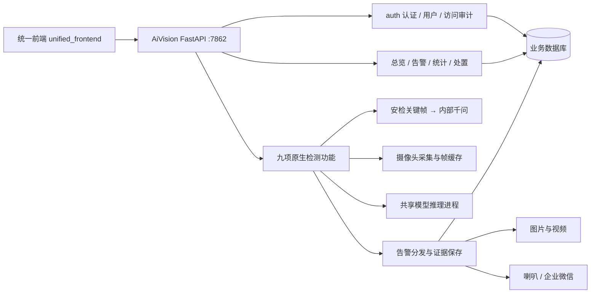
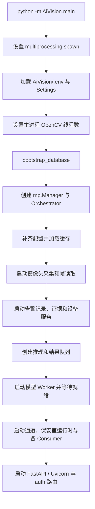
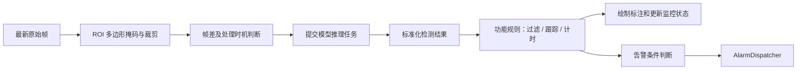

# AiVision：多摄像头视觉检测与告警后端

AiVision 是福达视觉平台唯一业务后端，负责摄像头采集、模型推理、九项原生检测功能、总览、告警、统计、处置和证据保存。它通过 FastAPI 直接向统一前端提供接口，并加载项目根目录的 `auth` 模块处理认证、账号和访问审计。

本文按当前源码整理（2026-09-20）。重点是**一帧图像如何变成检测结果和告警、各算法实际判定什么，以及模块之间如何协作**。文中的默认值来自代码声明；实际运行值以本机配置文件、数据库配置和运行状态接口为准。

## 目录

- [1. 系统定位与功能全景](#1-系统定位与功能全景)
- [2. 整体架构与目录职责](#2-整体架构与目录职责)
- [3. 启动流程与并发模型](#3-启动流程与并发模型)
- [4. 摄像头到检测结果的数据流](#4-摄像头到检测结果的数据流)
- [5. 功能注册、配置与热更新](#5-功能注册配置与热更新)
- [6. 模型推理与模型管理](#6-模型推理与模型管理)
- [7. 基础检测与通道算法](#7-基础检测与通道算法)
- [8. 告警分发、证据与媒体清理](#8-告警分发证据与媒体清理)
- [9. 保安行为与安检流程](#9-保安行为与安检流程)
- [10. 数据存储与权限边界](#10-数据存储与权限边界)
- [11. 环境准备与启动](#11-环境准备与启动)
- [12. API 导航](#12-api-导航)
- [13. 人脸库同步与特征生成](#13-人脸库同步与特征生成)
- [14. 验证、调参与故障定位](#14-验证调参与故障定位)
- [15. 开发扩展与源码阅读顺序](#15-开发扩展与源码阅读顺序)

## 1. 系统定位与功能全景

### 1.1 在整个项目中的位置



- **统一前端**负责配置页面、监控画面、状态和记录展示。
- **auth**负责认证、用户管理、密码修改和访问审计，路由挂载到 AiVision。
- **AiVision**提供唯一业务 API，负责总览、报警、统计和检测运行，默认监听 `7862` 端口。
- **保安室、安检**均为 `features/` 下的原生功能，共享摄像头、模型、数据库和报警链路。

平台级部署与其他服务关系见[项目根 README](../README.md)。

### 1.2 九项原生功能

Python 目录名用于组织代码，业务标识用于 API、数据库、缓存和前端查询。接入时应使用表中的业务标识。

| Python 功能目录 | `FeatureSpec.name` | 判定方法 | 模型依赖 |
| --- | --- | --- | --- |
| `features/intrusion/` | `blocks` | 人体框与警戒线的位置关系 | `yolo_human` |
| `features/door_state/` | `detect_door` | 图像差分与持续变化确认 | 无 |
| `features/face_dwell/` | `detect_face` | 人脸检测、跟踪与逗留计时 | `insightface_detection` |
| `features/person_dwell/` | `detect_human` | 人体检测、跟踪与逗留计时 | `yolo_human` |
| `features/phone_detection/` | `detect_phone` | 手机候选、人体关联与持续确认 | `yolo_phone`，人体关联时调用 `yolo_human` |
| `features/face_recognition/` | `recognize_face` | 人脸对齐、特征与底库相似度匹配 | `insightface` |
| `features/logistics_channel/` | `detect_logistics_single_person` | 单路人数检测与通道联合判定 | `yolo_human` |
| `features/guard_behavior/` | `guard_behavior` | 单路感知与保安室规则汇总 | 必需 `yolo_guard_person_phone`、`guard_uniform`；可选 `yolo_guard_pose`、`yolo_vehicle` |
| `features/security_inspection/` | `security_inspection` | 人员交互会话、关键帧与千问判定 | `yolo_human`，另通过 HTTP 调用千问 |

所有正式事业部均可使用上述功能，事业部用于数据归属和访问隔离。FeatureSpec 不再声明事业部白名单。人员逗留共用一套 `HumanConsumer`、Schema 和配置表；人脸身份识别提供独立识别记录，不触发普通违规告警。

保安行为与安检流程均在同一个注册表和 Orchestrator 下运行，共享平台摄像头、模型与告警设施；没有独立 Web 子应用。

## 2. 整体架构与目录职责

### 2.1 目录结构

```text
AiVision/
├── main.py                         # 正式启动入口
├── api/
│   ├── app.py                      # FastAPI、认证中间件和全部 API 路由
│   ├── deps.py                     # 运行对象和服务的依赖注入
│   └── routes/                     # 摄像头、功能、模型、告警、通道等 API
├── runtime/
│   ├── bootstrap.py                # 启动阶段 ORM 注册、建表与结构核验
│   ├── orchestrator.py             # 总编排、配置事件路由、运行状态聚合
│   ├── overview.py                 # 平台、能力、事业部和摄像头总览
│   └── process_cleanup.py          # 启动前残留进程清理
├── cameras/
│   ├── config_manager.py           # 摄像头数据库配置管理
│   ├── runtime_manager.py          # 采集进程启动、停止和运行管理
│   ├── runtime.py                  # 单路 FFmpeg 采集、共享内存写入
│   ├── frame_reader.py             # 共享内存读取、最新帧和更新时间
│   ├── probe.py                    # 视频源探测
│   └── orm.py                      # 摄像头 ORM
├── inference/
│   ├── model_registry.py           # 固定逻辑模型及 Worker 注册
│   ├── model_paths.py              # 本机 YAML 路径读取、校验、保存
│   ├── runtime_manager.py          # 队列、共享 Worker、重载、看门狗
│   ├── base_worker.py              # 模型子进程、任务读取与结果路由
│   ├── contracts.py                # 推理任务结果状态契约
│   ├── insightface_detector.py     # InsightFace 检测和 GPU 模型加载
│   └── workers/                    # YOLO、人脸检测、人脸身份识别
├── features/
│   ├── registry.py                 # 九项功能唯一显式注册入口
│   ├── _shared/
│   │   ├── spec.py                 # FeatureSpec 元数据
│   │   ├── consumer.py             # 公共帧处理、推理调用和告警衔接
│   │   ├── dwell_consumer.py       # 人脸/人员共用逗留逻辑
│   │   ├── tracking.py             # IoU、中心距离、面积联合跟踪
│   │   ├── roi.py                  # 归一化 ROI 和警戒线契约
│   │   ├── config_manager.py       # 功能配置读写与事件发布
│   │   ├── orm.py                  # 配置 ORM 基类
│   │   ├── alarm_schema.py         # 普通检测告警配置契约
│   │   └── defaults.py             # 公共默认参数
│   ├── intrusion/                  # 区域入侵
│   ├── door_state/                 # 大门状态变化
│   ├── face_dwell/                 # 人脸逗留
│   ├── person_dwell/               # 人员逗留
│   ├── phone_detection/            # 手机使用检测
│   ├── face_recognition/           # 身份识别、识别记录
│   │   └── library/                # 人员同步、照片特征和内存索引
│   ├── logistics_channel/          # 通道配置、成员、快照、状态机和拼图
│   ├── guard_behavior/             # 保安室、感知、规则、成员和告警策略
│   └── security_inspection/        # 工位 ROI、会话、千问调度与历史
├── alarms/
│   ├── dispatcher.py              # 统一告警分发与冷却
│   ├── devices/                   # 喇叭配置、绑定、运行队列与心跳
│   ├── notifications/             # 企业微信、通知图片
│   ├── records/                   # 告警、MySQL 处置、异步写入与媒体引用
│   └── evidence/                  # 报警前后视频缓存与编码
├── departments/                   # 固定事业部目录和平台功能查询
├── core/                          # Settings、数据库、缓存、事件、日志等
├── connectors/hikvision/           # 海康签名、HTTP 客户端与人员协议
├── config/model_paths.example.yaml
├── migrations/                    # 显式离线迁移
├── .env.example                   # 主服务环境变量模板
├── requirements.txt               # 主服务基础依赖
└── pyproject.toml                  # Python 版本、依赖和 Ruff 配置
```

### 2.2 各层如何分工

| 层次 | 主要职责 | 典型入口 |
| --- | --- | --- |
| HTTP 接口层 | 参数验证、鉴权、调用业务服务、组织响应 | `api/routes/`、`../auth/api.py` |
| 配置与持久化层 | 配置读写、事务、事业部约束、设备绑定 | 各模块的 `service.py`、`config_manager.py`、`orm.py` |
| 运行编排层 | 把摄像头、模型、Consumer 和告警模块组装起来 | `runtime/orchestrator.py` |
| 图像采集层 | 解码、发布最新帧、维护采集进程 | `cameras/` |
| 模型推理层 | 加载模型、执行推理、返回标准检测结果 | `inference/` |
| 检测业务层 | ROI、过滤、跟踪、计时、状态机、是否违规 | `features/` |
| 告警与证据层 | 冷却、数据库记录、喇叭、企微、截图和视频 | `alarms/` |

模型只回答“图像里检测到了什么”。Consumer 根据业务规则回答“是否满足违规条件”。分发器再决定“这次告警是否达到冷却条件，发送到哪些渠道”。这三步分开，便于复用模型并单独测试判定规则。

## 3. 启动流程与并发模型

### 3.1 正式启动顺序

入口：[main.py](main.py)，编排：[runtime/orchestrator.py](runtime/orchestrator.py)。



关键行为：

1. 主入口按源码位置加载 `AiVision/.env`，已注入进程的环境变量优先；Settings 只读进程环境和默认值，不扫描当前工作目录的旧 `.env`。
2. `bootstrap_database()` 集中导入 ORM，创建缺失表，核验功能配置、物流、保安室、人脸底库、安检会话、认证、审计和处置等表结构。
3. 主启动会先准备业务运行资源，再启动 HTTP 服务。模型等待时间会影响端口开始响应的时间。
4. 摄像头按总开关和功能启用关系启动；启动时还会整理共享内存名称、补齐默认功能配置。
5. 模型运行管理器按注册模型建立物理 Worker 分组；并非只为当前开启的摄像头临时加载一个模型。
6. 保安行为通过专用运行时汇总摄像头快照；安检 Consumer 管理千问调度线程。各功能依照配置和模型就绪情况参与检测。
7. `SIGINT`、`SIGTERM` 和主循环退出会进入资源清理，停止 Consumer、运行时、模型、告警服务、采集及共享管理器。

`bootstrap_database()` 的职责是准备数据库结构；业务采集与推理由 Orchestrator 启动。已有业务字段转换和历史数据合并通过离线迁移完成，主启动不会代替迁移脚本修改这些业务语义。

### 3.2 进程和线程如何组织

九项功能共用采集和模型推理流水线；保安室、物流通道有独立的汇总调度，安检另有千问请求和健康检查线程。

| 执行单元 | 数量/粒度 | 作用 |
| --- | --- | --- |
| 主 Python 进程 | 一个 | FastAPI、Orchestrator、配置、Consumer 和后台服务 |
| `multiprocessing.Manager` 服务进程 | 一个 | 提供跨进程共享管理能力 |
| 摄像头采集进程 | 每路启用摄像头一个 | 管理该路 FFmpeg，写入共享内存 |
| FFmpeg 子进程 | 每路采集对应一个 | 解码 RTSP，输出 BGR 原始帧 |
| 帧读取线程 | 每路已注册摄像头一个 | 把共享内存中的新帧复制到主进程缓存 |
| 模型 Worker 进程 | 每组可共享物理模型一个 | 加载权重并轮询逻辑模型队列 |
| Consumer 线程 | 每个成功启动的功能一个 | 遍历该功能已启用的摄像头并执行检测 |
| 后台服务线程 | 按模块创建 | 通道/保安室评估、千问调度与健康检查、模型监控、写入、视频编码和通知 |

同一功能的 Consumer 在一个线程中依次处理多路摄像头，并同步等待当前推理结果。因此路数、模型耗时和超时等待会共同影响该功能的更新频率。

主进程持有唯一运行资源集合。部署应使用 `python -m AiVision.main`；单独运行 `uvicorn AiVision.api.app:app` 不会执行主入口里的数据库 bootstrap 和 Orchestrator 启动流程，也不应直接用多个 Web Worker 重复拥有同一批采集资源。

## 4. 摄像头到检测结果的数据流

### 4.1 从 RTSP 到最新帧

```text
RTSP 摄像头
  → ffprobe 探测分辨率
  → CameraRuntime 启动 FFmpeg，按配置输出 BGR24 原始帧
  → 采集进程进行大幅帧差过滤
  → 双缓冲共享内存：<shm_name>_0 / <shm_name>_1
  → 更新 active_index 和 frame_seq
  → FrameReaderRegistry 读取新序号、复制有效帧
  → latest_frames / latest_frame_times / latest_frame_seq
```

- 写入端交替使用两个共享内存缓冲区；读取端复制前后检查序号和缓冲索引，遇到发布切换则放弃本次读取。
- `latest_frames` 保存最新图像，发布后的 NumPy 数组设为只读；绘制标注时另行复制。
- 帧读取线程只在采集序号变化时更新时间，避免把反复读取同一张图误认为摄像头持续产生新帧。
- 采集端的大幅帧差过滤是异常图像过滤手段。默认变化比例阈值为 `0.7`，不能把它等同于精确的花屏分类器。
- FFmpeg 流中断会按重启窗口和次数限制重试；超出限制后采集进程退出并报告运行异常。

### 4.2 从最新帧到业务结果

公共处理基类：[features/_shared/consumer.py](features/_shared/consumer.py)。



门状态检测直接在 ROI 上计算帧差，不提交模型任务。其他功能通过 `dispatch_inference_sync()` 调用模型。

### 4.3 ROI 坐标约定

ROI 是要检测的图像区域，配置字段为 `value.roi_pos`。

```json
{
  "roi_pos": [[0.1, 0.2], [0.8, 0.2], [0.8, 0.9], [0.1, 0.9]]
}
```

规则：

- 普通检测每路每项功能维护一个多边形 ROI；安检使用 `staff_rois` 保存多个命名工位，保安行为单独保存车辆 ROI。
- 坐标范围是 `[0, 1]`；`x` 对应图像宽，`y` 对应图像高。
- 空列表 `[]` 表示全帧；非空多边形至少三个点，面积必须大于零。
- 运行时将坐标映射到像素，取多边形外接矩形，再用掩码把矩形内、多边形外的像素置零。
- Worker 返回裁剪图内的坐标。绘制到原图、做警戒线判断或生成通道快照时，需要加回 ROI 左上角偏移。
- ROI 或帧尺寸变化会重建掩码；相关功能通过 `_on_roi_changed()` 清理背景、跟踪或候选状态。

配置和校验实现见 [roi.py](features/_shared/roi.py)。

### 4.4 处理频率和静止画面

公共层用低分辨率采样和高斯模糊判断帧变化，并缓存结果。各功能按自身采样策略处理静止画面，以维持站立人员检测、逗留计时和状态更新。

需要区分三个参数/频率：

| 名称 | 含义 |
| --- | --- |
| 摄像头 `fps` | 采集端希望输出的帧率 |
| 功能 `cap_interval` | Consumer 的处理间隔参数；公共层对静止画面用它判断是否再次处理 |
| 实际检测更新频率 | 同时受采集速度、帧变化、摄像头数、模型排队和推理耗时影响 |

公共基类对发生变化的画面可提前处理，`cap_interval` 不能统一理解为所有功能的严格限频器。人脸身份识别和安检通过 `_should_process_now()` 额外限制采样间隔；物流通道还受成员关系和通道检测时段约束。

### 4.5 前端看到什么

- `GET /api/cameras/{key}/frame.jpg`：读取原始帧，用于 ROI 等配置。
- 加上 `?feature=detect_phone` 等参数：只读取对应功能的标注帧。
- 原始帧当前使用 **10 秒**新鲜度窗口；功能标注帧使用 **2 秒**窗口。
- 指定功能但标注帧过期时，接口不会用原始帧冒充有效检测结果。
- 监控状态过期时返回 `reason=unknown`、人数/时长为空等状态。专门的状态快照目前由逗留、身份识别和物流等 Consumer 提供，其他功能不能仅凭“没有状态快照”判断为故障。

## 5. 功能注册、配置与热更新

### 5.1 FeatureSpec 是功能连接点

每个 `features/{package}/spec.py` 定义一个 `FeatureSpec`：

| 字段 | 用途 |
| --- | --- |
| `name` | 持久化业务标识 |
| `display_name` | 展示名称 |
| `consumer_cls` | 执行业务算法的 Consumer 类 |
| `orm_class` | 保存配置的数据库模型 |
| `config_schema` | 验证请求和配置的 Pydantic Schema |
| `required_models` | 功能运行必需的逻辑模型 |
| `optional_models` | 仅影响对应子规则的逻辑模型 |
| `alarm_types` | 该功能拥有的告警类型元组 |
| `model_names` | 必需与可选模型合并去重后的只读属性 |

[registry.py](features/registry.py) 显式导入九项 SPEC，并提供 `all_specs()`、`get_spec()`、`list_orm_classes()`。重复功能标识、非法/重复告警类型、跨功能重复拥有告警类型或 SPEC 导入失败会直接报错。功能包的 `__init__.py` 不承担扫描和自动注册职责。

### 5.2 配置分为三类

| 配置类别 | 保存位置 | 例子 | 生效方式 |
| --- | --- | --- | --- |
| 部署环境 | `AiVision/.env` / 进程环境 | 数据库、存储目录、API 端口、全局通知开关 | 通常重启后生效 |
| 本机模型路径 | `config/model_paths.yaml` | YOLO 权重、人脸检测文件、身份模型目录 | 模型路径 API 保存后后台重载 |
| 业务配置 | MySQL | 摄像头、ROI、阈值、通道、保安室、千问参数和设备绑定 | 对应管理接口保存并刷新运行时 |

普通检测配置的 HTTP 结构如下；`value` 的内容由各功能 Schema 定义：

```json
{
  "enable": true,
  "value": {
    "roi_pos": [],
    "CONF_THRESHOLD": 0.3,
    "MAX_TIME": 10.0
  },
  "alarm": {
    "sql": {"enable": true, "parm": {}},
    "horn": {"enable": false, "parm": {}},
    "wechat": {"enable": false, "parm": {"user": ""}}
  }
}
```

上例对应人员逗留配置的部分字段，省略项由 Schema 默认值补齐。`PUT` 保存采用完整配置校验和写入语义，不能当作只改一个字段的 `PATCH`；实际编辑时应先读取配置，保留其他字段后再保存。

物流通道把人数置信度、检测时段、无人/多人容忍时间、NMS 阈值、几何过滤、采样间隔和告警渠道统一保存在通道层；成员摄像头的检测配置只保留 ROI，通过专用 `/roi` 接口读写。人脸身份识别的普通告警渠道固定关闭。

### 5.3 热更新链路

```text
HTTP 保存请求
  → 对应 Schema 校验
  → 数据库事务与业务约束检查
  → 提交事务
  → config_cache 刷新
  → ConfigEventBus 发布 ConfigChangeEvent
  → Orchestrator 路由到摄像头、Consumer 或通道运行时
  → 更新运行配置和必要的缓存/状态
```

`ConfigEventBus` 是主进程内的同步回调总线，支持精确、前缀及通配订阅。它不是跨进程消息中间件；模型进程接收的是推理任务中携带的参数。

摄像头、通道和保安室必须属于正式事业部，成员关系需保持事业部一致。保安室接口在事务提交后显式刷新运行时；千问设置保存后重新配置调度器，并取消旧设置下排队的判定。

## 6. 模型推理与模型管理

### 6.1 当前注册的逻辑模型

来源：[model_registry.py](inference/model_registry.py)。

| 模型名 | Worker | 输出类型 | 权重路径要求 |
| --- | --- | --- | --- |
| `yolo_human` | `YoloDetectorWorker` | `person`，过滤类别 `0` | 本地 YOLO 权重文件 |
| `yolo_phone` | `YoloDetectorWorker` | `phone`，过滤类别 `1` | 本地 YOLO 权重文件 |
| `insightface_detection` | `FaceDetectorWorker` | `face` | `det_10g.onnx` 检测文件 |
| `insightface` | `FaceRecognizerWorker` | `face_identity` | 本地完整 `buffalo_l` 目录 |
| `yolo_guard_person_phone` | `YoloDetectorWorker` | `guard_object`，类别 `0/1` | 人体/手机权重 |
| `guard_uniform` | `UniformClassifierWorker` | `uniform` | 制服分类权重 |
| `yolo_guard_pose` | `YoloPoseWorker` | `pose` | 姿态模型 |
| `yolo_vehicle` | `YoloDetectorWorker` | `vehicle`，过滤类别 `1/2/3` | 车辆检测权重 |

人体/手机权重约定 `0=person`、`1=phone`；车辆模型使用自身的类别映射。换权重时必须检查对应模型的类别，不能把同一数字跨权重解释为同一对象。千问不在本地模型 Worker 注册表中，通过安检设置和 HTTP 客户端管理。

### 6.2 一份权重如何共享

`InferenceRuntimeManager` 按 **Worker 类 + 文件设备号 + inode** 分组。两个逻辑模型指向同一物理文件且 Worker 类型相同时，可共用一个模型进程。

例如 `yolo_human` 和 `yolo_phone` 指向同一个 `person_phone.pt`：

```text
yolo_human 输入队列 ─┐
                    ├→ 一个 YoloDetectorWorker / 一份模型实例
 yolo_phone 输入队列 ─┘       → 按任务 model_name 过滤类别和标记类型
                             → 按 function_name 返回对应功能结果队列
```

共享的是模型实例及进程资源。人员和手机任务仍分别调用 `predict()`，当前没有把两项业务请求自动合并为一次推理，也没有跨功能的检测结果缓存。

纯人脸检测与身份识别使用不同 Worker。即使身份识别目录中也有 `det_10g.onnx`，两者仍有独立模型实例。

### 6.3 任务和结果协议

- 每个逻辑模型一个输入队列，每个功能一个结果队列，当前队列容量均为 `10`。
- Worker 轮询自己负责的逻辑模型队列，加载成功并设置 ready 标志后才算运行就绪。
- Consumer 按 `request_id`、摄像头、功能和 ROI 标识匹配结果，避免迟到结果被用于下一次请求。
- 通用等待超时为 `0.8` 秒；具体调用可以覆盖，例如入侵检测使用 `1.0` 秒。
- 共享内存用于**采集进程到主进程**的帧传递；主功能流水线提交推理时，ROI 数组仍放在多进程 Queue 任务中，存在序列化和复制成本。

典型结果结构：

```json
{
  "request_id": "detect_human:12:example",
  "model_name": "yolo_human",
  "function_name": "detect_human",
  "camera_id": 12,
  "roi_id": 0,
  "status": "ok",
  "error_code": null,
  "error_message": null,
  "inference_ms": 18.2,
  "detections": [
    {"bbox": [20.0, 30.0, 100.0, 210.0], "confidence": 0.92, "class_id": 0, "type": "person"}
  ]
}
```

| `status` | 含义 |
| --- | --- |
| `ok` | 推理成功；`detections=[]` 表示成功观察到没有目标 |
| `error` | 模型执行或结果契约异常 |
| `dropped` | 输入队列已满，本次任务未入队 |
| `timeout` | 在等待窗口内没有取得匹配结果 |
| `unavailable` | 请求的模型没有对应输入队列 |

模型有队列但 Worker 异常时，也可能表现为 `timeout`。故障状态与正常空检测含义不同，逗留和物流功能对此有明确分支处理。

### 6.4 模型路径配置与重载

```yaml
models:
  yolo_human:
    path: /path/to/person_phone.pt
  yolo_phone:
    path: /path/to/person_phone.pt
  yolo_guard_person_phone:
    path: /path/to/person_phone.pt
  guard_uniform:
    path: /path/to/uniform_classes.pt
  yolo_guard_pose:
    path: /path/to/yolo11n-pose.engine
  yolo_vehicle:
    path: /path/to/yolo11n.pt
  insightface_detection:
    path: /srv/models/insightface/buffalo_l/det_10g.onnx
  insightface:
    path: /srv/models/insightface/buffalo_l
```

`MODEL_PATHS_CONFIG` 默认是 `config/model_paths.yaml`，相对路径以 **AiVision 目录**为基准。模型身份、Worker 类、类别过滤及默认推理参数在代码中固定注册，YAML 只配置本机模型路径。

YAML 中每个模型的 `path` 必须是当前服务器上的绝对路径，指向可读、非空的模型文件或满足校验要求的模型目录。配置文件自身可使用相对路径，与模型权重路径的规则不同。

管理员调用 `PATCH /api/models/{model_name}/path` 后：

1. 校验模型名及本机路径，保留 YAML 注释并原子保存，清除路径缓存。
2. 返回 HTTP `202` 和 `configuration_saved=true`。
3. 运行中的服务在后台重载受影响的物理 Worker/逻辑模型组，保留 Consumer 原有队列引用。
4. 通过 `GET /api/models` 观察 `reload.status` 的 `loading/succeeded/failed` 和真实 `runtime` 状态。
5. 运行时未启动则报告 `not_started`；重载期间再次提交路径修改会被拒绝。

“配置已保存”只代表配置写入完成。是否加载成功，需要继续看运行状态。模型路径不再从旧 `ai_model` 表读取，启动也不负责删除该历史表。

### 6.5 自动恢复与可观测性

模型看门狗检查 Worker 是否存活、是否就绪及是否加载失败，按退避时间重启；默认最多连续尝试 `3` 次。稳定运行达到重置时间后可恢复重试额度。

Consumer 统计各摄像头/模型的推理结果、连续失败次数及最近状态。默认连续失败 `3` 次达到异常通知条件，通知冷却 `300` 秒。运行状态可通过 `/api/runtime/status` 和 `/api/models` 查看。

## 7. 基础检测与通道算法

### 7.1 区域入侵：`blocks`

源码：[intrusion/consumer.py](features/intrusion/consumer.py)、[intrusion/schema.py](features/intrusion/schema.py)。

**目标：检测警戒线指定一侧是否有人。**

处理步骤：

1. 对 ROI 运行 `yolo_human`，取得人体框。
2. 将检测框坐标还原到原图。
3. 从人体框计算接近脚底的参考点：

   ```text
   Px = (x1 + x2) / 2
   Py = y1 + (y2 - y1) × foot_ratio
   ```

4. 将归一化警戒线端点转换到原图坐标。设有向线为 A → B，用叉积判断 P 位于哪一侧：

   ```text
   side = (Bx - Ax) × (Py - Ay) - (By - Ay) × (Px - Ax)
   ```

5. `alarm_side >= 0` 时，`side >= 0` 属于报警侧；反向时使用 `side <= 0`。边界在线上的点也计入报警侧。
6. 任一人体参考点满足条件即产生本帧违规候选，之后由统一告警冷却控制分发。

关键参数：`threshold` 默认 `0.1`，`foot_ratio` 默认 `0.93`，以及 `line_points`、`alarm_side`。

**语义边界：**当前实现不要求观察到人员从另一侧跨过线，也不计算进出方向或通行人数。线的两个端点定义的是方向和分界，侧别判定作用于该直线；ROI 用于进一步限定实际检测范围。未配置警戒线时不产生此规则的入侵判定。

### 7.2 大门开关检测：`detect_door`

源码：[door_state/consumer.py](features/door_state/consumer.py)、[door_state/schema.py](features/door_state/schema.py)。

**目标：检测门所在 ROI 是否持续偏离参考画面。**实现使用图像差分，不依赖门类别模型。

维护四类状态：上一张处理灰度图、参考背景、连续变化候选、首次告警计时。

算法步骤：

1. 使用公共层缓存的模糊 ROI 转灰度；第一张有效图像建立上一帧和背景，本次不告警。
2. 同时计算两种差分：

   ```text
   短期运动比例 = 灰度差超过 diff_threshold_env 的像素数 / 裁剪图总像素数
   背景变化比例 = 灰度差超过 diff_threshold 的像素数 / 裁剪图总像素数
   ```

3. 若短期运动比例大于 `global_motion_threshold`，或开启了 `env_threshold` 且背景变化比例超过它，则本次视为不稳定，清除连续候选，保留参考背景。
4. 稳定时，背景变化比例必须同时达到 `threshold` 和 `min_local_change_ratio`。
5. 连续满足条件至少 `stable_confirm_seconds`，并达到 `stable_confirm_hits` 次，才确认持续变化。条件中断则清零。
6. 稳定且没有达到变化条件时，用 `background_update_alpha` 缓慢更新背景；有变化候选时暂停背景更新。
7. 确认变化后，再连续保持 `first_alarm` 秒才允许首次告警；持续异常之后按分发器冷却控制重复告警。
8. 状态恢复时，连续确认和首次报警计时重置。

| 参数 | 默认值 | 作用 |
| --- | --- | --- |
| `diff_threshold` | `5` | 与参考背景比较的灰度差阈值 |
| `diff_threshold_env` | `10` | 与上一处理图比较的灰度差阈值 |
| `threshold` | `0.5` | 背景变化比例下限 |
| `min_local_change_ratio` | `0.01` | 另一变化比例下限，两者同时满足 |
| `global_motion_threshold` | `0.22` | 短期运动比例上限 |
| `env_threshold` | `null` | 关闭背景变化比例上限过滤 |
| `stable_confirm_seconds` / `stable_confirm_hits` | `1.0` 秒 / `3` 次 | 持续变化确认 |
| `background_update_alpha` | `0.05` | 更新时当前画面占 5%，旧背景占 95% |
| `first_alarm` | `60` 秒 | 确认变化后的首次告警等待 |
| `alarm_interval` | `5.0` 秒 | 统一分发冷却 |

默认流程是“先至少 1 秒且 3 次确认，再等待 60 秒”，两段计时分别执行。黄色 ROI 提示表示变化已确认，实际通知还受首次告警等待和渠道配置约束。

**使用边界：**参考图像从初次处理画面建立，部署时应让摄像头观察预期正常门状态。光照、阴影、遮挡和摄像头移动都会影响差分；统计分母是 ROI 外接矩形裁剪图的总像素数，因此多边形形状也影响变化比例。

### 7.3 人脸逗留：`detect_face`

源码：[face_dwell/consumer.py](features/face_dwell/consumer.py)、[dwell_consumer.py](features/_shared/dwell_consumer.py)。

**目标：同一条人脸轨迹在 ROI 中持续出现达到指定时间。**

- `FaceDetectorWorker` 使用本地 InsightFace 检测模型，只输出人脸框及置信度，不查询人员底库。
- 检测输入按 `640 × 640` 尺寸准备，缩放、补边、坐标还原由检测实现处理。
- 每项任务设置自己的检测置信度和 NMS 阈值，避免不同摄像头沿用前一项任务的阈值。
- 检测框交给公共逗留跟踪器，当前可见轨迹达到 `MAX_TIME` 后标记为逗留。

默认参数：`FACE_SCORE_THR=0.6`、`DETECTION_IOU_THR=0.3`、`TRACK_IOU_THR=0.3`、`MAX_LOST=5`、`MAX_TIME=10.0` 秒。

人脸逗留回答“这个位置上的人脸是否停留过久”；身份信息由 `recognize_face` 单独处理。

### 7.4 人员逗留：`detect_human`

源码：[person_dwell/consumer.py](features/person_dwell/consumer.py)、[tracking.py](features/_shared/tracking.py)。

**目标：同一条人体轨迹在 ROI 中停留达到阈值。**

人体检测采用 `yolo_human`，先做最小框面积和宽高比过滤，再复用与人脸相同的跟踪和计时流程。各事业部使用相同算法，状态按摄像头隔离。

默认检测参数：`CONF_THRESHOLD=0.3`、`DETECTION_IOU_THR=0.3`、`MIN_BOX_AREA=0`、`ASPECT_RATIO_RANGE=[0.0, 10.0]`、`MAX_TIME=10.0` 秒。

#### 人脸与人员共用的目标跟踪

跟踪器采用轻量几何关联，没有人员外观 ReID 特征，也没有跨摄像头身份追踪。

对每个旧轨迹框和当前检测框计算：

```text
IoU = 交集面积 / 并集面积
面积相似度 = min(旧框面积, 新框面积) / max(旧框面积, 新框面积)
归一化中心距离 = 两个框中心的欧氏距离 / max(旧框宽, 旧框高, 1)
中心分数 = 1 - min(1, 归一化中心距离 / CENTER_DIST_THR)
匹配分数 = 0.55 × IoU + 0.30 × 中心分数 + 0.15 × 面积相似度
```

- IoU 低于 `TRACK_IOU_THR` 时，还要求中心足够近、面积相似度达到 `AREA_RATIO_THR`。
- 候选分数达到 `MATCH_SCORE_THR` 后，按分数从高到低做一对一贪心匹配。
- 匹配成功：更新框和中心位移，重置丢失次数。默认框平滑是 `旧框 × 0.3 + 新框 × 0.7`。
- 未匹配旧轨迹：丢失次数加一，按上一中心位移预测位置；`lost > MAX_LOST` 时删除。
- 未匹配检测框：建立新轨迹和首次观察时间。
- 当前告警只使用 `lost == 0` 的可见轨迹。轨迹一旦达到时长门槛，`alarmed` 保持到轨迹删除或相关状态重置。

默认跟踪参数：`TRACK_IOU_THR=0.3`、`CENTER_DIST_THR=0.65`、`AREA_RATIO_THR=0.55`、`MATCH_SCORE_THR=0.35`、`TRACK_SMOOTH_ALPHA=0.7`。

`DETECTION_IOU_THR` 控制同次检测的 NMS 去重，`TRACK_IOU_THR` 控制相邻观察之间的轨迹关联，两者作用不同。`MAX_LOST` 的单位是有效跟踪更新次数，不是秒。

#### 逗留时间与推理故障

`DwellObservationClock` 使用单调时钟构造有效观察时间轴，轨迹时长为该时间轴上的 `last_seen - first_seen`。

- 正常推理成功：推进观察时间；成功但检测为空时，跟踪器正常累计丢失次数。
- 推理失败、超时或检测结果损坏：暂停计时，保留轨迹，不把故障当成“人离开”。
- 恢复后的第一张成功结果：恢复观察基点，不把故障间隔补算进逗留时间。
- 短暂正常漏检后若仍匹配回原轨迹，保留原首次观察时间。
- 故障期间状态为 `unknown`，人数和时长为空，本次不提交逗留告警。

几何跟踪遇到严重遮挡、交叉、框变化或画面抖动可能换 ID；因此轨迹 ID 不能当作人员真实身份。

### 7.5 手机使用检测：`detect_phone`

源码：[phone_detection/consumer.py](features/phone_detection/consumer.py)、[phone_detection/schema.py](features/phone_detection/schema.py)。

**目标：持续检测到与人体位置关联的手机候选，减少孤立背景手机框误报。**

1. 在 ROI 上调用 `yolo_phone`，按手机置信度和 NMS 阈值检测。
2. 默认开启人体关联，另行调用 `yolo_human`。
3. 根据人体框构造一个向左右和顶部扩展、向下覆盖到指定高度比例的区域。
4. 手机中心落在该区域，或手机框与区域的交集占手机框面积达到阈值，才通过关联。
5. 手机框按 IoU 或归一化中心距离关联到已有候选轨迹。
6. 命中次数和持续时间同时达标时，候选被确认，生成本帧告警条件。
7. 两次命中间隔超过 `MAX_MISSED_SECONDS` 时重新累计；长时间不出现的候选按 TTL 清理。

| 参数 | 默认值 | 含义 |
| --- | --- | --- |
| `CONF_THRESHOLD` / `IOU_THR` | `0.7` / `0.5` | 手机检测置信度和 NMS |
| `REQUIRE_PERSON_ASSOCIATION` | `true` | 开启人体关联 |
| `PERSON_CONF_THRESHOLD` / `PERSON_IOU_THR` | `0.3` / `0.3` | 人体检测参数 |
| `PERSON_EXPAND_RATIO` | `0.18` | 人体关联区扩展比例 |
| `HAND_REGION_MAX_Y_RATIO` | `0.85` | 关联区下界相对于人体高度的位置 |
| `MIN_PERSON_PHONE_OVERLAP` | `0.08` | 手机框被关联区覆盖的最低比例 |
| `MIN_CONSECUTIVE_HITS` | `3` | 最少确认命中次数 |
| `MIN_CONFIRM_SECONDS` | `1.2` 秒 | 最短确认时间 |
| `MAX_MISSED_SECONDS` | `0.6` 秒 | 允许的命中间隔 |
| `TRACK_TTL_SECONDS` | `2.0` 秒 | 候选清理时间 |
| `TRACK_IOU_THRESHOLD` | `0.2` | 手机候选关联阈值 |

这里的“手部区域”是人体框推导的几何区域，不是手腕关键点检测。算法没有直接理解屏幕内容或人的操作意图，桌面手机靠近人体等情况仍需结合现场样本调参。

当前代码仅在人体输入队列存在时强制执行人体关联；关闭关联或缺少该队列会按手机候选继续判断。人体队列存在但推理失败时没有有效人体框，关联候选会受影响。手机候选计时实现与公共逗留时钟不同，不能套用逗留的故障暂停语义。

### 7.6 人脸身份识别：`recognize_face`

源码：[face_recognition/consumer.py](features/face_recognition/consumer.py)、[face_recognizer.py](inference/workers/face_recognizer.py)、[library/index.py](features/face_recognition/library/index.py)。

处理链路：

```text
ROI → SCRFD 人脸检测及关键点 → 人脸对齐 → 512 维特征
    → 特征归一化 → 与有效人员矩阵计算余弦相似度
    → 取最高分 → 达到阈值则匹配，否则显示未知人员
```

- 检测使用 `det_10g.onnx`，身份特征模型使用 `w600k_r50.onnx`。
- 本机路径校验要求完整 `buffalo_l` 目录，运行识别主要加载检测和识别模型。
- 人员索引只加载有效人员、模型名匹配、照片签名仍一致的特征。
- 索引保存归一化矩阵，使用 `matrix @ vector` 一次计算与所有已索引人员的相似度。
- 运行中的索引每 `60` 秒在推理时检查刷新；刷新失败会报告推理失败，等待后续刷新恢复。
- 无底库或最高相似度未达阈值时返回“未知人员”。

| 参数 | 默认值 |
| --- | --- |
| `detection_threshold` | `0.5` |
| `similarity_threshold` | `0.5` |
| `cap_interval` | `0.5` 秒 |
| `record_enabled` | `true` |
| `record_cooldown_seconds` | `30` 秒 |

相似度是特征向量的匹配分数，不是“身份正确概率”。识别效果受照片质量、拍摄角度、遮挡、光照和底库规模影响。

Consumer 更新结构化姓名、工号、相似度和全图框；图像主要画 ROI 和框，文字由前端展示。记录异步写入，已知人员按“摄像头 + 人员”冷却，同一帧同一人员保留最高分；未知人员按摄像头单独冷却。

### 7.7 物流通道单人检测：`detect_logistics_single_person`

源码：[consumer.py](features/logistics_channel/consumer.py)、[state.py](features/logistics_channel/state.py)、[runtime.py](features/logistics_channel/runtime.py)、[compositor.py](features/logistics_channel/compositor.py)。

**目标：多台摄像头共同观察一条物流通道，判断持续无人或某一路持续出现多人。**

#### 两层职责

1. **摄像头 Consumer**：人体检测、面积/宽高比过滤、坐标还原、同画面检测框去重，发布 `CameraSnapshot`。
2. **LogisticsChannelRuntime**：读取通道成员、检测时段、阈值和各路快照，计算通道状态、异常时长、告警和拼图。

单路 Consumer 不直接发人数告警。通道运行时通过依赖注入提供给 Consumer，缺少运行时不能启动此功能。

#### 联合判定规则

先检查通道是否处于启用时段、是否配置成员；对参与判定的摄像头检查在线状态、快照时间和人数有效性，再按下表优先级判断：

| 情况 | 通道状态 | 说明 |
| --- | --- | --- |
| 通道停用或不在检测时段 | `inactive` | 不进行人数告警 |
| 没有参与判定的成员 | `unconfigured` | 无可用通道成员 |
| 任一有效摄像头人数 ≥ 2 | `multiple` | 优先于单人和未知状态 |
| 没有多人，至少一路有效人数为 1 | `normal` | 即使另一路为未知，也判正常 |
| 没有多人、单人证据，但存在无效/过期快照 | `unknown` | 不能确认所有位置无人 |
| 所有参与判定的快照有效且均为 0 | `empty` | 可以确认通道全无人 |

例子：`[1, 1] → normal`，`[2, 0] → multiple`，`[0, unknown] → unknown`，`[1, unknown] → normal`。

**人数不会跨摄像头直接相加。**同一人可能被两路看到，而当前没有跨摄像头人员身份去重。因此两路各看到一个人被定义为正常，无法据此保证物理空间中一定只有一个唯一人员。

#### 时间状态机与告警

- 默认检测时段 `08:00–20:00`，按服务本地时间判断；Schema 要求开始时间早于结束时间，不支持跨午夜区间。
- `empty` 连续达到默认 `2.0` 秒，或 `multiple` 连续达到默认 `1.0` 秒，才满足告警条件。
- `empty` 与 `multiple` 切换重新计时；恢复正常、未知、停用或未配置时重置异常计时。
- 快照默认超过 `5.0` 秒视为过期，由 `LOGISTICS_STATUS_STALE_SECONDS` 控制。
- 相同持续异常分发成功后，运行时记住当前事件，**不会在每轮评估或每个冷却周期重复发同一持续事件**。状态恢复、变化或相关运行状态重置后才形成下一事件；统一分发器仍有冷却约束。
- 告警主体为 `logistics_channel`，记录通道、事业部、各摄像头人数/状态、触发原因和违规摄像头 ID。
- 通道最多 `9` 台摄像头；拼图由独立 compositor 生成，缺失、离线和未知画面有对应状态表达。

通道默认人数置信度 `0.3`、`model_iou_threshold=0.3`、`cap_interval=0.2` 秒，检测策略对成员统一生效。同画面附加去重的 IoU 阈值为 `0.5`。

## 8. 告警分发、证据与媒体清理

### 8.1 告警流水线

```text
Consumer / 通道状态机满足规则
  → 构造 AlarmRequest，确定功能、事业部和主体
  → AlarmDispatcher.maybe_dispatch() 检查冷却
  → 按配置分别处理：
      ├─ 喇叭设备播放队列
      ├─ 图片与告警数据库记录
      ├─ 报警前后视频任务
      └─ 企业微信发送队列
```

[dispatcher.py](alarms/dispatcher.py) 的冷却键为：

```text
(cooldown_subject_type, cooldown_subject_id, violation_type)
```

普通检测按摄像头冷却，物流按通道，保安行为按保安室和告警类型。安检持久化主体仍为摄像头，冷却主体使用 `security_inspection_roi`，ID 为 `camera_id:roi_name`，避免不同工位相互抑制。冷却时间在分发尝试时登记，业务上的“已触发”不代表所有外部渠道都已成功送达。

### 8.2 告警记录和身份

当前主告警 ORM 是 `AiAlarmEvent`，沿用表名 `ai_violation_image`，记录内容已经包括完整事件信息：

- 违规类型、功能标识、事业部。
- 主体类型、主体 ID、主体名称快照；摄像头主体还保存 `camera_no`。
- 原因 `reason` 和结构化 `event_metadata`。
- 图片路径、视频路径、视频状态和创建时间。

业务告警类型：入侵 `1`、门状态 `2`、手机 `3`、人脸逗留 `4`、人员逗留 `5`、物流通道 `6`、保安离岗/手机/趴睡/车辆检查 `8–11`、安检不合规 `12`。类型表还定义身份识别 `7`，但识别 Consumer 使用独立记录流程。记录写入检查类型、功能、事业部与主体身份。

普通配置可以分别开启数据库、喇叭和企微。**企微通知需要持久化记录用于卡片跳转**，因此开启有效企微通知时，即使普通 SQL 渠道关闭，也会保存相应事件。识别记录使用单独的记录流程。

### 8.3 视频证据

[evidence_recorder.py](alarms/evidence/evidence_recorder.py) 维护滚动帧缓存，触发时取已有前置帧，再收集后置帧，异步编码 MP4。

| 设置 | 默认值 |
| --- | --- |
| `ALARM_CLIP_ENABLED` | `true` |
| `ALARM_CLIP_PRE_SECONDS` | `10.0` 秒 |
| `ALARM_CLIP_POST_SECONDS` | `10.0` 秒 |
| `ALARM_CLIP_FPS` | `5.0` |
| `ALARM_CLIP_MAX_WIDTH` | `960` |
| `ALARM_CLIP_WORKERS` | `2`，上限也是 2 |
| `ALARM_CLIP_MAX_TASKS` | `32` |

视频经历 `pending → ready/failed`，由回调更新记录。启动时间较短、摄像头断流或缓存不足时，实际片段可能短于配置的前后时长；任务满或编码失败时应查看视频状态和日志。

该功能保存报警证据片段，不能作为全天连续录像存储使用。物流证据使用通道画面；安检告警采用 `snapshot` 模式，保存已结束 session 的关键帧拼图，不使用模型返回时的实时帧代替证据。

### 8.4 后台写入、通知和清理

- `AsyncViolationWriter` 负责图片/记录保存、批量处理、数据库重试和相关清理；企微卡片需要记录时走即时保存入口。
- 喇叭通过设备 ID 和语音任务 ID 绑定，运行管理器处理播放队列、心跳、冷却和设备配置变化。
- 企业微信在独立线程中发送；通知图片和公开缩略图由专门模块处理。
- 媒体清理按保留时间和容量控制，主配置默认 `7` 天、`10 GB`、每 `60` 分钟检查。告警和识别图片通过媒体引用接口协调清理。
- API、摄像头、Worker 和 Consumer 的运行异常有独立异常通知配置，不等同于检测业务告警。

## 9. 保安行为与安检流程

### 9.1 保安行为：`guard_behavior`

源码：[consumer.py](features/guard_behavior/consumer.py)、[runtime.py](features/guard_behavior/runtime.py)、[site_rules.py](features/guard_behavior/site_rules.py)。

```text
平台最新帧 → 人体/手机检测 → ByteTrack → 制服分类与身份保持
           → 手机关联、姿态、车辆感知 → GuardCameraSnapshot
           → 保安室成员快照汇总 → 规则状态 → 统一告警 / 拼图
```

- 保安室（Site）保存事业部、成员顺序、规则参数和各类告警策略，摄像头本体复用 `ai_camera_config`。
- `yolo_guard_person_phone` 和 `guard_uniform` 是必需模型；姿态和车辆模型是可选依赖，缺失时影响对应子规则的可用性。
- 规则覆盖离岗、玩手机、趴睡和车辆出厂检查异常，分别维护状态并使用告警类型 `8–11`。
- 规则同时考虑成员是否启用、摄像头是否在线、模型就绪和快照是否有效。不可用或未知不能直接当作“无人”。
- 制服识别、跟踪保持、手机关联与姿态质量共同影响行为判断；其规则和阈值不等同于普通 `detect_phone`。
- 当前画面用灰色框表示非保安人员，具体标注在 Consumer 中生成。
- 配置保存在 MySQL，由 `/api/guard-behavior/sites/...` 管理；事务保存后刷新运行对象。若返回“配置已保存，但运行时刷新失败”，应重新读取配置和日志再处理。

相关文件：`schema.py/orm.py/service.py` 管配置与事务，`behavior.py` 管单路行为，`site_rules.py` 管多路规则，`vehicle_episode.py` 管车辆事件。旧独立 YAML、RTSPReader 和子应用生命周期已不属于当前链路。

### 9.2 安检流程：`security_inspection`

源码：[consumer.py](features/security_inspection/consumer.py)、[sessions.py](features/security_inspection/sessions.py)、[runtime.py](features/security_inspection/runtime.py)、[vlm.py](features/security_inspection/vlm.py)。

```text
平台最新帧 → 共享 yolo_human → 摄像头独立 ByteTrack
           → 命名工位 ROI → 双人交互 session → JPEG 关键帧
           → 按事业部/摄像头轮询的有界队列 → 千问 Chat Completions
           → 严格校验 verdict → MySQL session 历史
           → non_compliant 时提交统一告警与关键帧拼图
```

摄像头、开关、ROI、检测参数和告警配置复用公共 API。`staff_rois` 使用归一化坐标，单台摄像头最多 16 个工位，每个工位 3–64 个顶点；不同工位使用不同名称。配置更新、禁用、分辨率变化或推理失败时，会清理相关跟踪/会话，旧配置的异步结果不能继续产生新告警。

全局千问设置通过 `/api/security-inspection/settings` 存入数据库，主要默认值如下：

| 字段 | 默认值 |
| --- | --- |
| `base_url` | `http://127.0.0.1:18100/v1` |
| `model` | `fuda-qwen36-27b` |
| `api_timeout_sec` / `queue_timeout_sec` | `45` / `60` 秒 |
| `max_concurrent` / `queue_capacity` | `3` / `32` |
| `max_tokens` / `temperature` | `2048` / `0.1` |
| `image_max_side` / `image_jpeg_quality` | `960` / `85` |

可选认证通过环境变量 `SECURITY_VLM_API_KEY` 提供，模型地址不允许携带用户名或密码。内部千问服务需独立可用，项目启动脚本不启动它。

客户端先检查 `/models` 中是否存在配置的模型，再向 `/chat/completions` 提交关键帧和提示词。返回内容严格转换为 `InspectionVerdict`：

```json
{"compliant": false, "confidence": 0.95, "reason": "安检动作未覆盖要求区域"}
```

`compliant` 必须为布尔值，`confidence` 在 `[0, 1]` 内，`reason` 不得为空。解析器接受完整 JSON 代码块和空的 think 前缀，但不会从解释文本猜测结论；截断、拒绝、字段错误和非法 JSON 保留为错误。

`InspectionRuntime` 使用后台线程执行网络调用，按部门和摄像头轮询调度。健康检查默认每 30 秒运行；连续判定失败 3 次或健康检查失败会开启熔断，按 5–60 秒退避检查恢复。接口重新可达后进入半开状态，须一次真实判定成功才恢复正常并发。

历史状态为 `compliant`、`non_compliant`、`error`、`cancelled`。只有不合规结果触发类型 `12` 的业务告警，错误不会冒充不合规；各工位独立冷却。历史写入和网络请求均避免长时间占用摄像头状态锁。

安检没有独立采集进程、FrameHub、外部 Worker Python 或旧版预算配置；原生 Consumer 随 Orchestrator 管理，通过摄像头/功能开关决定是否产生检测任务。

## 10. 数据存储与权限边界

### 10.1 主模块存储

| 数据 | 存储/模块 | 说明 |
| --- | --- | --- |
| 摄像头 | `ai_camera_config` / `cameras/orm.py` | 视频源、名称、事业部、采集参数和总开关 |
| 各功能配置 | 各功能 `orm.py` | 按 `camera_id` 关联；算法参数、ROI 和功能启用状态 |
| 物流通道与成员 | `ai_logistics_channel`、`ai_logistics_channel_camera` | 通道配置、成员关系和排序 |
| 告警事件 | `ai_violation_image` | 功能/事业部/主体快照及证据引用 |
| 报警处置 | `ai_alarm_disposition` | 状态、备注、处理人及最近 20 次历史 |
| 用户与访问审计 | `auth_users`、`auth_access_viewers` | 项目根目录 `auth/` 模块，与业务共享 MySQL |
| 保安室 | `ai_guard_behavior_site`、`ai_guard_behavior_site_camera` 等 | Site、成员、规则和告警策略 |
| 安检会话 | `ai_security_inspection_session` | 合规、不合规、错误、取消及判定详情 |
| 喇叭设备 | `ai_horn_config` | 设备连接和运行配置 |
| 人员底库与特征 | `ai_face_person`、`ai_face_embedding` | 人员元数据、照片签名和 512 维特征 |
| 图片和视频 | `DATA_PATH` 及相关模块目录 | 数据库存引用，媒体文件落磁盘 |
| 最新帧、跟踪、计时和冷却 | 共享内存或主进程内存 | 运行状态，重启后重新建立 |
| 逻辑模型路径 | 本机 YAML | 不读写旧 `ai_model` 表 |

`core/db.py` 提供 SQLAlchemy Base、连接池、Session 和事务上下文。常驻池大小 `20`，允许临时额外连接 `10`，启用连接预检查。`core/schema.py` 提供结构核验工具；`core/cache.py` 缓存摄像头和功能配置，仍直接依赖这些业务模块。

### 10.2 事业部和鉴权

事业部代码来源：[department_registry.py](departments/department_registry.py)。

| 代码 | 名称 |
| --- | --- |
| `general_electric` | 通用电气事业部 |
| `electronics_electrician` | 电子电工事业部 |
| `electrical_components` | 电气部件事业部 |
| `research_institute` | 福达新材院 |
| `precious_metal_recycling` | 伟达子公司 |
| `haoda_company` | 皓达子公司 |
| `fulida_company` | 福力达子公司 |

全部正式事业部共用九项功能。认证由 [auth/auth.py](../auth/auth.py) 提供，路由在 [auth/api.py](../auth/api.py)，随 AiVision 注册。普通用户按授权事业部访问摄像头、告警和状态；管理员管理配置及账号；访问审计额外检查用户 capability。

报警处置读取/写入遵守报警访问权限，列表按主键游标分页，默认 50 条、最多 100 条，返回 `items` 和 `next_cursor`。处置更新锁定报警主记录，保存当前状态并保留最近 20 次历史。不能把全部写操作都理解为管理员专属。

`/api/runtime/health`、登录和登出是公开接口；`/api/public/alarms/...` 的通知图片需签名及有效期校验，其余告警媒体仍需登录和授权。`AUTH_SECRET` 由运行环境提供，运维脚本从 `scripts/auth_secret` 注入。

### 10.3 数据迁移边界

- 创建缺失表不代表自动修复所有旧表列结构；核验发现不兼容时应查看明确的迁移流程。
- [migrations/](migrations/) 包含配置结构、物流功能和人员逗留合并等离线脚本。
- 人员逗留合并说明见 [human_20260915.md](migrations/human_20260915.md)。
- 模型路径迁移后不再使用 `ai_model`，但升级不会自动 DROP 历史表。
- 源码和接口已统一，不能据此推断某个现场数据库已经完成迁移。

## 11. 环境准备与启动

### 11.1 运行前提

- 项目声明 Python `>=3.10,<3.12`，可使用现有 `aivision` 环境。
- 安装主依赖，准备可用的 MySQL、FFmpeg 和 ffprobe。
- 准备本地 YOLO、制服、姿态和 InsightFace 模型；使用安检时准备可访问的内部千问服务。
- `DATA_PATH` 必须可写；部署系统需要支持当前采集代码使用的进程和共享内存机制。

**人脸模型的运行要求：**当前 `load_insightface_model()` 明确要求 `CUDAExecutionProvider`，并关闭静默 CPU fallback。仅安装 CPU ONNX Runtime 不能满足当前人脸 Worker 的运行方式。

[pyproject.toml](pyproject.toml) 中列出 InsightFace、ONNX 和 CPU/GPU Runtime 的可选依赖及安装说明。GPU 环境应按服务器已有 PyTorch/CUDA/cuDNN 组合准备；该文件特别说明了 InsightFace 的 CPU Runtime 依赖与 GPU Runtime 替换问题，不宜直接一次安装 `face-gpu` extra 后就认定 GPU 配置完成。

### 11.2 安装依赖与准备模板

在项目根目录执行：

```bash
cd /usr/zyy/Fuda_CVPreject_V3
conda activate aivision

python -m pip install -r AiVision/requirements.txt

# -n 保留已经存在的本机配置。复制后仍需修改占位值。
cp -n AiVision/.env.example AiVision/.env
cp -n AiVision/config/model_paths.example.yaml AiVision/config/model_paths.yaml

ffmpeg -version
ffprobe -version
```

保安行为和安检使用同一个 Python 环境；千问客户端使用 `requests`，无需旧版 `dashscope` 或独立 Worker 解释器。上述基础安装命令不包含完整人脸 GPU 环境配置。ByteTrack 相关依赖当前固定为 `ultralytics==8.4.124` 和 `lap==0.5.13`，以依赖声明为准。

### 11.3 关键环境配置

完整字段见 [.env.example](.env.example) 和 [settings.py](core/settings.py)。

| 环境变量 | 用途/默认值 |
| --- | --- |
| `MYSQL_DB_URL/PORT/USER/PASSWORD/NAME/CHARSET` | 主业务数据库；`MYSQL_DB_URL` 是主机地址，完整连接串由 Settings 组装 |
| `AUTO_CREATE_DB` | 默认 `false`；显式开启时可尝试创建缺失数据库 |
| `DATA_PATH` | 必填，图片/视频等存储根目录 |
| `API_HOST` / `API_PORT` | `0.0.0.0` / `7862` |
| `MODEL_PATHS_CONFIG` | `config/model_paths.yaml`，相对 AiVision 目录 |
| `AUTH_SECRET` | 至少 32 字符的认证密钥；运维脚本注入 |
| `AUTH_TOKEN_EXPIRE_HOURS` | 登录有效期设置，模板为 `never` |
| `PLATFORM_OWNER_EMPLOYEE_ID` | 访问审计等能力的所有者账号配置 |
| `ACCESS_AUDIT_RETENTION_DAYS` | 访问审计保留天数，模板为 `90` |
| `SECURITY_VLM_API_KEY` | 内部千问接口需要认证时配置 |
| `OPENCV_NUM_THREADS` | 主进程 OpenCV 线程数，默认 `4` |
| `WECHAT_ENABLE` / `HORN_ENABLE` | 全局通知渠道开关；还需配置具体功能/通道及设备 |
| `WECHAT_CORP_ID/CORP_SECRET/AGENT_ID` | 企业微信配置 |
| `WECHAT_CARD_BASE_URL` | 通知卡片可访问的站点地址 |
| `MODEL_WORKER_READY_TIMEOUT` | 模型就绪等待，默认 `60` 秒 |
| `MODEL_WORKER_WATCHDOG_INTERVAL_SECONDS` | 看门狗检查间隔，默认 `5` 秒 |
| `LOGISTICS_STATUS_STALE_SECONDS` | 物流快照有效期，默认 `5` 秒 |

主启动会访问数据库并 bootstrap；`SQL_ENABLE=false` 不能当作“完整主服务无需数据库”的启动模式。

主入口和人脸库 CLI 按源码位置加载 `AiVision/.env`，已注入环境变量优先。Settings 不再从当前工作目录读取 `.env`，启动预检也只检查 `AiVision/.env` 或已注入配置。模板端口与代码、运维脚本、前端默认代理统一为 `7862`；数据库、存储和权重占位值仍需填写。

### 11.4 正式启动与状态检查

```bash
python -m AiVision.main
```

临时覆盖监听地址和端口：

```bash
python -m AiVision.main --host 127.0.0.1 --port 7863
```

默认地址：

- API：`http://127.0.0.1:7862`
- Swagger：`http://127.0.0.1:7862/docs`
- OpenAPI：`http://127.0.0.1:7862/openapi.json`

公开健康检查：

```bash
curl --fail --silent --show-error http://127.0.0.1:7862/api/runtime/health
```

健康响应中的 `ok` 表示“Orchestrator 已启动且至少一个逻辑模型就绪”，不等于所有模型、摄像头或千问接口都正常。确认完整运行状态还要查看 `/api/runtime/status`、`/api/models` 和各功能状态。

启动会使用实际摄像头、模型和通知配置。首次现场验证可先关闭业务通知渠道，确认画面、判定和归属后再开启所需渠道。

## 12. API 导航

以下均是 AiVision 直接提供的路径，统一前端通过 Vite `/api` 代理访问，无额外子系统前缀。字段和响应类型以对应路由和运行实例的 OpenAPI 为准。

### 12.1 运行、摄像头、功能与模型

| 方法 | 路径 | 用途 |
| --- | --- | --- |
| GET | `/api/runtime/health` | 公开健康检查 |
| GET | `/api/runtime/status` | 有权限的运行状态与推理统计 |
| GET / POST | `/api/cameras` | 列表 / 新建摄像头 |
| GET / PATCH / DELETE | `/api/cameras/{key}` | 读取 / 修改 / 删除摄像头 |
| GET | `/api/cameras/{key}/frame.jpg` | 原图；`feature` 参数选择功能标注图 |
| GET | `/api/features` | 功能元数据列表 |
| GET | `/api/features/{feature}` | 功能详情和配置元数据 |
| GET / PUT | `/api/features/{feature}/configs/{shm_name}` | 读取 / 保存功能配置 |
| GET | `/api/features/{feature}/cameras/{key}/status` | 摄像头功能监控状态 |
| GET | `/api/models` | 模型路径、加载和重载状态 |
| PATCH | `/api/models/{model_name}/path` | 保存模型路径并请求后台重载 |
| GET | `/api/departments` | 事业部列表 |
| GET | `/api/departments/{name}/features` | 事业部可用功能 |

### 12.2 告警、设备和身份识别

| 方法 | 路径 | 用途 |
| --- | --- | --- |
| GET | `/api/alarms` | 告警列表 |
| GET | `/api/alarms/{alarm_id}` | 告警详情 |
| GET | `/api/alarms/{alarm_id}/image` | 告警图片 |
| GET | `/api/alarms/{alarm_id}/video` | 告警视频 |
| GET | `/api/alarms/statistics/summary` | 告警统计 |
| GET / POST | `/api/alarm-dispositions` | 游标分页读取 / 更新处置 |
| GET | `/api/alarm-dispositions/{alarm_id}` | 单条处置及历史 |
| GET / PUT | `/api/exception-alert` | 系统异常通知配置 |
| GET / POST | `/api/horns` | 喇叭列表 / 新建 |
| GET / PATCH / DELETE | `/api/horns/{horn_id}` | 喇叭详情 / 修改 / 删除 |
| POST | `/api/horns/test-connection` | 设备连接测试 |
| GET | `/api/horns/{horn_id}/status` | 喇叭运行状态 |
| GET | `/api/face-recognition/records` | 身份识别记录 |
| GET | `/api/face-recognition/records/{record_id}/image` | 识别图片 |

### 12.3 物流通道

下表 `{feature}` 使用 `detect_logistics_single_person`。

| 方法 | 路径 | 用途 |
| --- | --- | --- |
| GET | `/api/logistics-channels/inventory` | 摄像头资源与通道归属 |
| GET / POST | `/api/logistics-channels/{feature}` | 通道列表 / 创建 |
| GET / PATCH / DELETE | `/api/logistics-channels/{feature}/{channel_id}` | 详情 / 修改 / 删除 |
| POST | `/api/logistics-channels/{feature}/{channel_id}/cameras` | 添加现有或新摄像头成员 |
| PUT | `/api/logistics-channels/{feature}/{channel_id}/cameras/order` | 成员排序 |
| PUT / DELETE | `/api/logistics-channels/{feature}/{channel_id}/cameras/{camera_id}` | 修改 / 移除成员 |
| PUT | `/api/logistics-channels/{feature}/{channel_id}/cameras/{camera_id}/enabled` | 修改成员启用状态 |
| GET / PUT | `/api/logistics-channels/{feature}/{channel_id}/cameras/{camera_id}/roi` | 成员 ROI |
| GET | `/api/logistics-channels/{feature}/{channel_id}/status` | 通道实时状态 |
| GET | `/api/logistics-channels/{feature}/{channel_id}/frame.jpg` | 通道拼接画面 |
| GET | `/api/logistics-channels/{feature}/{channel_id}/alarms` | 通道告警 |
| GET | `/api/logistics-channels/{feature}/{channel_id}/statistics` | 通道统计 |

### 12.4 保安行为、安检与平台管理

保安室接口前缀为 `/api/guard-behavior/sites`：

| 方法 | 后缀 | 用途 |
| --- | --- | --- |
| GET / POST | 无 | 列表 / 创建保安室 |
| GET / PATCH / DELETE | `/{site_id}` | 详情 / 修改 / 删除 |
| GET / POST | `/{site_id}/cameras` | 成员列表 / 绑定平台摄像头 |
| DELETE | `/{site_id}/cameras/{camera_id}` | 移除成员 |
| PUT | `/{site_id}/cameras/order` | 排序 |
| PUT | `/{site_id}/cameras/{camera_id}/enabled` | 成员启停 |
| GET / PATCH | `/{site_id}/policy` | 规则参数 |
| GET / PUT | `/{site_id}/cameras/{camera_id}/roi` | 车辆 ROI |
| GET | `/{site_id}/alarm-policies` | 告警策略 |
| PATCH | `/{site_id}/alarm-policies/{violation_type}` | 更新指定类型的策略 |
| GET | `/{site_id}/status`、`/{site_id}/frame.jpg`、`/{site_id}/latest-alarm` | 运行状态、拼图和最新告警 |

其他原生接口：

| 方法 | 路径 | 用途 |
| --- | --- | --- |
| GET | `/api/security-inspection/history` | 按事业部及可选摄像头查询 session 历史 |
| GET | `/api/security-inspection/status` | 处理器、队列与千问健康状态 |
| GET / PUT | `/api/security-inspection/settings` | 管理员读取 / 保存全局千问设置 |
| GET | `/api/overview` | 平台、事业部、能力和摄像头总览 |
| POST | `/api/auth/login`、`/api/auth/logout`、`/api/auth/password` | 登录、退出和改密 |
| GET | `/api/auth/me` | 当前用户 |
| GET / POST | `/api/admin/users` | 用户列表 / 创建 |
| PATCH / DELETE | `/api/admin/users/{employee_id}` | 更新 / 删除用户 |
| POST | `/api/admin/users/{employee_id}/reset-password` | 重置密码 |
| GET | `/api/admin/access-audit` | 有权限的访问记录 |

安检摄像头配置使用 `/api/features/security_inspection/configs/{shm_name}`，画面使用 `/api/cameras/{key}/frame.jpg?feature=security_inspection`。检测启停通过公共配置完成。

## 13. 人脸库同步与特征生成

目录：[features/face_recognition/library/](features/face_recognition/library/)。海康协议适配位于 [connectors/hikvision/](connectors/hikvision/)。

这条链路分成三个阶段：

```text
海康 one / two 人员目录
  → sync：同步人员及照片元数据
  → embedding：读取照片，生成并保存特征
  → FaceIndex：运行中的识别 Worker 周期刷新有效索引
```

### 13.1 人员同步

在项目根目录执行：

```bash
python -m AiVision.features.face_recognition.library.sync
```

- 通过 `HIKVISION_ONE_*`、`HIKVISION_TWO_*` 分别配置来源。
- 对分页完整性、总数和重复人员进行检查，完整获取成功后再提交该来源的同步事务。
- 输出新增、更新、未变化、停用和失败统计；来源失败会返回非零退出状态。
- 这是人员元数据同步，不会自动完成照片特征生成。

### 13.2 特征生成

```bash
python -m AiVision.features.face_recognition.library.embedding
```

- 读取待生成的有效人员照片。
- 已有特征模型名、照片签名一致时跳过。
- 照片需要恰好检测到一张人脸，提取 512 维特征并保存模型名及照片签名。
- 无照片、照片解码失败、多人脸/无人脸、外部服务异常等分别计入跳过或失败。
- 在线识别 Worker 在后续索引刷新时使用有效特征。

两项 CLI 根据源码位置定位 `AiVision/.env`，已注入环境变量优先；模块命令本身仍需要项目在 Python 导入路径中。两项操作都会使用实际人员来源和数据库。

### 13.3 定时同步模板

现有 [service](features/face_recognition/library/hikvision-face-library-sync.service) 和 [timer](features/face_recognition/library/hikvision-face-library-sync.timer) 模板：

- 开机约 `2` 分钟后首次触发。
- 从上次 service 启动计算，每 `10` 分钟触发人员同步。
- `ExecStart` 指向新的 `AiVision.features.face_recognition.library.sync` 模块。
- 模板工作目录是 `/srv/Fuda_CVPreject`，解释器是 `/root/miniconda3/envs/aivision/bin/python`，部署时应替换为目标机器实际值。
- 模板没有 `EnvironmentFile`，环境文件由同步 CLI 加载。

仓库内存在 unit 文件只代表提供了部署模板，不代表本机已安装或启用。当前 timer 执行的是 `sync`，特征生成需要单独安排。

## 14. 验证、调参与故障定位

### 14.1 当前验证入口

仓库已删除原有测试文件及 pytest 项目配置，历史文档里的 `AiVision/tests` 和其他旧测试目录不能作为当前可执行入口。现有验证按修改范围选择：

1. 文档改动检查路径、链接、字段与源码，并执行 `git diff --check`。
2. Python 改动进行语法检查和受影响模块的隔离验证，避免直接导入或启动整套服务连接现场资源。
3. 在已准备的环境检查健康接口、登录后的业务 API 和配置保存结果。
4. 真实检测需验证摄像头、模型、GPU、数据库、喇叭、企微和千问，静态检查不能替代现场验证。

在项目根目录检查文档：

```bash
git diff --check -- README.md unified_frontend/info.md AiVision/README.md
```

完整启动需要 MySQL；`SQL_ENABLE=false` 不会跳过主入口的数据库准备。文中接口和启动命令用于部署与排障，不代表本次文档更新已执行现场测试。

### 14.2 常见现象与定位入口

| 现象 | 先检查什么 |
| --- | --- |
| 启动后端口暂时不响应 | 数据库 bootstrap、摄像头探测、模型就绪等待；主入口在这些步骤后才运行 Uvicorn |
| `health.ok=false` | `started`、模型就绪数、Worker 加载错误；HTTP 可达和业务就绪是不同状态 |
| `health.ok=true` 但某功能没结果 | 该功能依赖模型、摄像头/功能开关、事业部、Consumer 及推理统计 |
| 摄像头原图不刷新 | RTSP、ffprobe/FFmpeg、采集序号、帧时间和采集进程日志 |
| 原图正常，功能画面缺失 | 对应 Consumer 是否启用、推理状态、标注更新时间是否超过 2 秒 |
| 推理频繁 `timeout` / `dropped` | 模型是否就绪、单次耗时、共享队列压力、同功能摄像头数 |
| 人脸 Worker 启动失败 | 本地 ONNX 文件、完整模型目录、CUDA Provider 以及实际解释器依赖 |
| 人脸全为未知 | 人员是否有效、是否生成特征、照片签名是否一致、索引刷新和相似度阈值 |
| 逗留计时反复从头开始 | 跟踪 ID 是否变化、遮挡/漏检、ROI 是否更新、`MAX_LOST` 和关联参数 |
| 门状态误报 | 初始背景、ROI、光照/阴影、运动上限和连续确认阈值 |
| 物流多路合计超过一人却正常 | 检查联合规则；当前依据单路人数优先级，不做跨路人数求和 |
| 物流无人不告警 | 是否所有成员快照有效、是否有 unknown、检测时段、容忍时间和已有持续事件 |
| 有违规标注但没有通知 | 首次确认/计时、分发冷却、渠道开关、接收人、喇叭绑定和发送日志 |
| 模型路径已保存但功能异常 | 查看 `reload.status` 和 Worker `runtime`，202 不代表加载成功 |
| 告警视频暂不可用 | `pending` 是否仍收集后置帧，任务容量、FFmpeg 编码、磁盘权限和 `failed` 日志 |
| 保安行为规则不可用 | 保安室/成员开关、必需/可选模型、摄像头快照与规则状态 |
| 安检持续 error | 工位关键帧、千问地址/模型、健康检查、熔断、响应字段和排队状态 |
| 登录或处置读取失败 | `auth_users`、`auth_access_viewers`、`ai_alarm_disposition` 表结构、授权和后端日志 |

### 14.3 调参顺序

建议先确认画面和算法输入，再逐层调整：

1. 校准摄像头角度、分辨率、ROI、警戒线及报警方向。
2. 检查权重类别映射和检测框，调整置信度、NMS、最小面积与宽高比。
3. 检查轨迹或候选是否稳定，再调整跟踪、漏检容忍和持续确认参数。
4. 对照正常与异常视频验证业务时间阈值。
5. 最后设置通知渠道、告警冷却和证据保存参数。

不要用延长告警冷却来替代检测质量排查：冷却只减少通知频率，不会改变本帧检测是否正确。

## 15. 开发扩展与源码阅读顺序

### 15.1 新增一项普通检测功能

1. 参考业务最接近的 `features/{package}`，定义独立 `schema.py`、`orm.py`、`consumer.py`、`spec.py`。
2. 复用 `BaseFunctionConsumer` 的 ROI、帧管理、推理结果匹配和告警衔接；逗留类规则优先复用 `DwellDetectionConsumer`。
3. 在 `features/registry.py` 显式登记 SPEC，保持业务标识稳定，明确必需/可选模型和告警类型。
4. 需要新模型时，在 `inference/model_registry.py` 注册 Worker 和模型语义，在路径模板中增加本机路径项。
5. 在服务层、Schema 和 ORM 中明确配置保存和默认值；已有数据库需要配套显式迁移。
6. 涉及告警时同步检查 `alarms/types.py`、`alarms/validation.py`、权限和统计映射；注册 SPEC 并不自动完成所有跨模块接入。
7. 测试正常检测、正常空结果、推理失败、配置更新、禁用/删除、状态过期和告警归属。
8. 对接统一前端时沿用同类功能的事业部权限、接口和交互方式。

普通规则保持在 Consumer；模型加载与执行保持在 Worker；HTTP 路由调用服务和运行对象。复杂的跨摄像头业务可参考物流通道和保安室，把成员管理、纯状态机、运行调度和画面合成分开。

### 15.2 推荐阅读路径

| 想了解的内容 | 阅读顺序 |
| --- | --- |
| 整个服务怎样启动 | `main.py` → `runtime/bootstrap.py` → `runtime/orchestrator.py` → `api/app.py` |
| 一帧图像怎样处理 | `cameras/runtime.py` → `cameras/frame_reader.py` → `features/_shared/consumer.py` |
| 模型怎样共享和返回结果 | `inference/model_registry.py` → `inference/runtime_manager.py` → `inference/base_worker.py` → `workers/` |
| 普通功能怎样新增或改配置 | `features/registry.py` → 目标功能 `spec.py/schema.py/orm.py` → `_shared/config_manager.py` |
| 逗留时间怎样计算 | 目标 Consumer → `features/_shared/dwell_consumer.py` → `features/_shared/tracking.py` |
| 物流通道怎样联合判定 | `features/logistics_channel/consumer.py` → 同目录 `state.py/runtime.py/compositor.py` |
| 告警怎样保存与通知 | `alarms/dispatcher.py` → `records/service.py` → `evidence/evidence_recorder.py` → `notifications/` |
| 人脸身份从何而来 | `library/sync.py` → `library/embedding.py` → `library/index.py` → `workers/face_recognizer.py` |
| 保安室怎样汇总规则 | `features/guard_behavior/consumer.py` → 同目录 `state.py/site_rules.py/runtime.py` |
| 安检怎样判定 | `features/security_inspection/consumer.py` → 同目录 `sessions.py/runtime.py/vlm.py` |
| 账号与处置怎样接入 | `api/app.py` → `../auth/api.py`、`api/routes/alarm_dispositions.py` |

以上目录和入口对应当前实现。历史设计文档、旧路径和过去的测试结果可用于追溯背景，当前运行行为应以这些源码入口与本机实际配置为准。
