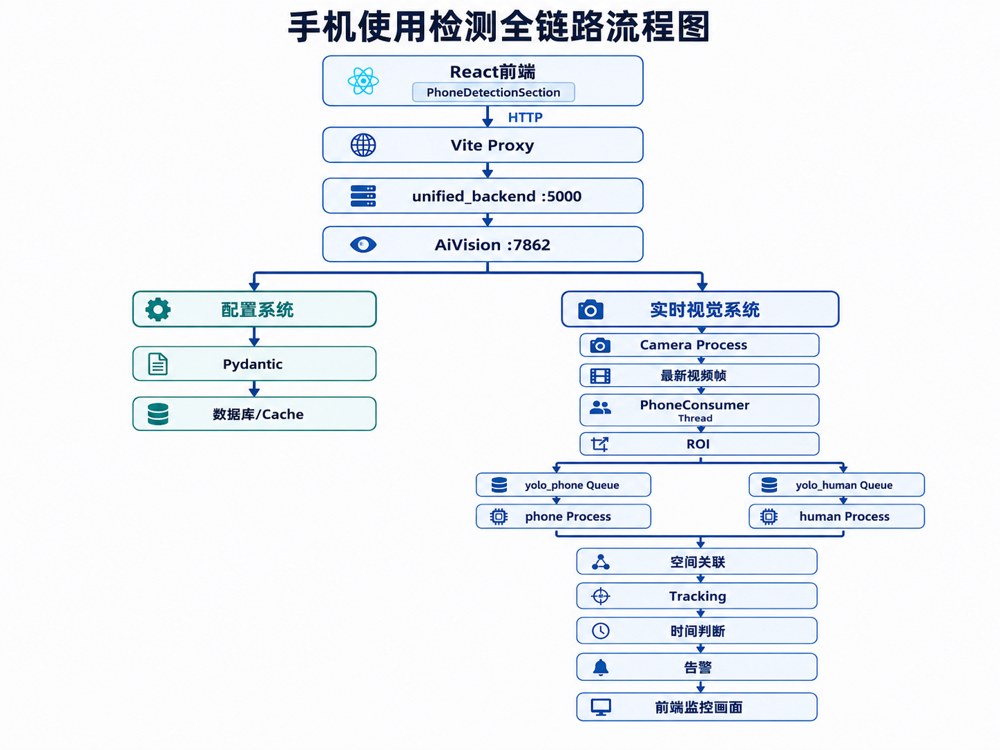

# 福达视觉平台项目架构说明

这份文档读完后应能回答三个问题：

1. 这个项目解决什么业务问题。
2. 前端、统一后端和 AiVision 视觉业务层分别负责什么。
3. 如果要运行、排查或新增能力，应该先看哪些文件。

## 1. 项目定位

本仓库是一个统一的 AI 视频监控平台，公网访问入口是：

```text
https://aicv.fudar.com/
```

公网网关将该域名的 HTTPS 请求转发到项目服务器的 Vite `3000` 端口。

平台把多个视觉检测能力整合到一个前端里，主要覆盖三类业务：

| 业务模块 | 子系统 | 做什么 |
| --- | --- | --- |
| 安检流程规范检测 | `AiVision/integrations/security_vlm` | 通过 YOLO + ByteTrack 跟踪安检工位人员交互过程，再把关键帧交给 Qwen-VL 判断流程是否合规。 |
| 保安行为规范检测 | `AiVision/integrations/guard_room` | 多路摄像头实时检测保安离岗、玩手机、趴睡，并保存报警截图/视频、推送企业微信。 |
| 通用视觉检测能力 | `AiVision` | 以 features-first 架构提供区域入侵、大门开关异常、人脸检测、人员逗留、手机使用检测等能力。 |
| 统一管理界面 | `unified_frontend` | React 前端，统一登录、导航、监控预览、ROI/模型/摄像头配置、报警记录与统计。 |

整体上，这是“一个 Vite 前端 + 一个统一后端 + 一个视觉业务后端”的三层项目。Guard Room 和
Security VLM 的源码、API 与生命周期都属于 AiVision，不再是仓库顶层的独立项目或服务。

## 2. 仓库顶层结构

```text
Fuda_CVPreject_V3/
├── unified_frontend/      # React + TypeScript + Vite 统一前端
├── AiVision/              # 统一视觉业务后端（含全部检测能力）
│   └── integrations/
│       ├── guard_room/    # 保安行为算法与 API 模块
│       └── security_vlm/  # 安检 VLM 算法与按需 worker
├── auth/                  # 登录鉴权模块：后端认证鉴权、前端权限分级
├── run_guide.txt          # 线上/tmux 启动命令与账号维护说明
└── PROJECT_ARCHITECTURE.md
```

生产环境统一管理三个 tmux 运行服务，前端由 Vite 直接提供：

| 服务 | 默认端口 | 启动目录 | 主要入口 |
| --- | ---: | --- | --- |
| 统一前端 | `3000` | `unified_frontend` | `npm run dev`（由 `scripts/start.sh` 启动） |
| 统一后端 | `5000` | 仓库| `python -m unified_backend.run_server` |
| AiVision 视觉业务层 | `7862` | `AiVision` | `conda activate aivision && python main.py` |

## 3. 整体调用关系

```text
浏览器
  |
  v
Vite -> unified_frontend (React 页面与 API 代理, :3000)
  |
  v
unified_backend (:5000)
  |
  +-- 保安行为 API        -> AiVision (:7862, 进程内 Guard Room)
  +-- 安检流程 API        -> AiVision (:7862, 进程内 Security VLM)
  +-- /api/aivision/*    -> AiVision (:7862)
  +-- /api/ai/*          -> AiVision (:7862, 旧路径兼容)
  +-- /aivision/*        -> AiVision (:7862)
```

开发环境的代理配置在：

```text
unified_frontend/vite.config.ts
```

前端 API 封装主要在：

```text
unified_frontend/src/lib/api.ts
unified_frontend/src/lib/aivision.ts
unified_frontend/src/lib/security-vlm.ts
```

因此排查“页面请求打到哪里”时，先看 `vite.config.ts` 的 proxy，再看 `src/lib/` 下对应封装。

## 4. 认证与权限

当前项目的后端认证实现集中在 `auth/auth.py`。统一后端负责登录入口，AiVision 校验同一个
JWT/Cookie；Guard Room 内的 `auth.py` 只是兼容旧 import 的转发层。

关键点：

| 项 | 说明 |
| --- | --- |
| 登录入口 | 前端 `unified_frontend/src/pages/LoginPage.tsx` |
| 前端登录态 | `unified_frontend/src/auth/` |
| 后端认证实现 | `auth/auth.py` |
| Guard Room 兼容入口 | `AiVision/integrations/guard_room/src/auth.py` |
| AiVision 兼容入口 | `AiVision/api/auth.py` |
| 用户文件 | `auth/auth_users.json` |
| 权限分级 | `unified_frontend/src/auth/permissions.ts` |
| 角色 | `admin` 可以配置/启停/录制；`viewer` 只能查看。 |

线上启动时需要让统一后端和 AiVision 使用同一个 `AUTH_SECRET`：

```bash
export AUTH_SECRET="<统一后端和AiVision保持同一串32位以上随机密钥>"
```

新增账号和角色修改参考`run_guide.txt`。

## 5. unified_frontend 前端架构

### 5.1 技术栈

| 类型 | 技术 |
| --- | --- |
| 构建工具 | Vite |
| UI 框架 | React 19 + TypeScript |
| 样式 | Tailwind CSS |
| UI 基础组件 | Radix UI + 本地 `components/ui` |
| 图标 | `lucide-react` |
| 图表 | `recharts` |

### 5.2 目录职责

```text
unified_frontend/
├── src/App.tsx              # 页面框架：Sidebar + Topbar + 当前模块内容
├── src/main.tsx             # React 入口
├── src/pages/               # 独立页面，目前主要是登录页
├── src/sections/            # 各业务模块页面主体
├── src/components/          # 业务组件和通用组件
├── src/components/ui/       # shadcn/Radix 风格基础 UI 组件
├── src/lib/                 # API、导航、工具函数
├── src/auth/                # 登录态与 AuthContext
├── src/types/               # 前端类型定义
└── vite.config.ts           # dev server、代理、路径别名
```

### 5.3 页面导航

导航配置在：

```text
unified_frontend/src/lib/nav.ts
```

`App.tsx` 根据 `currentPage` 渲染对应 section：

| 页面 id | 组件 | 对应后端 |
| --- | --- | --- |
| `overview` | `HomeSection` | 聚合展示 |
| `security-vlm` | `SecurityVlmSection` | `security_vlm` |
| `guard-behavior` | `GuardBehaviorSection` | `guard_room` |
| `intrusion-detection` | `IntrusionDetectionSection` | `AiVision` |
| `door-detection` | `DoorDetectionSection` | `AiVision` |
| `face-detection` | `FaceDetectionSection` | `AiVision` |
| `human-detection` | `HumanDetectionSection` | `AiVision` |
| `phone-detection` | `PhoneDetectionSection` | `AiVision` |
| `alarms` | `AlarmsSection` | 聚合三类视觉业务报警 |
| `statistics` | `StatisticsSection` | 基于报警数据聚合统计 |

如果新增一个前端模块，通常需要改：

1. `src/lib/nav.ts` 增加导航项。
2. `src/App.tsx` 增加 `case` 渲染。
3. `src/sections/` 增加页面组件。
4. `src/lib/` 增加后端 API 封装。

## 6. guard_room 保安行为规范检测

### 6.1 业务职责

`AiVision/integrations/guard_room` 是 AiVision 内置的保安行为模块，用于值班室/保安场景。它的 FastAPI 子应用
挂载在 AiVision 7862 端口下，没有独立 Web 进程或端口。它支持多路 RTSP 摄像头，并检测：

| 异常 | 判定逻辑概览 |
| --- | --- |
| 离岗 | 多路摄像头超过阈值时间都没有识别到保安。 |
| 玩手机 | 手机框与保安框在时间窗口内持续关联。 |
| 趴睡 | 姿态低头比例 + 画面静止程度持续满足阈值。 |

触发报警后会保存快照、录制短视频，并可通过企业微信推送。

### 6.2 核心数据流

```text
RTSP 摄像头
  |
  v
RTSPReader 线程（每路一个）
  |
  v
LatestFrameBuffer 单槽缓冲（始终只保留最新帧）
  |
  v
GuardRoomRuntime._run_loop
  |
  +-- ThreadPoolExecutor 并行处理每路摄像头
        |
        +-- YOLO 人体/手机检测
        +-- ByteTrack 跟踪
        +-- UniformClassifier 制服识别
        +-- TrackGuardGate 识别结果平滑
        +-- PoseEstimator 姿态估计
        +-- BehaviorEngine 规则判定
  |
  v
MultiCameraConsensus 多摄像头共识
  |
  v
AlarmManager + AlarmClipRecorder + WeChatNotifier
  |
  v
AppState
  |
  v
FastAPI API / MJPEG / 报警列表
```

### 6.3 关键文件

```text
AiVision/integrations/guard_room/
├── config/config.example.yaml # 配置模板
├── auth/auth_users.json     # 用户账号文件
├── src/server.py              # FastAPI API、认证中间件、配置/报警/推流接口
├── src/auth.py                # 兼容入口，实际转发到 ../auth/auth.py
├── src/runtime.py             # 核心运行时，串联拉流、推理、报警、状态
├── src/config.py              # YAML 配置 dataclass
├── src/state.py               # API 与 runtime 之间的共享状态
├── src/behavior.py            # 离岗/玩手机/趴睡规则引擎
├── src/consensus.py           # 多摄像头共识裁决
├── src/uniform.py             # 制服分类模型封装
├── src/pose.py                # 姿态估计
├── src/alarms.py              # 报警事件、冷却、快照、持久化
├── src/alarm_clip_recorder.py # 报警视频录制
└── src/wechat_notifier.py     # 企业微信异步推送
```

### 6.4 配置重点

主配置文件运行时应是：

```text
AiVision/integrations/guard_room/config/config.yaml
```

模板在：

```text
AiVision/integrations/guard_room/config/config.example.yaml
```

重点配置节：

| 配置节 | 作用 |
| --- | --- |
| `video` | 摄像头 RTSP、跳帧、输出目录、重连、JPEG 质量。 |
| `models` | 人体/手机 YOLO、制服分类、姿态模型路径与推理参数。 |
| `rules` | 离岗、手机、趴睡的阈值和报警冷却时间。 |
| `wechat` | 企业微信开关、凭据、报警接收人、视频片段时长。 |

排查 Guard Room 时，进入 `aivision` tmux，优先看 `src/runtime.py` 日志和状态 API 返回。

## 7. AiVision 通用视觉检测后端

### 7.1 业务职责

`AiVision` 是通用视觉检测后端 v2。它把每一种检测能力都抽象成一个 feature，当前包含：

| feature name | 页面名称 | 检测能力 | 是否依赖模型 |
| --- | --- | --- | --- |
| `blocks` | 区域入侵检测 | ROI 区域变化/入侵检测 | 否 |
| `detect_door` | 大门开关异常检测 | 门禁状态检测 | 否 |
| `detect_face` | 人脸检测 | 人脸逗留检测 | `yolo_face` |
| `detect_human` | 人员逗留检测 | 人体逗留检测 | `yolo_human` |
| `detect_phone` | 手机使用检测 | 手机检测 | `yolo_phone` |
| `detect_logistics_single_person` | 通用电气物流通道单人检测 | 多摄像头联合人数判定 | `yolo_human` |
| `detect_logistics_single_person_electronics_electrician` | 电子电工物流通道单人检测 | 多摄像头联合人数判定 | `yolo_human` |
| `detect_logistics_single_person_electrical_components` | 电气部件物流通道单人检测 | 多摄像头联合人数判定 | `yolo_human` |
| `detect_logistics_single_person_precious_metal_recycling` | 伟达公司物流通道单人检测 | 多摄像头联合人数判定 | `yolo_human` |

#### 手机使用检测全链路

下图展示了手机使用检测从 React 前端、统一后端、AiVision 配置系统，到实时视觉推理、空间关联、跟踪、时间判断与告警展示的完整链路：



### 7.2 features-first 架构

AiVision 的核心设计是 features-first：

```text
features/{feature_name}/
├── __init__.py   # 导出 SPEC = FeatureSpec(...)
├── consumer.py   # 该功能的运行时处理逻辑
├── orm.py        # 该功能的数据库配置表
└── schema.py     # 该功能的配置校验模型
```

每个 feature 通过 `FeatureSpec` 声明自己：

```text
name            # URL 和数据库 function_name 使用的机器名
display_name    # 前端/接口展示名称
consumer_cls    # 运行时消费者类
orm_class       # 配置表 ORM
config_schema   # 配置 Pydantic schema
required_models # 依赖哪些推理模型
violation_type  # 违规类型枚举
```

`AiVision/features/__init__.py` 会自动扫描所有 feature 子目录，因此新增 feature 时一般不需要改注册表。

### 7.3 核心数据流

```text
main.py
  |
  v
init_orchestrator()
  |
  v
Orchestrator.start()
  |
  +-- ensure_schema_compatible()
  +-- camera_service 加载摄像头与功能配置
  +-- CameraManager 启动摄像头进程
  +-- frame_reader_registry 读取最新帧
  +-- violation_writer 启动违规图片写入
  +-- alarm_dispatcher 配置喇叭/微信/图片写入
  +-- inference_manager 启动模型推理 worker
  +-- 为每个 FeatureSpec 启动 BaseFunctionConsumer 子类
  |
  v
FastAPI API v2 + 旧路径兼容
```

### 7.4 关键文件

```text
AiVision/
├── main.py                      # 后端入口，设置 multiprocessing spawn，启动 Uvicorn
├── pyproject.toml               # AiVision Conda 环境内安装的 Python 依赖
├── .env.example                 # 环境变量模板
├── api/app.py                   # FastAPI app、中间件、路由注册
├── api/auth.py                  # 兼容入口，实际转发到 ../auth/auth.py
├── api/compat.py                # 旧接口兼容层
├── api/v2/                      # v2 路由：runtime/cameras/features/models/alarms
├── core/settings.py             # 统一环境变量配置入口
├── core/db.py                   # 数据库连接与 schema 初始化
├── core/cache.py                # 配置缓存
├── core/events.py               # 配置变更事件总线
├── core/alarm/                  # 告警分发、喇叭、企业微信
├── platform/orchestrator.py     # 总编排器
├── platform/camera/             # 摄像头进程、帧读取、摄像头配置服务
├── platform/inference/          # 模型 worker、队列、推理管理
├── platform/violation/          # 违规图片与事件写入
├── platform/alarm_device/       # 声光报警设备
└── features/                    # 所有检测功能模块
```

### 7.5 API 概览

新接口主要在：

```text
/api/v2/runtime/health
/api/v2/runtime/status
/api/v2/cameras
/api/v2/cameras/{key}/frame.jpg?feature=detect_phone
/api/v2/features
/api/v2/features/{feature}
/api/v2/features/{feature}/configs/{shm_name}
/api/v2/models
/api/v2/alarms
/api/v2/logistics-channels/{feature}
/api/v2/logistics-channels/{feature}/{channel_id}/status
/api/v2/logistics-channels/{feature}/{channel_id}/frame.jpg
```

兼容旧前端的路径包括：

```text
/api/aivision/cameras
/api/aivision/cameras/{key}/frame.jpg
/api/ai/blocks-config/{shm_name}
/api/ai/door-config/{shm_name}
/api/ai/face-config/{shm_name}
/api/ai/phone-config/{shm_name}
/api/ai/human-config/{shm_name}
```

前端现在仍大量使用兼容路径，见 `unified_frontend/src/lib/aivision.ts`。

### 7.6 物流通道多摄像头单人检测

四个物流单人检测模块共用同一套“物流通道”管理能力。管理员在对应模块的配置页新建具名通道，然后新建或绑定摄像头；每个通道支持 1–9 路摄像头，每路摄像头单独保存 ROI。监控页按成员顺序自动拼接：1 路单画面、2 路左右、3–4 路 2×2、5–9 路 3×3。

通道按所有已启用成员的最新结果联合判定：

| 摄像头结果 | 通道状态 | 报警 |
| --- | --- | --- |
| 任意一路人数大于等于 2 | 多人异常 | 达到通道“多人持续时间”后报警 |
| 全部摄像头都有新鲜结果且全部为 0 | 无人异常 | 达到通道“无人持续时间”后报警 |
| 没有多人，至少一路为 1（包括多路各 1 人） | 正常 | 不报警 |
| 存在离线、过期或未出结果的摄像头，其余均为 0 | 未知 | 不报警，未知不能当作无人 |

检测开始/结束时间、无人和多人持续时间、报警间隔及通知开关均在前端按通道独立配置。成员 ROI 和推理过滤参数仍按摄像头独立配置。状态结果默认超过 5 秒即视为过期，可在启动 AiVision 前调整：

```bash
export LOGISTICS_STATUS_STALE_SECONDS=5
```

AiVision 启动时会先由 `ensure_schema_compatible()` 自动创建 `ai_logistics_channel`、`ai_logistics_channel_camera` 等缺失表，再运行旧配置迁移。迁移会为四个物流 feature 中每个已启用且尚未归属通道的摄像头创建同名通道；同一 feature 名称冲突时稳定追加摄像头 ID，并保留原 ROI、检测参数和启用状态。迁移可重复执行，已迁移成员会跳过，不会重复建通道。

上线前应备份 AiVision 数据库。回滚旧版本代码前也应先备份；新增物流表可以保留，不影响旧代码，不要在未经独立数据清理评审时删除旧摄像头级配置字段或物流表。迁移失败会记录 feature、camera ID 和原因，其他摄像头仍继续迁移；启动日志出现“物流通道迁移存在失败”时，应先处理冲突再重启验证。

纯逻辑回归可在项目根目录执行：

```bash
cd AiVision
MYSQL_DB_URL=127.0.0.1 MYSQL_DB_USER=test MYSQL_DB_PASSWORD=test MYSQL_DB_NAME=test \
  DATA_PATH=/tmp/aivision-logistics-test pytest -q
cd ..
PYTHONPATH=. pytest unified_backend/tests -q
cd unified_frontend
node --test tests/*.mjs
npm run lint
npm run build
```

### 7.7 新增 AiVision 检测能力的入口

新增一个 feature 时，优先照着现有目录复制结构：

```text
AiVision/features/detect_phone/
AiVision/features/detect_human/
```

通常要做：

1. 新建 `AiVision/features/{new_feature}/`。
2. 实现 `consumer.py`，继承 `BaseFunctionConsumer`。
3. 实现 `orm.py`，定义该功能配置表。
4. 实现 `schema.py`，定义配置校验。
5. 在 `__init__.py` 导出 `SPEC = FeatureSpec(...)`。
6. 如果依赖新模型，确保数据库 `ai_model` 中有对应 `name` 和 `import_path`。
7. 前端增加 section、导航和 API 封装。

## 8. security_vlm 安检流程规范检测

### 8.1 业务职责

`AiVision/integrations/security_vlm` 是 AiVision 内置的安检流程模块。其 API 没有独立端口；点击开启后，
AiVision 才按配置拉起隔离的检测/VLM worker。它不是逐帧直接给 VLM，而是先用传统视觉算法
筛选出“有意义的交互 session”，再把关键帧拼图交给 VLM 判断。

核心目标：

1. 识别每个安检 ROI 内是否出现双人交互。
2. 形成一次完整安检 session。
3. 抽取关键帧。
4. 由 Qwen-VL 判断上身、中身、下身、手臂张开等流程是否合规。
5. 输出历史记录、统计、异常结果和关键帧拼图。

### 8.2 多进程架构

```text
AiVision main.py (7862，托管 security_vlm FastAPI 子应用)
  |
  +-- capture_worker.py
  |     读取 RTSP/视频源，写入 FrameHub 双缓冲共享内存
  |
  +-- detector_worker.py
  |     从 FrameHub 读帧，YOLO + ByteTrack 检测/跟踪人员
  |
  +-- session_worker.py
  |     按工位 ROI 管理双人交互 session，抽取关键帧
  |
  +-- vlm_worker.py
        消费 session_pending 队列，调用 Qwen-VL，写结果和统计
```

进程间通信由 `AiVision/integrations/security_vlm/src/frame_hub.py` 提供：

| 数据类型 | 机制 | 说明 |
| --- | --- | --- |
| 视频帧 | `/dev/shm` 双缓冲 `memmap` | 高频大数据，避免通过 JSON 或队列传大图。 |
| 状态/结果 | `/dev/shm` 原子 JSON 文件 | 小数据，使用 `os.replace` 防止读到半截文件。 |

### 8.3 API 和前端交互

`AiVision/integrations/security_vlm/src/main.py` 提供：

```text
GET  /
GET  /health
GET  /api/history
GET  /api/rois
POST /api/rois
POST /api/control/start
POST /api/control/stop
POST /api/control/restart
GET  /video/original
GET  /video/rule
```

前端封装在：

```text
unified_frontend/src/lib/security-vlm.ts
```

前端访问路径会先经过统一后端，再进入 AiVision 内的 Security VLM 子应用：

```text
/security-vlm/* -> unified_backend (:5000) -> AiVision (:7862)
```

### 8.4 关键文件

```text
AiVision/integrations/security_vlm/
├── src/main.py              # FastAPI 主进程，负责 API 和 worker 生命周期
├── src/frame_hub.py         # 共享内存帧库 + 原子 JSON 状态存储
├── src/capture_worker.py    # 读视频源，写最新帧
├── src/detector_worker.py   # YOLO + ByteTrack 检测/跟踪
├── src/session_worker.py    # ROI session 管理、关键帧抽取
├── src/vlm_worker.py        # Qwen-VL 调用、结果落盘、统计
├── configs/config.example.yaml
├── results/                 # 每个 session 的 JSON 结果
├── clips/                   # 不合规关键帧拼图
└── logs/
```

### 8.5 配置重点

运行配置应是：

```text
AiVision/integrations/security_vlm/configs/config.yaml
```

模板在：

```text
AiVision/integrations/security_vlm/configs/config.example.yaml
```

重点配置节：

| 配置节 | 作用 |
| --- | --- |
| `envs.worker_python` | worker 子进程使用的 Python 解释器。 |
| `runtime.dir` | `/dev/shm` 共享内存和状态文件目录。 |
| `data.input_video` | RTSP 或视频源。 |
| `staff_rois` | 初始工位 ROI；前端保存后以 JSON 文件为准。 |
| `yolo` | 人员检测模型、设备、阈值、ByteTrack。 |
| `session` | 双人交互 session 的开始/结束/关键帧/指纹参数。 |
| `vlm` | Qwen-VL API Key、模型、超时和并发。 |
| `budget` | 每日成本上限和单次调用估算。 |

ROI 热加载逻辑：前端 `POST /api/rois` 后写入 `staff_identity_dir/<video_id>_staff_rois.json`，`session_worker` 通过文件 mtime 自动加载，不需要重启。

## 9. 报警与统计

报警来源有三类：

| 来源 | 前端归一化位置 | 说明 |
| --- | --- | --- |
| Guard Room | `unified_frontend/src/lib/api.ts` 的 `normalizeGuardAlarm` | 离岗、玩手机、趴睡。 |
| AiVision | `normalizeAiVisionAlarm` | 区域入侵、大门、手机、人脸、人体等。 |
| Security VLM | `normalizeSecurityVlmAlarm` | VLM 判定不合规或错误。 |

`getAlarms()` 会并发读取三套系统报警，归一化后按时间倒序合并。统计页目前也是基于报警记录聚合生成。

排查报警时按以下顺序：

1. 先看具体模块页面是否有实时画面和状态。
2. 再看后端原始报警接口是否有数据。
3. 最后看 `unified_frontend/src/lib/api.ts` 的归一化逻辑是否过滤或转换了字段。

## 10. 启动方式

`run_guide.txt` 是线上 tmux 运行手册。常用启动命令如下。

### 10.1 前端

生产环境由统一启动脚本在 tmux 中启动 Vite：

```bash
bash scripts/start.sh
```

也可以只启动前端排障：

```bash
cd unified_frontend
npm run dev -- --host 0.0.0.0 --port 3000
```

生产环境公网访问：

```text
https://aicv.fudar.com/
```

临时改端口：

```bash
npm run dev -- --port <前端调试端口>
```

### 10.2 AiVision（同时承载 Guard Room 与 Security VLM API）

```bash
tmux new -s aivision
cd AiVision
conda activate aivision
export AUTH_SECRET="<与统一后端保持同一串32位以上随机密钥>"
python main.py
```

临时改端口：

```bash
python main.py --port <AiVision调试端口>
```

Guard Room 随 AiVision 启动。Security VLM 的 API 同样随 AiVision 启动，但 token 推理 worker
默认关闭，只有页面点击开启后才使用 `AiVision/integrations/security_vlm/configs/config.yaml` 的 `envs.worker_python`
拉起子进程。不要再创建 `guard_room` 或 `security_vlm` tmux。

## 11. 排查问题的推荐路径

### 11.1 页面打不开

1. 运行 `bash scripts/status.sh`，确认 `unified_frontend` tmux 存在、3000 正在监听且首页返回 2xx。
2. 执行 `tmux attach -t unified_frontend`，查看 Vite 启动日志。
3. 浏览器 Network 里看失败的是静态资源，还是 `/api`、`/aivision`、`/security-vlm` 请求。
4. 检查 `npm run dev`、3000 端口和 `vite.config.ts` 代理配置。

### 11.2 登录失败

1. 看 `auth/auth_users.json` 是否有该工号且 `enabled=true`。
2. 确认统一后端和 AiVision 的 `AUTH_SECRET` 是否一致。
3. 看 `auth/auth.py` 的 token 签发和校验逻辑。

### 11.3 某个算法页面无画面

| 页面 | 优先检查 |
| --- | --- |
| 保安行为规范检测 | `AiVision/integrations/guard_room/src/runtime.py`、`AiVision/integrations/guard_room/config/config.yaml` 的 RTSP 和模型路径。 |
| AiVision 各检测页面 | AiVision 摄像头配置、功能是否启用、模型表是否启用、`/api/v2/runtime/status`。 |
| 安检流程规范检测 | `aivision` 日志中 Security VLM worker 是否启动、状态 API、`runtime.dir` 下状态文件。 |

### 11.4 报警没有出现

1. 先确认算法页面是否已经判定异常。
2. 看对应后端的报警接口是否返回记录。
3. 看前端 `getAlarms()` 是否能读到该来源。
4. 如果是企业微信问题，再查对应后端的企业微信配置和日志。

### 11.5 配置改了但不生效

| 子系统 | 注意事项 |
| --- | --- |
| Guard Room | 部分规则参数被运行中对象持有，配置更新后可能需要重启检测或服务。 |
| AiVision | 摄像头/功能配置通过事件总线热更新；模型 worker 相关变化通常需要重启后端。 |
| Security VLM | ROI 支持热加载；worker_python、模型、VLM 凭据等通常需要重启服务。 |

## 12. 二次开发入口

### 12.1 新增一个前端页面

改这些文件：

```text
unified_frontend/src/lib/nav.ts
unified_frontend/src/App.tsx
unified_frontend/src/sections/<NewSection>.tsx
unified_frontend/src/lib/<new-api>.ts
```

### 12.2 新增一个 AiVision 检测能力

改这些位置：

```text
AiVision/features/{new_feature}/__init__.py
AiVision/features/{new_feature}/consumer.py
AiVision/features/{new_feature}/orm.py
AiVision/features/{new_feature}/schema.py
unified_frontend/src/sections/
unified_frontend/src/lib/
```

### 12.3 调整 Guard Room 行为规则

优先看：

```text
AiVision/integrations/guard_room/src/behavior.py
AiVision/integrations/guard_room/src/consensus.py
AiVision/integrations/guard_room/config/config.yaml
```

如果涉及画面标注，看：

```text
AiVision/integrations/guard_room/src/drawing.py
```

如果涉及报警保存/推送，看：

```text
AiVision/integrations/guard_room/src/alarms.py
AiVision/integrations/guard_room/src/alarm_clip_recorder.py
AiVision/integrations/guard_room/src/wechat_notifier.py
```

### 12.4 调整 Security VLM 判定流程

优先看：

```text
AiVision/integrations/security_vlm/src/session_worker.py
AiVision/integrations/security_vlm/src/vlm_worker.py
AiVision/integrations/security_vlm/configs/config.yaml
```

如果只是改工位 ROI，走前端 ROI 编辑即可，不需要改代码。

## 13. 最重要的心智模型

这个项目由三个逻辑层组成；生产运行态是 Vite 前端加两个项目后端服务：

```text
unified_frontend = Vite 承载的门面、操作台与前端 API 代理
unified_backend  = 统一鉴权、聚合与 API 网关
AiVision         = 通用视觉能力 + Guard Room + Security VLM
```

Guard Room 与 Security VLM 是 `AiVision/integrations/` 下的业务模块，不是两个独立后端。排查问题时先判断属于哪个视觉模块，再进入 AiVision 内对应目录查看配置、API 和运行时。
