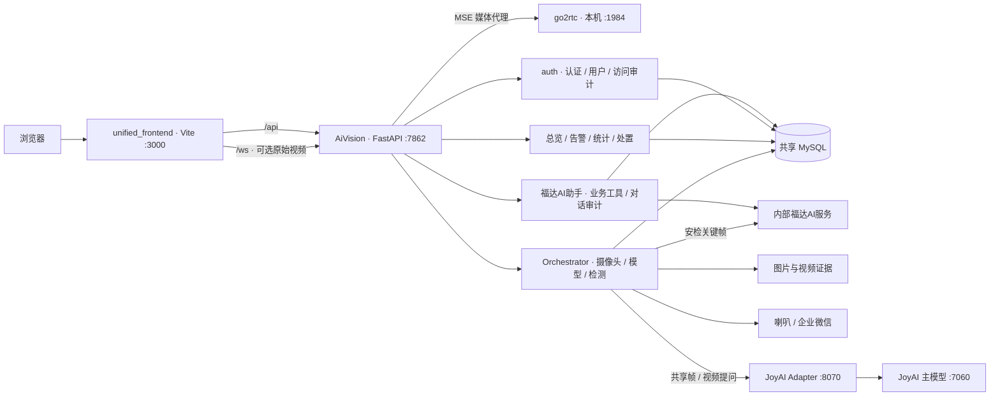

# 福达视觉平台

福达视觉平台将摄像头管理、十四项检测功能、告警证据、统计和用户管理整合在一个系统中。当前运行结构是 **React/Vite 前端 + AiVision 唯一业务后端**；认证模块 `auth` 由 AiVision 加载，共用 MySQL。

本文按当前源码整理（2026-09-20）。算法、配置和 API 细节见 [AiVision README](AiVision/README.md)，部署操作见 [运行手册](run_guide.txt)。本机的 `unified_frontend/info.md` 提供页面与组件导览，该文件按现有 Git 忽略规则在本地维护。

## 1. 运行架构



主启停脚本管理以下两个 tmux 服务：

| 服务 | 默认监听地址 | 启动入口 |
| --- | --- | --- |
| `unified_frontend` | `0.0.0.0:3000` | `npm run dev` |
| `aivision` | `0.0.0.0:7862` | `python -m AiVision.main` |

项目站点地址为 `https://aicv.fudar.com/`，网关部署需把请求转发至前端入口。Vite 的 `/api` 代理默认指向 `http://127.0.0.1:7862`，由 `VITE_AIVISION_TARGET` 覆盖；配置中也保留 `/ws` 的 WebSocket 代理。

可选的原始视频由 `scripts/go2rtc_preview.sh start|stop|status` 独立管理。go2rtc 只监听 `127.0.0.1:1984`，普通监控及保安室成员通过网站同源的 MSE/WebSocket 播放；摄像头源从数据库按需注册到内存，不向浏览器返回 RTSP 地址。除安检流程规范检测外，各检测页面优先播放原始视频，由浏览器叠加 ROI 和判定线；动态检测结果展示在旁侧卡片，报警证据保留标注。

保安行为与安检流程均在 `AiVision/features/` 中注册，使用同一套摄像头、推理、数据库和告警设施。内部福达AI为安检和福达AI助手提供模型服务，由独立的运维入口管理。

## 2. 仓库目录

```text
Fuda_CVPreject_V3/
├── unified_frontend/       # React + TypeScript + Vite
│   ├── src/auth/           # 登录状态、角色与事业部权限
│   ├── src/sections/       # 业务页面
│   ├── src/components/     # 业务组件与基础 UI
│   ├── src/hooks/          # 总览、轮询、主题等 Hooks
│   └── src/lib/            # API、导航和公共逻辑
├── AiVision/
│   ├── main.py             # 唯一后端正式入口
│   ├── api/routes/         # 检测、总览、告警、处置等 API
│   ├── runtime/            # 数据库 bootstrap、资源编排和总览
│   ├── cameras/            # 配置、FFmpeg 采集、帧读取和镜头控制
│   ├── inference/          # 模型注册、共享 Worker 和后台重载
│   ├── features/           # 十四项原生检测功能
│   ├── alarms/             # 记录、处置、证据、设备和通知
│   ├── assistant/          # 福达AI对话、配置工具、权限和执行审计
│   ├── departments/        # 固定事业部目录
│   ├── core/               # 环境配置、数据库、日志、缓存和事件
│   ├── connectors/         # 海康、福达AI与 JoyAI Adapter HTTP 协议
│   └── migrations/         # 历史数据的显式离线迁移
├── auth/                   # 认证、账号与访问审计
├── scripts/                # 主服务及可选视频侧车的启停和状态检查
├── docs/diagrams/           # 项目流程图
└── run_guide.txt            # 运维说明
```

## 3. 功能与业务标识

功能唯一注册入口是 [features/registry.py](AiVision/features/registry.py)。目录名、后端业务标识、前端页面 ID 各有用途，调用接口时应使用业务标识。

| 功能 | 功能目录 | 后端业务标识 | 前端页面 ID |
| --- | --- | --- | --- |
| 指令驱动智慧安防 | `visual_language_detection` | `visual_language_detection` | `visual-language-detection` |
| 区域入侵 | `intrusion` | `blocks` | `intrusion-detection` |
| 大门开关异常 | `door_state` | `detect_door` | `door-detection` |
| 人脸逗留 | `face_dwell` | `detect_face` | `face-detection` |
| 人员违规逗留 | `person_dwell` | `detect_human` | `human-detection` |
| 手机使用 | `phone_detection` | `detect_phone` | `phone-detection` |
| 警戒围栏 | `security_fence` | `security_fence` | `security-fence` |
| 非法闯闸检测 | `tailgating` | `tailgating` | `tailgating-detection` |
| 烟雾检测 | `smoke_detection` | `smoke_detection` | `smoke-detection` |
| 人脸身份识别 | `face_recognition` | `recognize_face` | `face-recognition` |
| 物流通道单人 | `logistics_channel` | `detect_logistics_single_person` | `logistics-single-person` |
| 保安行为规范 | `guard_behavior` | `guard_behavior` | `guard-behavior` |
| 安检流程规范 | `security_inspection` | `security_inspection` | `security-vlm` |
| AGV 无人运货 | `agv_person_check` | `agv_person_check` | `agv-person-check` |

各事业部的可访问功能由系统管理员在“系统管理 → 功能分配”中配置，保存于 MySQL 的 `department_feature_access` 表。系统管理员、部门管理员和普通用户进入检测页面均遵守事业部功能分配；部门管理员和普通用户还需具有对应事业部的账号授权。取消分配不会停止检测或删除数据，摄像头是否参与检测仍取决于摄像头、功能及通道/保安室成员的开关和运行状态。

平台具有十四项检测能力，总览按账号可访问的事业部和功能汇总能力卡片、摄像头入口与功能数量。点击平台汇总中的“摄像头离线”可查看未在线设备的名称、所属事业部和状态，列表区分离线与已停用，并随总览刷新。AGV 摄像头待机时仍计入在线设备；只有尚未完成的检测请求计入“正在检测”，判定完成后即退出该统计。

检测页面在手机上优先展示实时画面，常规监控的摄像头选择和刷新位于画面卡片内、视频正上方；保安室与物流通道在对应画面上方切换监控对象。状态统计和检测详情位于画面下方，AGV 请求判定优先显示在画面之后；共享监控布局在桌面显示顶部统计和可调整宽度的左右区域。手机配置标签可横向滑动，保存操作适配底部安全区，摄像头管理中的长名称完整换行显示。

各检测功能的“配置管理 → 摄像头”提供变焦入口，物流通道与保安室在成员列表使用同一控件。管理员可在弹窗查看实时原始画面，通过海康 ISAPI 控制摄像头镜头。速度滑条向两侧拖动并保持可连续缩小或放大，松手归中停止，按钮提供短步微调；设备不支持变焦或能力未确认时禁用镜头控制。镜头调整会影响同一设备的全部检测功能，完成后需核对 ROI 和警戒线位置。

AGV 无人运货检测按已保存的 ROI 采样人体，收到 HTTP 请求后才执行检测。监控使用原始视频及浏览器绘制的 ROI，视频不可用时通过保留功能授权的原始 JPEG 预览；待机、检测期间和请求结束后均持续更新画面，取图独立于检测请求。

公共监控播放与检测推理独立：安检以外的画面使用原始视频及前端 ROI 覆盖，未绘制 ROI 时按全画面检测，预览不叠加区域边框、填色或标签；已配置的判定线照常显示。当前检测结果由旁侧业务卡片展示，并按采样时间判定是否有效。安检保留工位标注与会话判定；报警截图和录像仍使用对应检测或会话的证据。JPEG 回退按摄像头 FPS 串行刷新，最高 10 帧/秒，实际流畅度受采集帧率与网络速度限制。

外部报警通过 `/api/external/alarms` 提供免登录、只读的事业部目录、报警列表、详情和 PNG 图片接口，支持人员逗留 `5`、围栏禁入 `15`、围栏非白名单 `16` 和非法闯闸 `17`。列表按 `violation_type` 数字及 `department` 查询，详情和图片按报警 ID 及所属部门读取；后台按平台当前功能分配与记录归属隔离，调用方无需传功能英文名。图片直接使用列表返回的 `image_url`，数据库 SQL 与调用示例见[外部报警对接说明](docs/external-alarm-api.md)。

AGV 监控的“请求与结果”显示等待请求、检测进度和回传状态，并保留当前摄像头最近一次结果、检测耗时及实际返回或回调的 JSON 内容。检测失败不作为无人判定，回调失败单独展示；状态查询遵守登录、事业部和功能权限，不触发检测。最近一次记录保留在检测服务内存中，服务重启后清空。

### 烟雾检测

`smoke_detection` 接收海康摄像头自身上报的烟雾事件，不加载烟雾识别模型。后台保持 ISAPI 事件连接，网页关闭不影响接收；监控展示原始画面、事件连接和设备最近上报状态。独立烟雾事件接入统一报警记录、企业微信及喇叭，无截图事件仍留档并发送带详情链接的文字通知。设备连接正常且尚无烟雾事件时，监控显示“未检测到烟雾”；断线、异常和状态过期分别提示，烟雾报警由设备明确事件触发。

摄像头管理和平台通知设置沿用普通检测功能。设备地址与鉴权从已保存的 RTSP 源读取，HTTP/HTTPS 端口、事件通道和参数通道由管理员配置；平台功能开关只控制事件接收，设备检测开关通过设备参数页单独读取和写入。参数按真实设备能力显示，保存须回读确认。区域编辑仅用于设备烟雾屏蔽区，框内不检测；编辑画面取自配置通道的设备抓图。具体固件的通道对应、事件格式及参数支持须在真机联调中确认。

### 福达AI助手

功能摄像头的数量和名单按用户指定部门、功能及真实功能开关筛选，默认统计该功能已启用的摄像头；“没有启用”仅查询未启用，“启用和未启用都要”或包含未启用时查询两种状态，也支持排除指定状态；状态条件冲突时先澄清。列表完成全部分页并核对去重数量后返回，展示实际部门、功能和摄像头台数，部门摄像头总表不能替代功能名单。正式功能名称的“检测”后缀可省略。

“删除 XXX 摄像头”“删除摄像头 XXX”“把 XXX 摄像头删掉”等独立明确的单目标命令使用同一删除分类。名称先按真实完整名称核对，类别词位于名称前后时再匹配完整名称；前缀相似不能作为目标身份证明。否定、讨论、示例、条件或批量要求继续通过严格规划处理，后台在工具执行前独立核对原话中的操作意图和完整删除对象；模型误判不能授权执行。所有实际删除仍经过权限、目标、读取版本与删除后回查。

导航中的“福达AI助手”提供账号私有、按会话部门隔离的聊天。系统管理员可通过自然语言维护业务与系统配置；部门管理员可在授权事业部内添加或删除摄像头、重命名、调整 FPS、启停、ROI、检测阈值和报警参数，也可管理已开放功能的物流通道、保安室及本部门喇叭基本信息。实际能力及参数约束由 `/api/assistant/capabilities` 和现有业务 Schema 提供；普通账号只能查询授权部门配置。

例如：“把二厂物流出口重命名为物流出口东侧，FPS 改成 8”“物流主通道只在工作日 08:00 到 18:00 报警”。模型先查询真实资源和当前参数，再提交局部修改；目标有歧义时需要补充说明。保存使用原业务事务、缓存和热更新事件，拒绝覆盖读取后发生的并发修改。聊天显示操作前后值、实际保存状态及操作编号，支持在配置未被继续修改时撤销参数修改；新建、绑定和删除不属于参数撤销范围。

普通检测参数按摄像头保存，资源搜索分别接收部门、功能和摄像头名称；参数名称通过业务 Schema 识别。例如非法闯闸的“人体置信度”对应 `value.threshold`，取值范围为 `0.01–1`。未指定摄像头时先查询该部门和功能下的候选，唯一目标读取当前版本后修改，多个目标则列出真实摄像头供选择；批量修改须有明确范围。

局部修改在保存前核对用户要求的字段、具体目标值和完整目标集合，字段名、正式 Schema 标题及常见业务名称可作为参数依据；只读描述、否定要求和资源名称中的同名字样不作为修改授权。数值、布尔、字符串和数组须与用户原话相符，明确的百分比及秒、毫秒按字段含义换算；相对调整、候选值、范围或不明单位需要澄清。多个参数须完整提交并逐项核对值，批量任务须完成目标搜索和分页，并提交全部目标；结果逐项核验后才能报告完成。同一工具范围内的参数校验错误可在原调用预算内纠正，纠正成功后不再计为未解决错误；权限、版本和保存结果异常继续保留。

会话别名须同时具备用户本轮的明确命名声明和真实资源读取结果，后台按部门、摄像头 ID 等身份信息核验后保存，不能仅凭模型回复建立绑定。部门范围与资源名称分别核验，带部门的“这台摄像头”等指代按当前明确目标或权限可见的近期目标解析；已核验别名的解析不依赖模型是否准确标注引用类别。已核验的别名可跨聊天历史窗口引用；绑定缺失、过期或来源不可见时先澄清，不能套用最近读取的摄像头。重新声明须重新核验，每次修改仍重新读取配置与版本。

删除摄像头须明确目标，助手读取并核对版本后调用原删除服务，同时移除该摄像头的检测配置并通知热更新；保留其他摄像头和物流通道。删除后回查数据库，记录仍存在时不能报告成功。已绑定保安室的摄像头须先通过管理页面解除绑定。停用功能与删除摄像头分别处理，删除不可撤销。

添加摄像头需明确名称和事业部，可提供完整 RTSP 或 IP、账号和密码。后一种方式默认端口 `554`、路径 `/Streaming/Channels/101`，明确指定的端口和路径优先生效，账号密码按 URL 规则编码。`shm_name` 自动生成 `camera_数字`。凭据在进入模型和聊天数据库前替换为引用，仅暂存在服务器内存；重启或引用过期后需重新提供。建档成功不代表视频源已连通，启用检测仍需配置对应 ROI 和规则。

助手通过内部福达AI的 Chat Completions 接口对话，每轮先判断聊天、平台查询或配置任务。“你好”“你好哇”等整条独立问候直接识别为聊天，本轮模型请求不携带旧任务上下文；附带查询、配置请求或明确续办指令时仍结合历史进行模型分类。普通聊天直接返回自然语言，语气轻松、亲切、适度俏皮；平台任务使用严格工具 JSON，后端按本轮允许的操作类别校验执行。查询结论来自实际工具数据，配置结果来自业务操作记录，模型自行声称完成不能作为成功依据。配置已为目标值时明确反馈无需修改，缺少信息时通过澄清工具提问。

`assistant/orchestration.py` 使用协调器、查询专家和配置专家处理业务请求。单一请求直接交给对应专家；明确的复合请求按用户原话拆成二至六个有序子任务，专家仅能使用当前步骤的工具和字段范围。交接携带后台核验的目标身份与进度，清空上一步的写入版本；各步骤共用工具执行、权限、变更总量和审计。前一步失败、结果不明或需要澄清时停止后续步骤，已保存结果保留并如实报告；含未核验执行条件的复合变更先澄清。后台开始执行后，规划与专家共用 `ASSISTANT_TASK_TIMEOUT_SEC` 整轮期限，默认 `300` 秒。

没有配置操作的聊天不会生成操作记录，工具指令不完整时不执行，整轮工具格式错误最多纠正一次。任务分类严格校验 JSON 和 Schema，可恢复的分类格式、字段或子任务来源错误最多纠正一次，两次请求共用分类超时预算并遵守取消与并发限制。分类与平台工具请求使用 `response_format=json_schema`，模型服务须支持 Schema 约束；普通聊天使用自然语言，安检沿用 JSON 对象模式。分类输出预算默认 `1024` tokens，并受模型设置中的输出上限限制。每个配置子任务未执行就返回正文时最多提醒模型执行一次，仍无有效结果则显示未完成；未知结果不自动重放。

查询计划区分能力目录、资源列表和实际配置。查询配置必须读完对应目标和分页，取得真实结果后由后端直接返回；名称列表不能替代参数值。历史同时按轮数与字符数限制，分类历史不携带助手答复正文。已读取的目标引用与待澄清请求在当前进程中短期保留，不缓存可复用的配置版本；权限变化导致原轮次不可见时，对应上下文失效。有效待办可接受明确数值或从真实候选中选择完整名称，执行前仍重新读取并核对版本；明确取消待办或停止任务后清除旧待办，简短回复不能恢复旧操作。取消待办不撤销已保存结果，参数撤销仍核对实际操作审计和版本。进程重启后依靠数据库中可见的最近历史继续理解，无法确认的目标需要澄清。

助手未独立保存模型设置时继承安检连接。后台任务有并发、队列及调用次数上限，不在启动阶段加载大模型或探测连接；与安检共享 `QWEN_MAX_CONCURRENT_REQUESTS` 请求预算。模型配置可在助手页面由管理员维护，部署后应使用实际模型验证对话和配置执行。

### 指令驱动智慧安防

检测导航按功能分配过滤，已分配“指令驱动智慧安防”时该功能位于检测导航首项。摄像头加入功能后由现有 Orchestrator 自动处理，共享帧经 `get_camera_frame_info()` 进入 `features/visual_language_detection/`，再由 `connectors/joyai/client.py` 调用 Adapter；浏览器只访问 AiVision API。

每台摄像头独立使用 `visual-language-{department}-{camera_id}` 会话，默认每秒发送一张新帧，同一摄像头串行处理并跳过重复帧。帧间隔、JPEG 质量、图像宽度、输出长度、采样参数、监控指令、ROI 和报警推送按摄像头保存到 MySQL。共享帧先经公共 ROI 裁剪，再发送给 JoyAI；空 ROI 表示全帧。监控页面使用统一统计卡片展示摄像头状态、启用摄像头数、最近推理耗时和最近结果时间；桌面右侧显示实时画面，左侧依次展示最新理解结果、聊天式视频问答和事件时间线，手机先显示画面再展示统计与结果。问答输入位于底部，本次提问与模型回答以不同气泡展示；静默结果不展示，回复只展示正文。提问响应和事件时间线保留同一帧的采集时间。

配置页依次为摄像头、监控指令、ROI 配置、推理参数、报警推送、喇叭设备。各标签共享当前摄像头草稿，保存时提交完整配置。ROI 使用 `AiVisionRoiEditor`，报警推送使用 `AlarmPushConfig` 管理当前功能的喇叭绑定、企业微信和报警间隔，喇叭设备管理由 `DetectionConfigTabs` 统一挂载。监控指令应要求仅在目标事件发生时输出结果；自动观察正文通过公共 `AlarmDispatcher` 按配置触发告警，静默、视频问答和处理错误不触发业务告警。

`AiVision/.env` 中的 `JOYAI_ADAPTER_URL` 指向 `http://172.16.0.32:8070`，模型名通过 Adapter 的 `/v1/models` 读取。`7060` 由 Adapter 调用，不进入 AiVision 业务客户端。Adapter 需启用 `HONOR_INBOUND_GENERATION_PARAMS=true` 才会采用摄像头保存的 `max_tokens`、`temperature`、`top_p`。管理员可修改绑定和参数；viewer 可在授权事业部内查看和提问。

### 普通检测与共享推理

```text
RTSP → FFmpeg 采集 → 双缓冲共享内存 → 最新帧缓存
     → 功能 Consumer → 共享模型 Worker → 业务规则
     → 标注画面 / 状态 / AlarmDispatcher
```

区域入侵使用人体框与警戒线侧别；门状态使用图像差分；人脸与人员逗留使用跟踪和持续时间；手机检测使用候选关联与持续确认；身份识别使用 InsightFace 和人员特征库，记录识别结果，不产生普通违规告警。

人脸与人员逗留只绘制本帧实际匹配到的轨迹；短暂丢失的轨迹保留用于后续重连，不在画面留下历史或预测框。

人脸身份识别共用人员资料和特征库，通行白名单按事业部独立保存。同一事业部的所有人脸识别摄像头共用该事业部白名单，添加或取消授权只影响当前事业部。

海康人员底库通过固定入口 `python -m AiVision.face_library` 依次同步人员资料和增量生成人脸特征。使用目标 Python 环境执行 `--install-systemd` 安装或更新定时任务，安装时自动写入当前项目和解释器路径并校验实际生效入口；任务结束后间隔 10 分钟再次执行。`--status` 同时检查定时器、入口和最近执行结果，部署用法见 [人脸库自动更新](AiVision/README.md#133-自动更新与-systemd-部署)。

模型名称和 Worker 类型由 `inference/model_registry.py` 固定注册，本机权重路径保存在 `AiVision/config/model_paths.yaml`。同一物理权重且 Worker 类型相同的逻辑模型可以共用进程。保存模型路径后需检查后台重载状态，HTTP `202` 只表示配置已接受。

YOLO 检测大图在进入进程队列前按当前 `imgsz` 等比例缩小，默认 `640`；模型结果恢复为原始 ROI 坐标。Consumer 保留原图用于跟踪、标注和证据，减少队列传图的数据量。

警戒围栏、非法闯闸、人脸身份识别、物流通道和保安行为按摄像头交叠处理有限数量的推理请求，并按原始采集时间发布结果。人脸通行授权在后台批量查询。物流人数状态随成员快照更新，通道证据与通知由后台处理。

`GET /api/runtime/status` 按功能和摄像头返回推理统计。`last_outcome.timing_ms` 区分输入传输与排队、Worker 执行、结果返回和请求总耗时；公共 Consumer 循环的 `last_frame_timing` 记录读帧、业务处理、画图及实际处理间隔，用于定位多路检测更新缓慢的原因。

### 警戒围栏

`security_fence` 按摄像头保存每日禁入时段、时区、警戒 ROI 和通行白名单，同一事业部的摄像头也独立授权。管理员在“围栏白名单”选择摄像头后，逐人设置允许状态并即时保存；未添加人员默认不允许通行，围栏授权与人脸身份识别权限分别维护。两个时段均使用 InsightFace 比对完整有效人员特征库：禁入时段内 ROI 有人即形成异常时间报警，包括白名单人员；其余时段白名单放行，确认库内非白名单或库外未知人员后形成异常人员报警。白名单只决定准入，不限制身份识别范围。识别与人脸身份识别共用有效特征库，不检查白名单是否人人都有特征；个别人员缺少特征不阻塞其他人员识别，未匹配的人脸按未知人员规则确认。

身份识别使用完整画面，人体和人脸分别检测，人员身份及区域规则结果在监控旁侧卡片展示；人员进入 ROI 后执行区域规则。库内、库外人脸均需通过尺寸、清晰度、偏转和五官关键点合理性检查，再在可靠的单摄像头轨迹内累计确认；库内身份复用共享人脸匹配结论。单次无人脸不清空有效观测；身份确认帧数支持 1～10，默认 3，设置为 1 时首次有效身份结果即可参与准入判定。禁入报警先记录，持续违规期间确认身份后补全同一记录，不重复生成记录；库外人员标记为“未知人员”。无有效身份依据或相似度不确定时保持“身份待核验”，不按等待时间判为未知人员，禁入时段仍然报警。短暂漏检或处理间隔变长时撤销通行身份，并在报警间隔窗口内保留事件关联；恢复后需当前有效人脸重新确认，持续违规不重复记录；记录与企微分别受当前摄像头的通知间隔限制。多人身份关联不明、配置变化或推理异常会重新核验。

围栏按轮转顺序投递请求，每个模型的在途上限由 `FENCE_INFLIGHT` 控制，默认 4、范围 1～4。普通时段在人体和人脸均有空位时取最新画面并并行检测，超过 5 秒的待处理画面释放名额。禁入时段可独立投递人体检测，有违规后先报警，再识别同一帧的身份；身份晚到只补全原记录。无违规时持续按采样间隔检测人体，普通时段仍需有效人脸依据。

围栏的独立记录和企业微信分别按事业部、功能与摄像头的稳定范围计时；换人、换轨迹、重新识别、报警原因切换或普通配置保存不会重置间隔。记录间隔控制独立记录通道，企微按自己的推送间隔保存当前卡片所需记录；两个通道同时到期时共用一条记录，其他摄像头独立计时。冷却保存在进程内存，服务重启后重新建立。人脸识别等待上限由 `FENCE_INFERENCE_TIMEOUT_SECONDS` 配置，默认 5 秒，从请求投递开始计时；失败信息包含实际超时、模型或索引刷新错误。

围栏监控使用原始视频和浏览器绘制的青色 ROI，人员身份、区域人数及违规原因由旁侧卡片展示。视频连接失败或编码不支持时使用原始 JPEG，状态快照按自身有效期独立展示。报警截图保存检测同帧的完整原图，保留现场全貌和原始分辨率；报警列表、详情、企业微信和外部抓拍图使用同一张完整截图。报警录像保留完整画面。检测状态与视频播放独立更新。

同一次连续围栏事件的独立记录和企微分别最多触发一次；事件开始时某个通道尚在冷却，仍保留随后到期的提交机会。企微单独到期时保存当前卡片所需记录。喇叭在当前有效违规持续成立时按独立间隔串行续播；间隔为 `0` 时，上一段播放完成后的下一次有效违规采样即可续播，播放耗时计入正间隔。同一喇叭正在播放相同语音时共享播放结果；入队或播放失败按 `FENCE_HORN_RETRY_SECONDS` 限速重试，默认 1 秒，喇叭先播或重试不提前触发记录和企微。

围栏状态卡片使用服务器返回的剩余有效时间，前端通过单调时钟管理过期，不依赖浏览器与服务器时间一致。短暂请求失败保留同一摄像头仍有效的状态、规则和人数；真正过期、离线或停用时更新为相应状态，旧快照不会通过轮询反复续期。

围栏页面沿用其他检测页的实时监控和配置管理两个标签；摄像头选择位于视频正上方，桌面左侧展示当前识别结果，右侧展示实时画面，支持拖动调整宽度；手机依次展示画面、状态统计和识别结果。配置包含摄像头、参数、ROI、模型和报警设置，报警间隔位于“报警推送”。报警统一在“数据中心 → 报警记录”中查看、筛选和处置，显示姓名、工号和摄像头所属事业部；详情另显示人员组织编码。人员库未提供部门名称，组织编码不等同于摄像头事业部。

大屏通过 `/api/external/security-fence` 读取摄像头、画面、实时状态及报警历史，无需 API Key 或账号登录，按事业部及平台当前功能分配查询。接入方式见[围栏外部 API 文档](docs/security-fence-external-api.md)。摄像头安装后应验证入口正脸像素、光照、多人遮挡及跟踪效果；该功能不保证未露出可识别人脸的人员一定触发身份报警。

### 非法闯闸

`tailgating` 使用共享人体模型跟踪完整画面，只有两个不同人员同向跨越过闸判定线的有效线段，并在同一 ROI 内连续共同出现达到确认时间，才触发尾随报警。默认共同出现确认时间为 0.3 秒；共同出现结束后的关联窗口默认 3 秒，用于等待双方完成过线。同组人员的一次通行只记录一次，三人及以上同行合并为同组事件，独立事件分别报警，元数据保存轨迹编号、方向和共同出现时间。

区域入侵警戒线和过闸判定线使用统一的青色抗锯齿描边，方向以独立短双箭头表示。闯闸的浅色标记表示通行方向，区域入侵的琥珀色标记指向报警侧。配置页沿用公共 ROI 编辑器，使用小方形控制点和轻透明区域填色。

配置按摄像头保存在 `ai_camera_config_tailgating`，默认停用，由管理员在“功能分配”中开放给目标事业部。摄像头加入功能后需保存 ROI、过闸判定线和监测方向；参数与启停经现有事务、缓存和事件总线热更新。画面使用最新采集帧，状态查询不等待推理锁；采样间隔超过配置上限、推理失败、分辨率变化或配置变更时清除旧通行状态。状态接口返回剩余有效时间，监控页使用浏览器单调时钟计时，短暂请求失败保留尚未过期的数据，结果超过 2 秒失效。实际部署需用闸机录像验证方向、贴身遮挡与检测采样频率。

外部大屏通过 `/api/external/tailgating` 只读查询事业部、摄像头、画面、实时状态、报警和抓拍图，无需 API Key 或账号登录。报警也可从 `ai_violation_image` 按 `feature_name='tailgating'`、`violation_type=17` 和事业部查询；图片地址可直接用于缩略图和原图链接。数据库 SQL、字段和 HTTP 示例见[非法闯闸对接文档](docs/tailgating-external-api.md)。

### 物流通道

一个通道最多绑定九路摄像头，每路独立配置 ROI，通道保存检测时段、人数阈值、持续时间和通知策略。联合规则按顺序判断：任一路多人 → 多人异常；否则至少一路单人 → 正常；否则存在未知 → 未知；全部有效且无人 → 无人异常。

通道的“时段与参数”使用一套检测与报警时段，按星期、每日起止时间和时区同时控制检测及通知，默认每天 `08:00～20:00`。时段外停止检测和报警，实时画面仍可查看；未选择星期时不检测、不报警。接口通过 `config.schedule` 读写时段，时间段须在同一天内，周一到周日编码为 `0～6`。“报警推送”维护报警间隔、记录、企微和喇叭渠道。

各路人数不相加，例如 `[1, 1]` 为正常、`[0, unknown]` 为未知。持续异常达到阈值后以通道为主体分发告警，监控在浏览器按成员顺序分路播放原始视频，ROI 通过通道成员专用接口读取，未绘制区域时不叠加边框；旁侧展示联合判定与逐路人数，报警证据使用通道拼接画面。

### 保安行为

`GuardBehaviorConsumer` 复用平台采集，执行人体/手机检测、ByteTrack、制服分类及可选的姿态/车辆推理，发布各摄像头感知快照。保安室运行时汇总成员状态，处理离岗、玩手机、趴睡和车辆出厂检查异常。

配置分为保安室、成员、规则参数、车辆 ROI 与各类告警策略。必需模型是 `yolo_guard_person_phone`、`guard_uniform`，姿态和车辆模型属于可选依赖，影响对应子规则。当前非保安人员框显示为灰色。

### 安检流程

`InspectionConsumer` 从平台帧缓存取图，调用共享 `yolo_human`，按命名工位 ROI 跟踪双人交互、生成 session 并抽取关键帧。后台 `InspectionRuntime` 按事业部和摄像头轮询调度福达AI请求，检测线程不等待网络判定。

安检每路最多保留一个人体检测请求，按摄像头顺序提前投递并重叠等待。`SECURITY_INSPECTION_INFLIGHT` 默认 `4`，范围 `1～4`；结果使用投递时的原图、采样时间和配置代次，禁用、离线或配置变化会取消相关请求。

交互候选按轨迹 ID 识别，检测结果排序变化不重置同一人员配对；低帧率下按有效采样间隔折算运动量，过期轨迹不用于启动会话。

- 摄像头开关、工位 ROI、检测参数和告警配置通过公共摄像头/功能 API 保存到 MySQL。
- ROI 配置页显示摄像头原始画面；新增工位并绘制、保存区域后，检测生成安检标注画面。
- 全局模型地址及调度参数通过 `/api/security-inspection/settings` 保存；默认地址为 `http://127.0.0.1:18100/v1`，模型名为 `fuda-qwen38-27b`。
- 模型最终返回 `compliant`、`confidence`、`reason`；历史状态区分合规、不合规、错误和取消。
- 只有不合规结果进入业务告警，截图使用该 session 的关键帧拼图。会话录像从交互开始采集、结束时封存，判定后按报警通道和冷却设置保存，可在报警详情播放；告警冷却按摄像头和工位隔离。
- 安检历史和统计采用滚动最近 31 天。每条不合规 session 与 JPEG 证据在同一数据库事务中保存，图片不受通知开关或报警冷却影响；历史列表支持查看证据。
- 安检总数等于合规与不合规次数之和；判定失败和修改 ROI 等操作产生的取消会话单独统计并保留历史，不计入安检总数。合规率只基于合规与不合规判定。
- 运行时提供模型健康检查、连续失败熔断和自动恢复状态。

外部安防大屏使用 `/api/external/security-inspection` 查询摄像头、画面、状态和会话历史，并读写摄像头安检配置；警戒围栏和非法闯闸分别使用 `/api/external/security-fence`、`/api/external/tailgating` 只读查询。三组接口均无需 API Key 或账号登录，按 `department` 和平台当前功能分配查询，并校验资源归属。图片地址可直接显示原图和缩略图，安检配置复用平台数据及热更新。接入方式见[安检文档](docs/security-inspection-external-api.md)、[围栏文档](docs/security-fence-external-api.md)和[非法闯闸文档](docs/tailgating-external-api.md)。

## 4. 认证、权限与数据

[auth/api.py](auth/api.py) 提供登录、登出、当前用户、修改密码、用户管理和访问审计接口，由 AiVision 的 `create_app()` 注册。浏览器通过 Cookie 维持登录，前端请求携带 `credentials: 'include'`；接口返回 `401` 时清空前端登录状态。

`/api/external/` 下的数据、图片和安检配置接口允许直接访问，无需请求头凭证，也不依赖人员登录 Cookie。平台账号接口、管理接口和全局模型设置仍校验人员登录及对应权限。

| 数据 | MySQL 表 / 存储 |
| --- | --- |
| 用户账号 | `auth_users` |
| 外部系统凭证摘要与授权 | `auth_external_clients` |
| 最近访问记录 | `auth_access_viewers` |
| 事业部功能分配 | `department_feature_access` |
| 摄像头及功能配置 | `ai_camera_config` 及各功能配置表 |
| 统一告警事件 | `ai_violation_image` |
| 报警处置与历史 | `ai_alarm_disposition` |
| 安检 session | `ai_security_inspection_session` |
| 安检不合规图片 | `ai_security_inspection_session_image`，按 `session_id` 关联的 JPEG 二进制 |
| 指令驱动智慧安防配置与事件 | `ai_camera_config_visual_language_detection`、`ai_visual_language_event` |
| 围栏时段、ROI 与报警策略 | `ai_camera_config_security_fence` |
| 围栏摄像头通行白名单 | `ai_security_fence_person_authorization` |
| 闸机 ROI、过闸判定线与共同出现规则 | `ai_camera_config_tailgating` |
| 人脸底库 | `ai_face_person`、`ai_face_embedding` |
| 人脸识别事业部通行白名单 | `ai_face_person_authorization` |
| 证据文件 | 本机 `DATA_PATH`，数据库保存引用 |

摄像头 `shm_name` 由后端按数据库主键生成，统一使用 `camera_<摄像头ID>`，例如 `camera_105`。总览及检测功能页面新建摄像头时无需自行生成该标识；画面、检测请求和报警筛选使用接口返回的完整值。

报警媒体、识别截图和安检 session 默认保留 31 天，启动后及每 60 分钟清理过期数据。安检数据库图片随 session 删除。磁盘媒体的 `ALARM_MEDIA_MAX_GB=10` 是容量告警阈值，超限不会提前删除保留期内证据；数据库 BLOB 不计入磁盘媒体阈值。磁盘报警目录由正式报警类型注册表统一确定。

`admin` 为系统管理员，管理全部配置、账号、部门归属及事业部功能分配；`department_admin` 为部门管理员，只能查看和修改账号授权事业部内的业务配置，功能配置还需具备对应事业部的功能授权；`viewer` 为普通用户，业务配置只读。部门管理员不能变更摄像头或喇叭的事业部归属，不能管理账号、功能授权、全局模型、系统异常通知、共享音频素材或 SIP 服务，但可选用已有音频配置本部门告警。系统管理员在“系统管理 → 用户管理”中分配角色及事业部，部门管理员和普通用户至少需要一个有效事业部。

功能分配保存采用事务和版本校验，冲突返回 409；后端请求读取最新权限，已登录页面每 30 秒同步一次，重新进入可见标签页时立即同步。账号角色或事业部授权变更会使旧登录会话失效，需重新登录。报警记录和统计保留事业部数据权限，不因取消功能分配而隐藏已有历史。访问记录页面还要求后端返回 `capabilities.view_access_audit=true`。报警处置接口按报警访问权限授权，并非所有写操作都限定管理员。

外部安检配置接口按对接约定保持免登录读写，校验请求事业部、功能分配及摄像头实际归属，不使用平台账号的部门角色限制。

已有 MySQL 的角色结构使用 `python -m AiVision.migrations.department_admin_20261111 --check` 检查，停止服务并备份后使用同一命令的 `--apply --offline` 应用；新库由正常启动建立。详见 [数据库迁移边界](AiVision/README.md#103-数据迁移边界)。

运维脚本复用 `scripts/auth_secret` 并向 AiVision 注入 `AUTH_SECRET`。手动启动也需要配置至少 32 字符的密钥；不要在文档或 Git 中写入真实密钥、数据库密码或带认证信息的视频地址。

## 5. 告警、统计与 API

全部检测告警进入同一数据库和接口，前端不再汇总三个独立后端的数据。告警 ID 使用数据库主键字符串，列表在数据库中按权限、事业部、事件类型和时间过滤后分页；统计接口按查询范围聚合。

处置状态包括 `pending`、`acknowledged`、`resolved`、`false_positive`，记录备注、处理人和最近 20 次历史。处置列表默认每页 50 条，最多 100 条，通过 `next_cursor` 继续读取。

| 接口入口 | 用途 |
| --- | --- |
| `/api/auth/*`、`/api/admin/*` | 认证、账号、访问审计 |
| `/api/overview` | 平台、事业部、摄像头与能力总览 |
| `/api/assistant/*` | 账号私有对话、异步指令、停止任务和模型设置 |
| `/api/runtime/health`、`/api/runtime/status` | 公开健康检查 / 受权限控制的运行状态 |
| `/api/cameras`、`/api/features` | 摄像头、功能配置和画面 |
| `/api/models` | 模型配置与运行/重载状态 |
| `/api/alarms`、`/api/alarms/statistics/summary` | 告警及统计 |
| `/api/alarm-dispositions` | 报警处置 |
| `/api/logistics-channels/*` | 通道与成员管理、状态及拼图 |
| `/api/guard-behavior/sites/*` | 保安室、策略、成员及运行状态 |
| `/api/security-fence/*`、`/api/external/security-fence/*` | 围栏平台状态与人员选择 / 无需 API Key 或登录的大屏只读接口 |
| `/api/tailgating/cameras/{key}/status` | 非法闯闸实时状态、轨迹与通行事件 |
| `/api/external/tailgating/*` | 无需 API Key 或登录的非法闯闸画面、状态、报警和图片只读接口 |
| `/api/security-inspection/*` | 安检历史、运行状态与福达AI设置 |
| `/api/external/security-inspection/*` | 无需 API Key 或登录的安检展示、图片和摄像头配置接口 |
| `/api/visual-language-detection/cameras/{key}/*` | 视觉理解结果、事件与视频提问 |
| `/api/face-recognition/records` | 身份识别记录 |
| `/api/horns`、`/api/exception-alert` | 喇叭与系统异常通知 |

接口字段以路由源码和运行实例的 `/docs`、`/openapi.json` 为准。

现场喇叭支持海康网络音柱（如 DS-QA6C301）。“喇叭设备”分为设备管理、音频库和 SIP 服务；各检测功能在“报警推送”中设置喇叭绑定。设备列表及报警绑定选项按当前事业部隔离，未归属的旧设备由管理员在“待分配设备”中整理。后端校验设备归属，禁止跨事业部绑定。管理员为每台设备填写 HTTP/HTTPS 管理地址、设备凭据和 SIP 身份，平台后台自动同步启用设备的 SIP 参数。SIP 通信服务和音频库由全平台共用，默认监听 UDP `5062`，独立于 HTTP API 的 `7862` 端口。

平台重启、注册超时或注册过期时，后台和试播会重新启用尚未注册的设备 SIP 通道，促使其立即注册；已完成注册的设备不反复启停。注册失败提示区分未收到请求、账户不匹配和摘要认证未通过。

“音频库”支持上传 AAC，默认限制为 10 MB、60 秒；服务器通过 FFmpeg 校验并转换音频，素材保存在 `DATA_PATH/horn_audio`。各设备和检测配置均可选择素材并点击“试播音频”现场确认。在“报警推送”中启用喇叭、选择设备和音频并保存后，异常告警由服务器通过 SIP/RTP 播放。选择“设备已有音频（ISAPI）”时，报警绑定填写设备素材库的整数音频 ID。连接测试只读取设备信息，不保存配置或播放声音。

每台 SIP 喇叭可在设备编辑弹窗设置 `0–200%` 音频响度，`100%` 保持原始响度，`0%` 静音。试播和实际报警使用同一设备设置，服务器在发送前调整音频，不改写共享素材。

所有检测功能的喇叭、企业微信和报警记录分别设置间隔。喇叭间隔为 `0` 时不额外等待，同台设备串行播放；人员或人脸逗留达到设定时长后，只要当前有效观测仍成立就继续触发，目标离开后不再续播。企业微信按自己的推送间隔发送当前告警的图文卡片，点击进入报警详情；事件型检测保持各自的事件触发规则。记录通道到期或企微推送时保存报警与证据，两个通道同时到期只保存一条。记录通道关闭或仍在冷却不影响企微保存卡片所需记录；保存失败时发送当前报警文本。

删除设备时展示引用它的事业部、功能、摄像头、物流通道和保安室，包括关闭告警后保留的绑定。已停用设备可在确认清单后解除绑定并删除；操作在同一事务内关闭相关喇叭告警、清空设备和音频绑定，保留其他报警渠道及检测配置。确认期间引用或设备状态发生变化时需重新核对。

## 6. 环境准备与启动

准备 Python `>=3.10,<3.12`、Node.js 20 环境、MySQL、FFmpeg/ffprobe，以及本机可用的模型权重。Python 依赖和 GPU 人脸环境说明见 [AiVision 环境准备](AiVision/README.md#11-环境准备与启动)。

首次部署从以下模板准备本机配置，已有文件应保留：

```bash
cd /usr/zyy/Fuda_CVPreject_V3
cp -n AiVision/.env.example AiVision/.env
cp -n AiVision/config/model_paths.example.yaml AiVision/config/model_paths.yaml
cp -n scripts/start.env.example scripts/cold_start.env
cd unified_frontend
npm ci
```

随后填写真实数据库连接、可写 `DATA_PATH` 和模型路径。`cold_start.env` 仅用于覆盖运行环境探测等脚本设置；模板占位值不能直接用于部署。

已有数据库的喇叭结构使用 `python -m AiVision.migrations.horn_sip_audio_20261016 --check` 核对。停止服务并备份数据库后，在项目根目录执行 `python -m AiVision.migrations.horn_sip_audio_20261016 --apply --offline`，准备事业部归属、SIP 配置列和音频表，再启动服务。工具支持为明确指定地址的旧设备分配事业部，参数见 [后端数据迁移说明](AiVision/README.md#103-数据迁移边界)。空库由正常启动流程建表。

独立通知间隔要求各告警配置表包含 `horn_interval` 和 `wechat_interval`。使用 `python -m AiVision.migrations.alarm_channel_intervals_20261021 --check` 只读核对；停止服务并备份数据库后执行同一命令的 `--apply --offline`，完成后再启动服务。未单独设置的通知间隔沿用该配置的报警记录间隔。

围栏摄像头白名单使用 `python -m AiVision.migrations.security_fence_camera_authorization_20261105 --check` 只读核对。停止后端及相关写入并备份数据库后，执行同一命令的 `--apply --offline`，为已配置围栏的摄像头复制其所属事业部的现有授权，保留原表备份，再启动后端。迁移完成后，各摄像头独立管理白名单，重复执行不会恢复已取消的授权。部署命令和生效方式见 [run_guide.txt](run_guide.txt) 第九节。

AiVision 启动命令使用默认参数，监听地址和端口读取 `API_HOST`、`API_PORT`，默认 `0.0.0.0:7862`。前端代理、启动健康检查和状态脚本使用后端端口 `7862`，前端端口为 `3000`；自定义端口时应同步调整代理目标和运维检查配置。

主入口按源码位置加载 `AiVision/.env`，已有进程环境变量优先。Settings 只读取环境变量与字段默认值；启动预检也不再回退到仓库根目录的旧 `.env`。

在项目根目录管理服务：

```bash
bash scripts/start.sh
bash scripts/status.sh
```

停止服务使用 `bash scripts/stop.sh`；`start.sh --force` 会等待已有后端正常退出、前端监听端口释放后重新启动，普通 `start.sh` 会跳过已有会话。后端收到正常停止通知后拒绝 AGV 新请求，保持摄像头和模型运行，等待已接收请求完成检测、同步响应或后台回调，再清理运行资源。`AiVision/.env` 中的 `SHUTDOWN_GRACE_SECONDS` 控制请求等待上限，默认 `75` 秒；请求本身的检测及回调超时仍然有效。

停止脚本只向当前 tmux 会话内的后端主进程发送 `SIGTERM`，不会直接终止模型和采集子进程。`scripts/cold_start.env` 的 `FUDA_STOP_TIMEOUT_SECONDS` 控制后端退出及前端端口释放的等待上限，默认 `600` 秒，应大于请求等待上限并留出资源清理时间；后端超时保留会话、返回失败，重启命令不会启动另一个后端。前端关闭 tmux 后继续检查端口，释放后才允许重启；超时或端口查询失败时返回失败，不终止其他占用端口的进程。更新时先完成停止，再部署代码并启动；暂停接收和启动期间的新调用需要由 AGV 端在遇到 HTTP `503` 或连接失败后重试。

单独排障时，在已配置 `AUTH_SECRET` 的终端启动后端：

```bash
conda activate aivision
python -m AiVision.main
```

另一个终端启动前端：

```bash
cd /usr/zyy/Fuda_CVPreject_V3/unified_frontend
npm run dev
```

主入口在数据库准备和运行资源启动后才启动 HTTP。不要用单独的 `uvicorn AiVision.api.app:app` 代替正式入口，也不要通过多个 Web Worker 重复启动同一批摄像头资源。

摄像头启动使用有限并行，`AiVision/.env` 中的 `CAMERA_START_WORKERS` 默认 `4`，范围 `1～16`，控制同时探测和等待首帧的路数。启动日志输出模块、数据库、摄像头、模型和总耗时。设备启动失败后由后台看门狗重试；持续的重连日志不表示整个平台仍在初始化，可通过健康接口确认运行状态。

正常退出时，媒体清理在当前记录的删除事务完成后响应取消，停止后续目录扫描、容量统计和过期删除；告警写入仍排空已接收队列。采集先统一收到退出通知，再按 `CAMERA_STOP_WORKERS` 并行回收，默认 `8`，范围 `1～16`。停止脚本每 `15` 秒输出等待进度；本地配置若显式设置较短的 `FUDA_STOP_TIMEOUT_SECONDS`，需按请求等待和资源回收耗时调整。

原始视频需先按 [go2rtc 环境准备](AiVision/README.md#112-安装依赖与准备模板) 放置官方程序，并执行 `bash scripts/go2rtc_preview.sh start`。除安检流程规范检测外，已授权的检测页面对启用的 RTSP/RTSPS 摄像头优先播放 MSE；媒体服务不可用或编码不支持时回退到原始 JPEG。安检仍按 `AiVision/.env` 的 `GO2RTC_PREVIEW_CAMERA_KEY` 与 `GO2RTC_PREVIEW_FEATURE` 名单选择视频模式。主启停脚本不管理该侧车，侧车二进制、配置和日志保存在忽略的 `runtime/go2rtc/`；各服务器的本地环境及程序需分别准备。

## 7. 验证与故障定位

| 现象 | 优先检查 |
| --- | --- |
| 页面打不开或 API 代理失败 | `scripts/status.sh`、两个 tmux 日志、监听端口与 Vite 代理目标 |
| 登录失败 | `auth_users` 中账号状态、MySQL 连接、`AUTH_SECRET` 和 `auth/auth.py` |
| 页面没有可选事业部 | 用户授权部门、URL 的 `department` 参数及前端权限解析 |
| 摄像头无画面 | 摄像头/功能开关、RTSP、FFmpeg、最新帧时间与模型状态 |
| 普通监控画面卡顿 | 当前播放模式、浏览器网络请求、go2rtc 状态、源视频码流及后端慢响应日志 |
| 配置保存但模型未工作 | `/api/models` 的 `reload`、`runtime` 和后端日志 |
| 保安行为部分规则不可用 | 保安室成员状态、必需/可选模型与对应规则开关 |
| 安检有画面但无判定 | 工位 ROI、session 条件、福达AI健康状态、排队与历史错误 |
| 有违规但无通知 | 持续时间、冷却主体、SQL/企微/喇叭开关、设备绑定及发送日志 |
| 告警视频未生成 | `pending/ready/failed` 状态、前后帧缓存、FFmpeg 和磁盘权限 |

`/api/runtime/health` 的 `ok=true` 表示 Orchestrator 已启动且至少一个模型就绪，不代表所有摄像头、功能或福达AI服务均正常。

公共摄像头 JPEG 取图实时读取摄像头身份与归属，保留部门及功能授权校验，不加载全部功能配置；摄像头详情和列表仍读取完整配置。

保安室与物流通道监控复用普通检测的原始视频组件，在视频上覆盖 ROI，行为结果和联合判定展示在画面旁的卡片中。进入监控或视频重连时先通过原始 JPEG 持续显示画面，MSE 在后台连接；浏览器确认开始播放后停止取图并切换到视频。JPEG 刷新按摄像头 FPS 串行执行，缺省 5 帧/秒、最高 10 帧/秒，取图和预解码耗时计入周期。MSE 播放期间不并行取 JPEG；权限拒绝时清空并停止画面，晚到的能力响应或图片不能恢复预览。页面的检测 FPS 与视频播放帧率分别表示。区域入侵、门状态、人脸及人员逗留、手机检测的结果卡片显示最新有效采样、持续时间与目标明细，过期、离线和推理失败不作为正常判定。

原始视频由浏览器 MSE 解码，不自动转码。浏览器不支持源编码或视频连接失败时明确回退到 JPEG。视频连接按 `GO2RTC_AUTH_CHECK_SECONDS`（默认 5 秒，范围 1～5 秒）复查权限及来源，每次校验最多等待 5 秒；失败时先停止媒体发送并关闭浏览器，再限时回收上游。入口鉴权逐次执行，持续视频按周期复查访问权限。

前端代码的现有检查入口：

```bash
npm --prefix unified_frontend run lint
npm --prefix unified_frontend run build
```

后端改动按实际影响进行 Python 语法检查、接口验证与现场验证，重点核对权限、配置保存、资源生命周期和业务判定。

`AiVision/connectors/qwen/swift_deploy.py` 是模型服务器的独立部署入口，适配 `ms-swift 4.4.2` 和 `vLLM 0.27.1`，保留显式 `--port`，将 Chat Completions 的 JSON 对象及完整 JSON Schema 约束传入解码器。脚本可单独复制运行，`--check` 只检查依赖和请求协议；安装及实际生成验收见[Swift 部署与格式约束](docs/assistant-diagnostics.md#swift-部署与格式约束)。

纯文档修改可执行：

```bash
git diff --check -- README.md unified_frontend/info.md AiVision/README.md
```

## 8. 开发入口

新增检测功能先参考最接近的 `features/` 模块，拆分 Schema、ORM、Consumer 和 SPEC，再在 `features/registry.py` 显式注册。需要新模型时更新模型注册表和路径模板；涉及告警时同步检查告警类型、主体身份与前端事件映射。

前端开发同时检查 `src/lib/nav.ts`、`src/auth/permissions.ts`、`src/App.tsx` 和对应业务组件，沿用已有事业部切换、请求取消、配置保存及错误处理方式。

修改保安行为规则从 `features/guard_behavior/behavior.py`、`site_rules.py` 和 `runtime.py` 入手；修改安检流程从 `features/security_inspection/sessions.py`、`vlm.py`、`schema.py` 和 `prompts.py` 入手。摄像头采集、模型推理、HTTP 路由保持各自职责。
