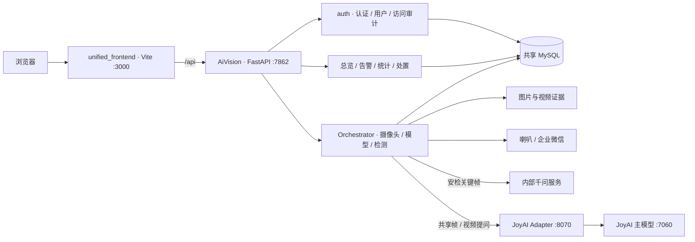

# 福达视觉平台

福达视觉平台将摄像头管理、十二项视觉检测、告警证据、统计和用户管理整合在一个系统中。当前运行结构是 **React/Vite 前端 + AiVision 唯一业务后端**；认证模块 `auth` 由 AiVision 加载，共用 MySQL。

本文按当前源码整理（2026-09-20）。算法、配置和 API 细节见 [AiVision README](AiVision/README.md)，部署操作见 [运行手册](run_guide.txt)。本机的 `unified_frontend/info.md` 提供页面与组件导览，该文件按现有 Git 忽略规则在本地维护。

## 1. 运行架构



运维脚本管理以下两个 tmux 服务：

| 服务 | 默认监听地址 | 启动入口 |
| --- | --- | --- |
| `unified_frontend` | `0.0.0.0:3000` | `npm run dev` |
| `aivision` | `0.0.0.0:7862` | `python -m AiVision.main` |

项目站点地址为 `https://aicv.fudar.com/`，网关部署需把请求转发至前端入口。Vite 的 `/api` 代理默认指向 `http://127.0.0.1:7862`，由 `VITE_AIVISION_TARGET` 覆盖；配置中也保留 `/ws` 的 WebSocket 代理。

当前仓库已没有独立的 `unified_backend`、Guard Room 或 Security VLM Web 服务。保安行为与安检流程均在 `AiVision/features/` 中注册，使用同一套摄像头、推理、数据库和告警设施。内部千问是安检依赖的模型服务，不由这两个 tmux 服务的启停脚本管理。

## 2. 仓库目录

```text
Fuda_CVPreject_V3/
├── unified_frontend/       # React + TypeScript + Vite
│   ├── src/auth/           # 登录状态、角色与事业部权限
│   ├── src/sections/       # 业务页面
│   ├── src/components/     # 业务组件与基础 UI
│   ├── src/hooks/          # 总览、轮询、主题等 Hooks
│   └── src/lib/            # API、导航和公共逻辑
├── AiVision/
│   ├── main.py             # 唯一后端正式入口
│   ├── api/routes/         # 检测、总览、告警、处置等 API
│   ├── runtime/            # 数据库 bootstrap、资源编排和总览
│   ├── cameras/            # 配置、FFmpeg 采集和帧读取
│   ├── inference/          # 模型注册、共享 Worker 和后台重载
│   ├── features/           # 十二项原生检测功能
│   ├── alarms/             # 记录、处置、证据、设备和通知
│   ├── departments/        # 固定事业部目录
│   ├── core/               # 环境配置、数据库、日志、缓存和事件
│   ├── connectors/         # 海康与 JoyAI Adapter HTTP 协议
│   └── migrations/         # 历史数据的显式离线迁移
├── auth/                   # 认证、账号与访问审计
├── scripts/                # 双服务启动、停止和状态检查
├── docs/diagrams/           # 项目流程图
└── run_guide.txt            # 运维说明
```

## 3. 功能与业务标识

功能唯一注册入口是 [features/registry.py](AiVision/features/registry.py)。目录名、后端业务标识、前端页面 ID 各有用途，调用接口时应使用业务标识。

| 功能 | 功能目录 | 后端业务标识 | 前端页面 ID |
| --- | --- | --- | --- |
| 指令驱动智慧安防 | `visual_language_detection` | `visual_language_detection` | `visual-language-detection` |
| 区域入侵 | `intrusion` | `blocks` | `intrusion-detection` |
| 大门开关异常 | `door_state` | `detect_door` | `door-detection` |
| 人脸逗留 | `face_dwell` | `detect_face` | `face-detection` |
| 人员违规逗留 | `person_dwell` | `detect_human` | `human-detection` |
| 手机使用 | `phone_detection` | `detect_phone` | `phone-detection` |
| 警戒围栏 | `security_fence` | `security_fence` | `security-fence` |
| 人脸身份识别 | `face_recognition` | `recognize_face` | `face-recognition` |
| 物流通道单人 | `logistics_channel` | `detect_logistics_single_person` | `logistics-single-person` |
| 保安行为规范 | `guard_behavior` | `guard_behavior` | `guard-behavior` |
| 安检流程规范 | `security_inspection` | `security_inspection` | `security-vlm` |
| AGV 无人运货 | `agv_person_check` | `agv_person_check` | `agv-person-check` |

各事业部的可访问功能由管理员在“系统管理 → 功能分配”中配置，保存于 MySQL 的 `department_feature_access` 表。管理员和普通账号进入检测页面均遵守事业部功能分配；管理员可查看全部事业部并修改分配，普通账号还需具有对应事业部的归属权限。取消分配不会停止检测或删除数据，摄像头是否参与检测仍取决于摄像头、功能及通道/保安室成员的开关和运行状态。

平台具有十二项检测能力，总览按账号可访问的事业部和功能汇总能力卡片、摄像头入口与功能数量。点击平台汇总中的“摄像头离线”可查看未在线设备的名称、所属事业部和状态，列表区分离线与已停用，并随总览刷新。AGV 摄像头待机时仍计入在线设备；只有尚未完成的检测请求计入“正在检测”，判定完成后即退出该统计。

### 指令驱动智慧安防

检测导航按功能分配过滤，已分配“指令驱动智慧安防”时该功能位于检测导航首项。摄像头加入功能后由现有 Orchestrator 自动处理，共享帧经 `get_camera_frame_info()` 进入 `features/visual_language_detection/`，再由 `connectors/joyai/client.py` 调用 Adapter；浏览器只访问 AiVision API。

每台摄像头独立使用 `visual-language-{department}-{camera_id}` 会话，默认每秒发送一张新帧，同一摄像头串行处理并跳过重复帧。帧间隔、JPEG 质量、图像宽度、输出长度、采样参数、监控指令、ROI 和报警推送按摄像头保存到 MySQL。共享帧先经公共 ROI 裁剪，再发送给 JoyAI；空 ROI 表示全帧。监控页面使用统一统计卡片展示摄像头状态、启用摄像头数、最近推理耗时和最近结果时间；左侧展示实时画面与突出的最新理解结果，右侧提供聊天式视频问答和事件时间线。问答输入位于底部，本次提问与模型回答以不同气泡展示；静默结果不展示，回复只展示正文。提问响应和事件时间线保留同一帧的采集时间。

配置页依次为摄像头、监控指令、ROI 配置、推理参数、报警推送、喇叭配置。ROI 使用 `AiVisionRoiEditor`，报警推送使用 `AlarmPushConfig` 管理当前功能的喇叭绑定、企业微信和报警间隔，喇叭设备管理由 `DetectionConfigTabs` 统一挂载。监控指令应要求仅在目标事件发生时输出结果；自动观察正文通过公共 `AlarmDispatcher` 按配置触发告警，静默、视频问答和处理错误不触发业务告警。

`AiVision/.env` 中的 `JOYAI_ADAPTER_URL` 指向 `http://172.16.0.32:8070`，模型名通过 Adapter 的 `/v1/models` 读取。`7060` 由 Adapter 调用，不进入 AiVision 业务客户端。Adapter 需启用 `HONOR_INBOUND_GENERATION_PARAMS=true` 才会采用摄像头保存的 `max_tokens`、`temperature`、`top_p`。管理员可修改绑定和参数；viewer 可在授权事业部内查看和提问。

### 普通检测与共享推理

```text
RTSP → FFmpeg 采集 → 双缓冲共享内存 → 最新帧缓存
     → 功能 Consumer → 共享模型 Worker → 业务规则
     → 标注画面 / 状态 / AlarmDispatcher
```

区域入侵使用人体框与警戒线侧别；门状态使用图像差分；人脸与人员逗留使用跟踪和持续时间；手机检测使用候选关联与持续确认；身份识别使用 InsightFace 和人员特征库，记录识别结果，不产生普通违规告警。

模型名称和 Worker 类型由 `inference/model_registry.py` 固定注册，本机权重路径保存在 `AiVision/config/model_paths.yaml`。同一物理权重且 Worker 类型相同的逻辑模型可以共用进程。保存模型路径后需检查后台重载状态，HTTP `202` 只表示配置已接受。

### 警戒围栏

`security_fence` 按摄像头保存每日禁入时段、时区、警戒 ROI 和独立白名单。禁入时段内 ROI 有人即报警；其余时间复用 InsightFace 和共享人员特征库，连续有效人脸证据确认非白名单后报警。未露出可识别人脸或相似度不确定时显示“身份待核验”，不按超时报警。白名单不会修改原有人脸身份识别的通行授权。

身份识别使用完整画面，人员进入 ROI 后执行区域规则；确认的身份仅在连续可靠的单摄像头跟踪中保留。轨迹丢失、人员重叠、配置变化或推理异常会重新核验。围栏页面沿用其他检测页的实时监控、报警记录、摄像头管理、参数、ROI、模型和报警设置。

大屏通过 `/api/external/security-fence` 读取摄像头、画面、实时状态及报警历史，凭证需要 `security_fence:read` 权限和对应事业部授权。接入方式见[围栏外部 API 文档](docs/security-fence-external-api.md)。摄像头安装后应验证入口正脸像素、光照、多人遮挡及跟踪效果；该功能不保证未露出可识别人脸的人员一定触发身份报警。

### 物流通道

一个通道最多绑定九路摄像头，每路独立配置 ROI，通道保存检测时段、人数阈值、持续时间和通知策略。联合规则按顺序判断：任一路多人 → 多人异常；否则至少一路单人 → 正常；否则存在未知 → 未知；全部有效且无人 → 无人异常。

各路人数不相加，例如 `[1, 1]` 为正常、`[0, unknown]` 为未知。持续异常达到阈值后以通道为主体分发告警，监控与证据使用通道拼接画面。

### 保安行为

`GuardBehaviorConsumer` 复用平台采集，执行人体/手机检测、ByteTrack、制服分类及可选的姿态/车辆推理，发布各摄像头感知快照。保安室运行时汇总成员状态，处理离岗、玩手机、趴睡和车辆出厂检查异常。

配置分为保安室、成员、规则参数、车辆 ROI 与各类告警策略。必需模型是 `yolo_guard_person_phone`、`guard_uniform`，姿态和车辆模型属于可选依赖，影响对应子规则。当前非保安人员框显示为灰色。

### 安检流程

`InspectionConsumer` 从平台帧缓存取图，调用共享 `yolo_human`，按命名工位 ROI 跟踪双人交互、生成 session 并抽取关键帧。后台 `InspectionRuntime` 按事业部和摄像头轮询调度千问请求，检测线程不等待网络判定。

- 摄像头开关、工位 ROI、检测参数和告警配置通过公共摄像头/功能 API 保存到 MySQL。
- 全局模型地址及调度参数通过 `/api/security-inspection/settings` 保存；默认地址为 `http://127.0.0.1:18100/v1`，模型名为 `fuda-qwen36-27b`。
- 模型最终返回 `compliant`、`confidence`、`reason`；历史状态区分合规、不合规、错误和取消。
- 只有不合规结果进入业务告警，证据使用该 session 的关键帧拼图；告警冷却按摄像头和工位隔离。
- 运行时提供模型健康检查、连续失败熔断和自动恢复状态。

外部安防大屏使用 `/api/external/security-inspection` 查询摄像头、画面、状态和会话历史，并读写摄像头安检配置。外部接口使用独立 `X-API-Key` 凭证，按事业部和读写权限授权，复用平台数据及配置热更新；凭证由受控服务端或代理保管。接口字段和调用示例见[安检外部 API 文档](docs/security-inspection-external-api.md)。

## 4. 认证、权限与数据

[auth/api.py](auth/api.py) 提供登录、登出、当前用户、修改密码、用户管理和访问审计接口，由 AiVision 的 `create_app()` 注册。浏览器通过 Cookie 维持登录，前端请求携带 `credentials: 'include'`；接口返回 `401` 时清空前端登录状态。

[auth/external.py](auth/external.py) 校验外部系统凭证；管理员通过 `/api/admin/external-clients` 管理授权、有效期、启停和轮换。密钥摘要保存于 `auth_external_clients`，明文仅在创建和轮换时返回。外部凭证不授予人员账号接口或全局模型设置的访问权限。

| 数据 | MySQL 表 / 存储 |
| --- | --- |
| 用户账号 | `auth_users` |
| 外部系统凭证摘要与授权 | `auth_external_clients` |
| 最近访问记录 | `auth_access_viewers` |
| 事业部功能分配 | `department_feature_access` |
| 摄像头及功能配置 | `ai_camera_config` 及各功能配置表 |
| 统一告警事件 | `ai_violation_image` |
| 报警处置与历史 | `ai_alarm_disposition` |
| 安检 session | `ai_security_inspection_session` |
| 指令驱动智慧安防配置与事件 | `ai_camera_config_visual_language_detection`、`ai_visual_language_event` |
| 围栏时段、ROI 与独立白名单 | `ai_camera_config_security_fence` |
| 人脸底库 | `ai_face_person`、`ai_face_embedding` |
| 证据文件 | 本机 `DATA_PATH`，数据库保存引用 |

`admin` 管理配置、账号及事业部功能分配；所有角色均按事业部与功能的配对授权进入检测页面和读取检测数据。分配保存采用事务和版本校验，冲突返回 409；后端请求读取最新权限，已登录页面每 30 秒同步一次，重新进入可见标签页时立即同步。报警记录和统计保留事业部数据权限，不因取消功能分配而隐藏已有历史。访问记录页面还要求后端返回 `capabilities.view_access_audit=true`。报警处置接口按报警访问权限授权，并非所有写操作都限定管理员。

运维脚本复用 `scripts/auth_secret` 并向 AiVision 注入 `AUTH_SECRET`。手动启动也需要配置至少 32 字符的密钥；不要在文档或 Git 中写入真实密钥、数据库密码或带认证信息的视频地址。

## 5. 告警、统计与 API

全部检测告警进入同一数据库和接口，前端不再汇总三个独立后端的数据。告警 ID 使用数据库主键字符串，列表在数据库中按权限、事业部、事件类型和时间过滤后分页；统计接口按查询范围聚合。

处置状态包括 `pending`、`acknowledged`、`resolved`、`false_positive`，记录备注、处理人和最近 20 次历史。处置列表默认每页 50 条，最多 100 条，通过 `next_cursor` 继续读取。

| 接口入口 | 用途 |
| --- | --- |
| `/api/auth/*`、`/api/admin/*` | 认证、账号、访问审计 |
| `/api/overview` | 平台、事业部、摄像头与能力总览 |
| `/api/runtime/health`、`/api/runtime/status` | 公开健康检查 / 受权限控制的运行状态 |
| `/api/cameras`、`/api/features` | 摄像头、功能配置和画面 |
| `/api/models` | 模型配置与运行/重载状态 |
| `/api/alarms`、`/api/alarms/statistics/summary` | 告警及统计 |
| `/api/alarm-dispositions` | 报警处置 |
| `/api/logistics-channels/*` | 通道与成员管理、状态及拼图 |
| `/api/guard-behavior/sites/*` | 保安室、策略、成员及运行状态 |
| `/api/security-fence/*`、`/api/external/security-fence/*` | 围栏平台状态与人员选择 / 大屏只读接口 |
| `/api/security-inspection/*` | 安检历史、运行状态与千问设置 |
| `/api/external/security-inspection/*` | 独立系统凭证认证的安检展示和摄像头配置接口 |
| `/api/visual-language-detection/cameras/{key}/*` | 视觉理解结果、事件与视频提问 |
| `/api/face-recognition/records` | 身份识别记录 |
| `/api/horns`、`/api/exception-alert` | 喇叭与系统异常通知 |

接口字段以路由源码和运行实例的 `/docs`、`/openapi.json` 为准。

## 6. 环境准备与启动

准备 Python `>=3.10,<3.12`、Node.js 20 环境、MySQL、FFmpeg/ffprobe，以及本机可用的模型权重。Python 依赖和 GPU 人脸环境说明见 [AiVision 环境准备](AiVision/README.md#11-环境准备与启动)。

首次部署从以下模板准备本机配置，已有文件应保留：

```bash
cd /usr/zyy/Fuda_CVPreject_V3
cp -n AiVision/.env.example AiVision/.env
cp -n AiVision/config/model_paths.example.yaml AiVision/config/model_paths.yaml
cp -n scripts/start.env.example scripts/cold_start.env
cd unified_frontend
npm ci
```

随后填写真实数据库连接、可写 `DATA_PATH` 和模型路径。`cold_start.env` 仅用于覆盖运行环境探测等脚本设置；模板占位值不能直接用于部署。

AiVision 启动命令使用默认参数，监听地址和端口读取 `API_HOST`、`API_PORT`，默认 `0.0.0.0:7862`。前端代理、启动健康检查和状态脚本使用后端端口 `7862`，前端端口为 `3000`；自定义端口时应同步调整代理目标和运维检查配置。

主入口按源码位置加载 `AiVision/.env`，已有进程环境变量优先。Settings 只读取环境变量与字段默认值；启动预检也不再回退到仓库根目录的旧 `.env`。

在项目根目录管理服务：

```bash
bash scripts/start.sh
bash scripts/status.sh
```

停止服务使用 `bash scripts/stop.sh`；`start.sh --force` 会先关闭已有同名会话，再重新启动。普通 `start.sh` 会跳过已有会话。

单独排障时，在已配置 `AUTH_SECRET` 的终端启动后端：

```bash
conda activate aivision
python -m AiVision.main
```

另一个终端启动前端：

```bash
cd /usr/zyy/Fuda_CVPreject_V3/unified_frontend
npm run dev
```

主入口在数据库准备和运行资源启动后才启动 HTTP。不要用单独的 `uvicorn AiVision.api.app:app` 代替正式入口，也不要通过多个 Web Worker 重复启动同一批摄像头资源。

## 7. 验证与故障定位

| 现象 | 优先检查 |
| --- | --- |
| 页面打不开或 API 代理失败 | `scripts/status.sh`、两个 tmux 日志、监听端口与 Vite 代理目标 |
| 登录失败 | `auth_users` 中账号状态、MySQL 连接、`AUTH_SECRET` 和 `auth/auth.py` |
| 页面没有可选事业部 | 用户授权部门、URL 的 `department` 参数及前端权限解析 |
| 摄像头无画面 | 摄像头/功能开关、RTSP、FFmpeg、最新帧时间与模型状态 |
| 配置保存但模型未工作 | `/api/models` 的 `reload`、`runtime` 和后端日志 |
| 保安行为部分规则不可用 | 保安室成员状态、必需/可选模型与对应规则开关 |
| 安检有画面但无判定 | 工位 ROI、session 条件、千问健康状态、排队与历史错误 |
| 有违规但无通知 | 持续时间、冷却主体、SQL/企微/喇叭开关、设备绑定及发送日志 |
| 告警视频未生成 | `pending/ready/failed` 状态、前后帧缓存、FFmpeg 和磁盘权限 |

`/api/runtime/health` 的 `ok=true` 表示 Orchestrator 已启动且至少一个模型就绪，不代表所有摄像头、功能或千问服务均正常。

前端代码的现有检查入口：

```bash
npm --prefix unified_frontend run lint
npm --prefix unified_frontend run build
```

当前仓库已删除原有测试文件及 pytest 项目配置，不应继续使用历史文档中的 `AiVision/tests`、`unified_backend/tests` 或前端 `tests/*.mjs` 命令。功能修改应按实际影响选择静态检查、接口验证和现场验证；文档中的命令不代表本次已经执行。

纯文档修改可执行：

```bash
git diff --check -- README.md unified_frontend/info.md AiVision/README.md
```

## 8. 开发入口

新增检测功能先参考最接近的 `features/` 模块，拆分 Schema、ORM、Consumer 和 SPEC，再在 `features/registry.py` 显式注册。需要新模型时更新模型注册表和路径模板；涉及告警时同步检查告警类型、主体身份与前端事件映射。

前端开发同时检查 `src/lib/nav.ts`、`src/auth/permissions.ts`、`src/App.tsx` 和对应业务组件，沿用已有事业部切换、请求取消、配置保存及错误处理方式。

修改保安行为规则从 `features/guard_behavior/behavior.py`、`site_rules.py` 和 `runtime.py` 入手；修改安检流程从 `features/security_inspection/sessions.py`、`vlm.py`、`schema.py` 和 `prompts.py` 入手。摄像头采集、模型推理、HTTP 路由保持各自职责。
